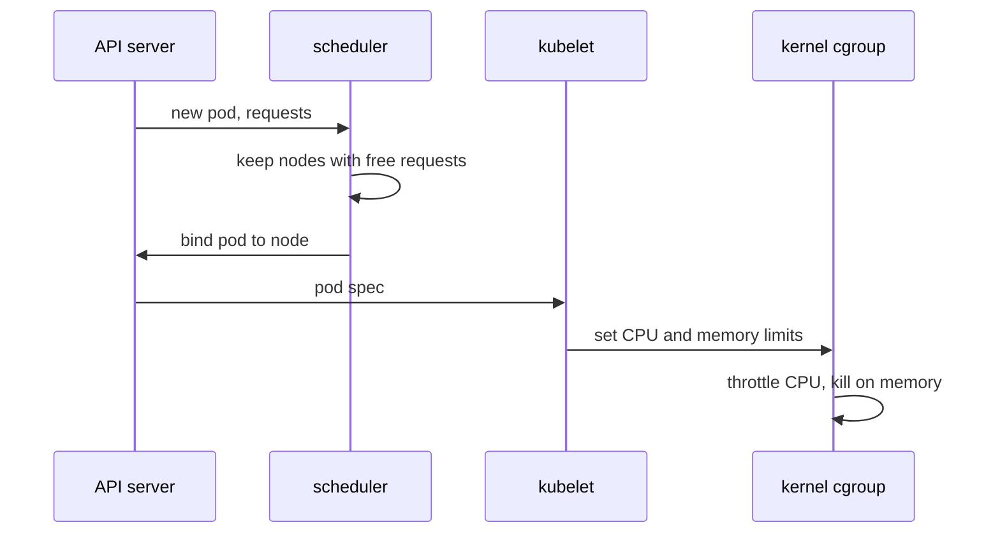

# Requests, Limits And Who Reads Them

A platform team decides how much of a node each workload may take. The decision is written in two small maps on every container, and three different components act on it at three different moments. This part sets both maps, reads them back from the cluster, and follows them from the scheduler to the kernel. Knowing which component reads which field is what lets you diagnose the failures in the rest of the module.

## Two maps on every container

Every container in a pod spec can have a `resources` block with two maps. `requests` says how much the container needs to start and run normally. `limits` says the most it may ever use. Both maps take the resource names `cpu` and `memory`.

The playground already runs three copies of `podinfo` that differ only in this block. List them first:

<!-- astrona:playground:renew -->

```sh
kubectl -n starfleet get deployments
```

You should see something like:

```text
NAME               READY   UP-TO-DATE   AVAILABLE   AGE
scout-besteffort   1/1     1            1           22s
scout-burstable    1/1     1            1           22s
scout-guaranteed   1/1     1            1           22s
shuttle            1/1     1            1           22s
```

Read the `resources` block of `scout-burstable` straight from the cluster. `kubectl get -o yaml` prints the stored object, and `grep -A8` keeps the eight lines after the match:

```sh
kubectl -n starfleet get deployment scout-burstable -o yaml | grep -A8 "resources:"
```

You should see:

```text
        resources:
          limits:
            cpu: 200m
            memory: 128Mi
          requests:
            cpu: 50m
            memory: 32Mi
        terminationMessagePath: /dev/termination-log
        terminationMessagePolicy: File
```

The two lines at the end belong to the next fields in the container. A JSONPath query prints only the block you asked for, from the running pod instead of the Deployment:

```sh
kubectl -n starfleet get pods -l app=scout-burstable -o jsonpath='{.items[0].spec.containers[0].resources}'
```

You should see:

```text
{"limits":{"cpu":"200m","memory":"128Mi"},"requests":{"cpu":"50m","memory":"32Mi"}}
```

## CPU and memory units

The numbers use Kubernetes quantity units, and the two resources use different ones.

CPU is counted in cores. `1` means one full CPU core, and `m` means millicores, a thousandth of a core. So `200m` is a fifth of a core and `1500m` is the same as `1.5`. CPU is a rate: a container with a `200m` limit may use 20 milliseconds of CPU time in every 100 milliseconds.

Memory is counted in bytes. `Mi` and `Gi` are binary units (`1Mi` is 1,048,576 bytes), and `M` and `G` are decimal units (`1M` is 1,000,000 bytes). Write `128Mi`, not `128m`: a lower-case `m` on memory means a thousandth of a byte, which the API server accepts and which is almost never what you meant.

## Who reads which field

Each field is read by a different component at a different time:



The diagram shows the scheduler using requests once, before the pod runs, and the kernel enforcing limits for as long as the container runs.

The **scheduler** is the control plane component that picks a node for each new pod. It adds up the requests of every container in the pod and keeps only the nodes whose free, unreserved capacity is at least that large. It does not look at how busy a node really is; a node full of idle pods with big requests counts as full. Limits play no part in this decision.

The **kubelet** is the agent on each node that starts containers. It passes the limits to the container runtime, which writes them into a Linux **control group (cgroup)**, a kernel feature that measures and caps the CPU and memory of a group of processes. From that moment the **kernel** enforces the limits, with no Kubernetes component in the loop. The kubelet also uses the requests later, when the node runs short of memory and it must choose which pods to evict.

If a container sets only `limits`, Kubernetes copies the limits into `requests` when the pod is created. If it sets only `requests`, there is no limit. A request can never be larger than the limit for the same resource; the API server rejects such a pod.

## Where the fields are documented

The fields live at `spec.containers[].resources` in the pod spec, and in the pod template of every workload. On the exam you only have the Kubernetes documentation, so learn to find them fast. `kubectl explain` prints the API reference for any field from the cluster itself:

```sh
kubectl explain pod.spec.containers.resources
```

You should see something like this (shortened to the first fields):

```text
KIND:       Pod
VERSION:    v1

FIELD: resources <ResourceRequirements>


DESCRIPTION:
    Compute Resources required by this container. Cannot be updated. More info:
    https://kubernetes.io/docs/concepts/configuration/manage-resources-containers/
    ResourceRequirements describes the compute resource requirements.
    
FIELDS:
  claims	<[]ResourceClaim>
  ...
  limits	<map[string]Quantity>
    Limits describes the maximum amount of compute resources allowed. More info:
    https://kubernetes.io/docs/concepts/configuration/manage-resources-containers/

  requests	<map[string]Quantity>
    Requests describes the minimum amount of compute resources required. If
    Requests is omitted for a container, it defaults to Limits if that is
    explicitly specified, otherwise to an implementation-defined value. Requests
    cannot exceed Limits. More info:
    https://kubernetes.io/docs/concepts/configuration/manage-resources-containers/
```

The `More info` address is the page "Resource Management for Pods and Containers" on `kubernetes.io`. It holds the unit rules, the examples and the behaviour at each limit, and it is the page to open first on the exam. The description says "Cannot be updated" for a normal pod update; changing the resources of a running pod goes through a separate `resize` request, which this module does not use.

You now know where the two maps live, what their units mean, and which component reads each: the scheduler reads requests before the pod starts, and the kernel enforces limits while it runs. The open question is what the kernel actually does when a container reaches its limit.

## Common pitfalls

> [!WARNING]
> - **Writing `m` on memory.** `128m` memory is a thousandth of 128 bytes, not 128 mebibytes. Use `Mi` or `Gi`.
> - **Expecting the scheduler to look at real usage.** It only adds up requests. A node can be "full" while its CPU is idle.
> - **Setting a request larger than the limit.** The API server rejects the pod; requests must be less than or equal to limits.
> - **Forgetting the other containers in the pod.** Every container has its own `resources` block. The scheduler adds up the requests of the app containers and sidecar containers; an ordinary init container counts only when it alone asks for more than that sum.
