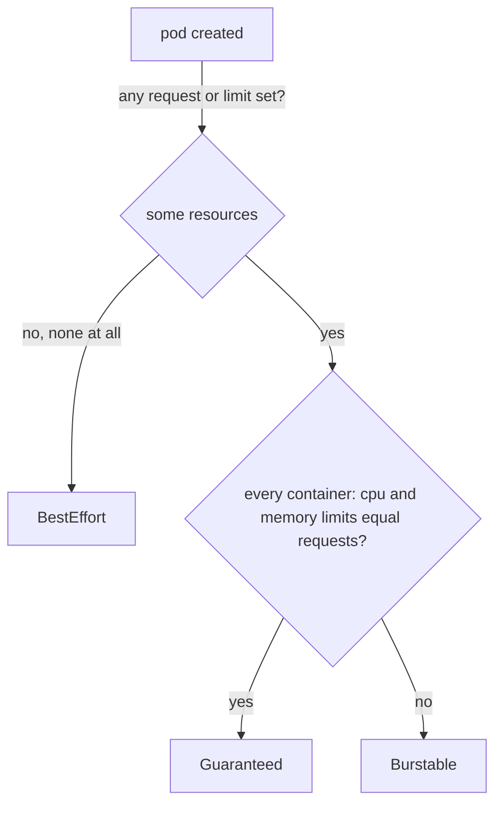

# QoS Classes And Eviction

Limits protect a node from one greedy container. They do not protect it when many pods together use more memory than the node has, which is easy when limits are set far above requests. In that case the kubelet must remove pods to save the node, and it needs a rule for which pods go first. That rule starts with the pod's Quality of Service class, which Kubernetes derives from the same `resources` fields you have been setting.

## Three classes from two maps

Every pod gets exactly one **Quality of Service (QoS) class**. You never set it yourself; Kubernetes computes it when the pod is created and stores it in `status.qosClass`. The rule looks at every container in the pod:



The diagram shows the decision: no resources anywhere gives `BestEffort`, CPU and memory limits equal to the requests in every container gives `Guaranteed`, and anything in between gives `Burstable`.

`Guaranteed` needs both CPU and memory, in both maps, in every container. A pod with one container set perfectly and a second container without a CPU limit is `Burstable`.

## Read the class from the cluster

The three playground Deployments were built to land in one class each. Print the class of every pod in a custom column:

<!-- astrona:playground:renew -->

```sh
kubectl -n starfleet get pods -o custom-columns=NAME:.metadata.name,QOS:.status.qosClass
```

You should see something like:

```text
NAME                                QOS
scout-besteffort-74b446bc89-hhqsv   BestEffort
scout-burstable-67658c66f7-rrrft    Burstable
scout-cpu-hog-6fc66bc6d6-pmttf      Burstable
scout-guaranteed-5dd68c8779-9qhmx   Guaranteed
scout-memory-hog-7c87554bc4-lskv9   Burstable
shuttle-5c44b786bb-cd2sf            Burstable
```

Each name matches its class. The two pods from the previous experiments are `Burstable` because their requests are below their limits. `shuttle` is `Burstable` as well: it has a memory limit but no CPU limit.

One rule from earlier changes the class in a way that surprises people: a container with only `limits` gets the same values copied into `requests`. Such a pod is `Guaranteed`, not `Burstable`.

Save this as `pod-scout-limits-only.yaml`:

```yaml
apiVersion: v1
kind: Pod
metadata:
  name: scout-limits-only
  namespace: starfleet
spec:
  containers:
    - name: scout
      image: ghcr.io/stefanprodan/podinfo:6.15.0
      resources:
        limits:
          cpu: 100m
          memory: 64Mi
```

Apply it:

```sh
kubectl apply -f pod-scout-limits-only.yaml
```

Then check the stored resources and the class:

```sh
kubectl -n starfleet get pod scout-limits-only -o jsonpath='{.spec.containers[0].resources}{"\n"}{.status.qosClass}{"\n"}'
```

You should see:

```text
{"limits":{"cpu":"100m","memory":"64Mi"},"requests":{"cpu":"100m","memory":"64Mi"}}
Guaranteed
```

The stored pod has `requests` you never wrote, equal to the limits, and so the class is `Guaranteed`. Always read the stored object, not your file, when you predict a class.

## Eviction under node pressure

When a node runs low on memory, the kubelet does not wait for the kernel to kill processes at random. It starts **node-pressure eviction**: it ends whole pods to get memory back, and marks them `Failed` with the reason `Evicted`. Pods that belong to a Deployment are then recreated, possibly on another node.

The kubelet ranks pods for eviction mainly by how far their usage is above their request:

1. Pods whose memory usage is above their memory request go first. `BestEffort` pods always fall in this group, because their request is zero.
2. Among those, pods with a lower pod priority go before pods with a higher one.
3. Then the pods with the largest usage above the request go first.

`Guaranteed` pods, and `Burstable` pods that stay under their requests, are evicted last, and only when system components themselves need the memory. That is why the QoS class is also a statement about risk. A `Guaranteed` pod costs more of the node, because its limit equals its request, but it is the last to be evicted. A `BestEffort` pod costs nothing to schedule and is the first to go.

This is hard to show safely on a playground, because it means filling the node's memory, so this part does not run it. The class you just read is the input to that decision.

## Choosing a class

A common platform rule follows from this:

| Workload | Class to aim for | Why |
| --- | --- | --- |
| Databases, control plane add-ons, anything that must not be evicted | `Guaranteed` | Last to be evicted, predictable memory |
| Normal web services | `Burstable`, with a memory request close to real usage | Can use spare CPU, and is safe while it stays near its request |
| Batch jobs that can be restarted | `Burstable` with small requests, or `BestEffort` | Cheap to place, fine to lose |

The memory request is the number that matters most for eviction. A request well below real usage puts a pod at the front of the queue even when it is `Burstable`.

You can now predict a pod's QoS class from its resources, confirm it in `status.qosClass`, and say which pods a node gives up first when memory runs short. The open question is the other side of the scheduler's decision: how much room a node really has, and what a pod looks like when its requests fit nowhere.

## Common pitfalls

> [!WARNING]
> - **Expecting `Guaranteed` from memory alone.** CPU and memory limits must both equal the requests, in every container.
> - **Predicting the class from your file.** Limits-only containers get requests copied from the limits. Read `status.qosClass`.
> - **Trying to set `qosClass` in the spec.** It is a status field; change the resources instead.
> - **Treating `Burstable` as safe from eviction.** A `Burstable` pod using more memory than it requested is evicted before one that stays under its request.
