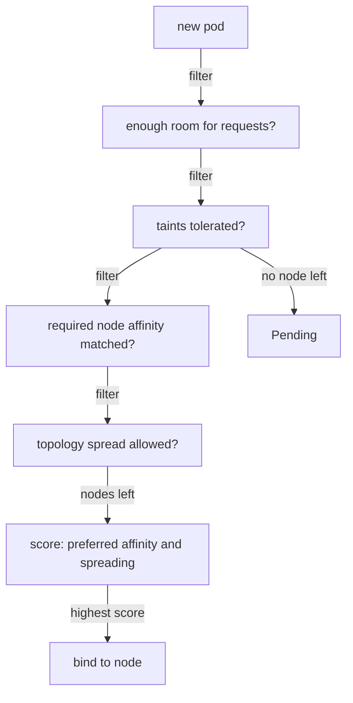

# Node Labels And Node Affinity

Every placement rule in Kubernetes matches on labels. Before you can send a pod to "the nodes with SSDs" or "zone b", those facts must exist as labels on the nodes, and you must know their exact keys and values. This part reads the playground's node labels, then uses them to pin pods with `nodeSelector` and with node affinity. It ends with the first lesson about the scheduler's two steps: a preference cannot beat a filter.

## The labels a node carries

A node label is a key and value on the Node object, like any other Kubernetes label. Some are set by the cluster for every node, and some are set by an administrator. Show the two labels this module uses as extra columns:

<!-- astrona:playground:renew -->

```sh
kubectl get nodes -L topology.kubernetes.io/zone,disktype
```

You should see something like:

```text
NAME                                            STATUS   ROLES           AGE   VERSION   ZONE     DISKTYPE
astro-ats-017-playground-010-02-control-plane   Ready    control-plane   31s   v1.35.8            
astro-ats-017-playground-010-02-worker          Ready    <none>          19s   v1.35.8   zone-a   ssd
astro-ats-017-playground-010-02-worker2         Ready    <none>          19s   v1.35.8   zone-b   
```

`-L` adds one column per label key. To see every label on one node, use `--show-labels`:

```sh
kubectl get node astro-ats-017-playground-010-02-worker --show-labels | tr ',' '\n'
```

You should see something like this (shortened to the labels):

```text
beta.kubernetes.io/arch=arm64
beta.kubernetes.io/os=linux
disktype=ssd
kubernetes.io/arch=arm64
kubernetes.io/hostname=astro-ats-017-playground-010-02-worker
kubernetes.io/os=linux
topology.kubernetes.io/zone=zone-a
```

Three of these are **well-known labels** that Kubernetes defines and that you will meet on every cluster. `kubernetes.io/hostname` holds the node's name and is unique per node. `kubernetes.io/arch` and `kubernetes.io/os` say which CPU architecture and operating system the node runs. `topology.kubernetes.io/zone` names the failure zone; on a cloud cluster the cloud provider sets it to the real zone, such as `eu-west-1a`. Here the playground set it by hand, together with the custom label `disktype=ssd`. You set a label yourself with `kubectl label node <name> key=value`.

Now look at where the three `scout` replicas run today, with no rules at all:

```sh
kubectl -n starfleet get pods -l app=scout -o wide
```

You should see something like (shortened to the first columns):

```text
NAME                     READY   STATUS    RESTARTS   AGE   IP           NODE
scout-64f55cb4bc-d5cw5   1/1     Running   0          7s    10.244.2.5   astro-ats-017-playground-010-02-worker
scout-64f55cb4bc-fscb7   1/1     Running   0          7s    10.244.2.2   astro-ats-017-playground-010-02-worker
scout-64f55cb4bc-hqrq7   1/1     Running   0          7s    10.244.2.3   astro-ats-017-playground-010-02-worker
```

All three replicas run on the same worker. The other worker has a taint that `scout` does not tolerate, and the control plane has one too, so only one node is left. One node failure would stop the whole service. The rest of the module fixes this step by step.

## The scheduler's two steps

The scheduler places each pod in two steps. In the **filter** step it removes every node the pod may not use: too little room for the requests, a taint the pod does not tolerate, a required affinity rule the node does not match. In the **score** step it ranks the nodes that are left, and preferences add points to some of them. The pod goes to the node with the highest score.



The diagram shows the filters each node must pass before any preference is weighed; if no node passes, the pod stays `Pending`.

## nodeSelector

`nodeSelector` is the simplest rule: a map of labels that a node must have, all of them. It is a filter.

Save this as `deployment-scout-ssd.yaml`:

```yaml
apiVersion: apps/v1
kind: Deployment
metadata:
  name: scout-ssd
  namespace: starfleet
spec:
  replicas: 2
  selector:
    matchLabels:
      app: scout-ssd
  template:
    metadata:
      labels:
        app: scout-ssd
    spec:
      nodeSelector:
        disktype: ssd
      containers:
        - name: scout
          image: ghcr.io/stefanprodan/podinfo:6.15.0
          resources:
            requests:
              cpu: 20m
              memory: 32Mi
```

Apply it:

```sh
kubectl apply -f deployment-scout-ssd.yaml
```

Then check the result. The `custom-columns` output keeps only the pod name, phase and node:

```sh
kubectl -n starfleet get pods -l app=scout-ssd -o custom-columns=NAME:.metadata.name,STATUS:.status.phase,NODE:.spec.nodeName
```

You should see something like:

```text
NAME                         STATUS    NODE
scout-ssd-774ff58766-blzg8   Running   astro-ats-017-playground-010-02-worker
scout-ssd-774ff58766-nbrln   Running   astro-ats-017-playground-010-02-worker
```

Both replicas run on the only node with `disktype=ssd`. `nodeSelector` can only say "this key equals this value". For anything more, use node affinity.

## Required node affinity

**Node affinity** is a set of node label rules in `spec.affinity.nodeAffinity`. The required form has the long name `requiredDuringSchedulingIgnoredDuringExecution`. The name says what it does: the rule is a filter when the pod is scheduled, and it is ignored afterwards, so a running pod is not moved if the node's labels change later. Each rule is a `matchExpressions` list with an `operator`: `In`, `NotIn`, `Exists`, `DoesNotExist`, `Gt` or `Lt`.

Ask for zone b, the worker that carries the taint:

Save this as `deployment-scout-zone-b.yaml`:

```yaml
apiVersion: apps/v1
kind: Deployment
metadata:
  name: scout-zone-b
  namespace: starfleet
spec:
  replicas: 1
  selector:
    matchLabels:
      app: scout-zone-b
  template:
    metadata:
      labels:
        app: scout-zone-b
    spec:
      affinity:
        nodeAffinity:
          requiredDuringSchedulingIgnoredDuringExecution:
            nodeSelectorTerms:
              - matchExpressions:
                  - key: topology.kubernetes.io/zone
                    operator: In
                    values:
                      - zone-b
      containers:
        - name: scout
          image: ghcr.io/stefanprodan/podinfo:6.15.0
          resources:
            requests:
              cpu: 20m
              memory: 32Mi
```

Apply it, then read the pod's events:

```sh
kubectl apply -f deployment-scout-zone-b.yaml
kubectl -n starfleet describe pod -l app=scout-zone-b | sed -n '/^Events:/,$p'
```

You should see something like:

```text
Events:
  Type     Reason            Age   From               Message
  ----     ------            ----  ----               -------
  Warning  FailedScheduling  4s    default-scheduler  0/3 nodes are available: 1 node(s) didn't match Pod's node affinity/selector, 2 node(s) had untolerated taint(s). no new claims to deallocate, preemption: 0/3 nodes are available: 3 Preemption is not helpful for scheduling.
```

The pod stays `Pending`, and the message counts the reason for every node. `1 node(s) didn't match Pod's node affinity/selector` is the zone-a worker. `2 node(s) had untolerated taint(s)` are the control plane and the zone-b worker: the only node in zone b refuses the pod. A required rule plus a taint left no node at all. Leave this pod `Pending`; the next part fixes the same situation for `probe`.

## Preferred node affinity

The preferred form, `preferredDuringSchedulingIgnoredDuringExecution`, gives each matching node extra score points (`weight`, 1 to 100). It never filters.

Save this as `deployment-scout-prefer-zone-b.yaml`:

```yaml
apiVersion: apps/v1
kind: Deployment
metadata:
  name: scout-prefer-zone-b
  namespace: starfleet
spec:
  replicas: 2
  selector:
    matchLabels:
      app: scout-prefer-zone-b
  template:
    metadata:
      labels:
        app: scout-prefer-zone-b
    spec:
      affinity:
        nodeAffinity:
          preferredDuringSchedulingIgnoredDuringExecution:
            - weight: 100
              preference:
                matchExpressions:
                  - key: topology.kubernetes.io/zone
                    operator: In
                    values:
                      - zone-b
      containers:
        - name: scout
          image: ghcr.io/stefanprodan/podinfo:6.15.0
          resources:
            requests:
              cpu: 20m
              memory: 32Mi
```

Apply it and check where the pods run:

```sh
kubectl apply -f deployment-scout-prefer-zone-b.yaml
kubectl -n starfleet get pods -l app=scout-prefer-zone-b -o custom-columns=NAME:.metadata.name,STATUS:.status.phase,NODE:.spec.nodeName
```

You should see something like:

```text
NAME                                   STATUS    NODE
scout-prefer-zone-b-7f4cd6d989-p7b4b   Running   astro-ats-017-playground-010-02-worker
scout-prefer-zone-b-7f4cd6d989-zfqvj   Running   astro-ats-017-playground-010-02-worker
```

The pods run, but in zone a, the zone they did not prefer. The taint removed the zone-b worker in the filter step, so the preference had nothing to score. This is the two-step rule at work: a preference can only choose among nodes that passed every filter.

You can now read node labels and use them with `nodeSelector`, required node affinity and preferred node affinity. You have also seen a required rule leave a pod `Pending` because of a taint. The open question is how a node chooses which pods it accepts, and how to send one tenant's pods onto a reserved node.

## Common pitfalls

> [!WARNING]
> - **Guessing label keys.** Read them with `kubectl get nodes --show-labels`; a typo in a key silently matches no node.
> - **Expecting a preference to win.** Preferred affinity only scores nodes that passed the filters.
> - **Expecting a running pod to move.** `IgnoredDuringExecution` means a label change does not evict a running pod.
> - **Mixing up `nodeSelectorTerms` and `matchExpressions`.** Several terms are ORed; several expressions inside one term are ANDed.
