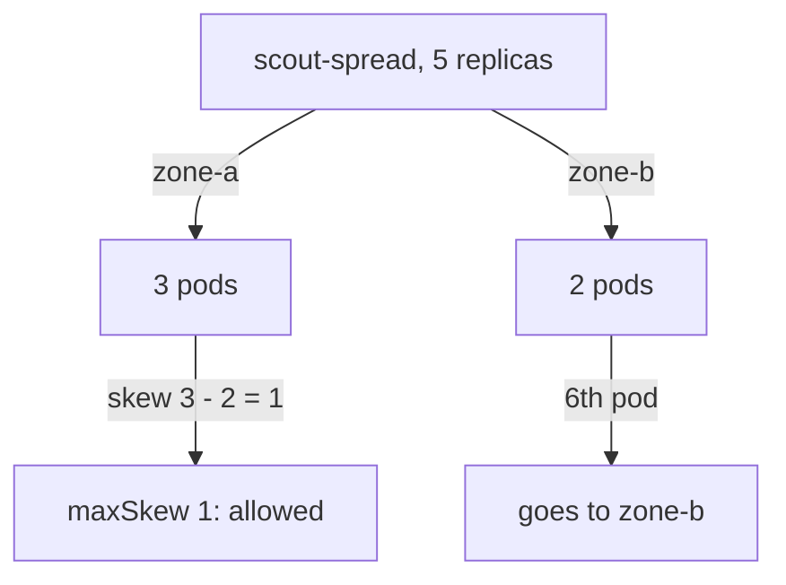

# Spreading Replicas

High availability is a placement problem. Three replicas on one node fail together when that node fails, and six replicas in one zone fail together when the zone fails. Node affinity cannot fix this, because it looks at node labels and not at the other pods. This part uses the two rules that do look at the other pods: pod anti-affinity, which keeps matching pods off the same node, and a topology spread constraint, which keeps the count per zone even.

Both workers must be candidates for spreading to work, so the examples in this part give `scout` the toleration for `dedicated=outpost:NoSchedule`. That would break the reservation for `outpost` in a real cluster; here it keeps the experiment to two zones without changing the nodes.

## Pod anti-affinity

**Pod anti-affinity** is a rule in `spec.affinity.podAntiAffinity` that says: do not put this pod in a topology domain that already runs pods matching this label selector. The `topologyKey` names a node label, and every distinct value of that label is one domain. With `kubernetes.io/hostname`, each node is its own domain, so the rule means "at most one of these pods per node".

<!-- astrona:playground:renew -->

Save this as `deployment-scout-ha.yaml`:

```yaml
apiVersion: apps/v1
kind: Deployment
metadata:
  name: scout-ha
  namespace: starfleet
spec:
  replicas: 3
  selector:
    matchLabels:
      app: scout-ha
  template:
    metadata:
      labels:
        app: scout-ha
    spec:
      tolerations:
        - key: dedicated
          operator: Equal
          value: outpost
          effect: NoSchedule
      affinity:
        podAntiAffinity:
          requiredDuringSchedulingIgnoredDuringExecution:
            - labelSelector:
                matchLabels:
                  app: scout-ha
              topologyKey: kubernetes.io/hostname
      containers:
        - name: scout
          image: ghcr.io/stefanprodan/podinfo:6.15.0
          resources:
            requests:
              cpu: 20m
              memory: 32Mi
```

Apply it and check the placement:

```sh
kubectl apply -f deployment-scout-ha.yaml
kubectl -n starfleet get pods -l app=scout-ha -o custom-columns=NAME:.metadata.name,STATUS:.status.phase,NODE:.spec.nodeName
```

You should see something like:

```text
NAME                        STATUS    NODE
scout-ha-58c79bb6f5-6hktw   Running   astro-ats-017-playground-010-02-worker
scout-ha-58c79bb6f5-772bj   Pending   <none>
scout-ha-58c79bb6f5-p5wch   Running   astro-ats-017-playground-010-02-worker2
```

Two replicas run, one per worker, and the third stays `Pending`. There are only two nodes it may use, and each already runs a `scout-ha` pod. Read the reason from the events:

```sh
kubectl -n starfleet get events --field-selector reason=FailedScheduling | grep scout-ha
```

You should see something like:

```text
8s          Warning   FailedScheduling   pod/scout-ha-58c79bb6f5-772bj       0/3 nodes are available: 1 node(s) had untolerated taint(s), 2 node(s) didn't match pod anti-affinity rules. no new claims to deallocate, preemption: 0/3 nodes are available: 1 Preemption is not helpful for scheduling, 2 No preemption victims found for incoming pod.
```

`2 node(s) didn't match pod anti-affinity rules` are the two workers. The remaining node is the control plane, whose taint `scout-ha` does not tolerate. Required anti-affinity is strict: it caps the replica count at the number of domains. That is right for something like a quorum database, where two replicas on one node are worse than one missing replica. For most services, the preferred form `preferredDuringSchedulingIgnoredDuringExecution`, or a topology spread constraint, is the better choice.

## Topology spread constraints

A **topology spread constraint** in `spec.topologySpreadConstraints` limits how uneven the number of matching pods may be between domains. Its fields are:

- `topologyKey`: the node label that defines the domains, here `topology.kubernetes.io/zone`.
- `labelSelector`: which pods to count, normally the workload's own pods.
- `maxSkew`: the largest allowed difference between the domain with the most matching pods and the domain with the fewest.
- `whenUnsatisfiable`: `DoNotSchedule` makes the rule a filter, so a pod that would break it stays `Pending`. `ScheduleAnyway` makes it a score only.



The diagram shows five replicas split three and two across the zones: the skew is one, which `maxSkew: 1` allows, and a sixth replica must go to the zone with fewer pods.

Save this as `deployment-scout-spread.yaml`:

```yaml
apiVersion: apps/v1
kind: Deployment
metadata:
  name: scout-spread
  namespace: starfleet
spec:
  replicas: 4
  selector:
    matchLabels:
      app: scout-spread
  template:
    metadata:
      labels:
        app: scout-spread
    spec:
      tolerations:
        - key: dedicated
          operator: Equal
          value: outpost
          effect: NoSchedule
      topologySpreadConstraints:
        - maxSkew: 1
          topologyKey: topology.kubernetes.io/zone
          whenUnsatisfiable: DoNotSchedule
          labelSelector:
            matchLabels:
              app: scout-spread
      containers:
        - name: scout
          image: ghcr.io/stefanprodan/podinfo:6.15.0
          resources:
            requests:
              cpu: 20m
              memory: 32Mi
```

Apply it and check the placement:

```sh
kubectl apply -f deployment-scout-spread.yaml
kubectl -n starfleet get pods -l app=scout-spread -o custom-columns=NAME:.metadata.name,STATUS:.status.phase,NODE:.spec.nodeName
```

You should see something like:

```text
NAME                           STATUS    NODE
scout-spread-c469b8865-c4xjr   Running   astro-ats-017-playground-010-02-worker2
scout-spread-c469b8865-fq9zr   Running   astro-ats-017-playground-010-02-worker2
scout-spread-c469b8865-pwbtw   Running   astro-ats-017-playground-010-02-worker
scout-spread-c469b8865-zkq97   Running   astro-ats-017-playground-010-02-worker
```

Two pods per zone. Unlike anti-affinity, the rule allows several pods per domain; it only limits the difference. Scale to five replicas and count the pods per node:

```sh
kubectl -n starfleet scale deploy/scout-spread --replicas=5
kubectl -n starfleet get pods -l app=scout-spread -o custom-columns=NODE:.spec.nodeName --no-headers | sort | uniq -c
```

You should see something like:

```text
   2 astro-ats-017-playground-010-02-worker
   3 astro-ats-017-playground-010-02-worker2
```

Three and two, a skew of one. Scaling down is different: when a Deployment removes replicas, it does not look at spread constraints, so after a scale-down the zones can end up uneven until new pods are created.

## When the spread cannot be kept

`DoNotSchedule` turns the rule into a filter, and you can see it refuse a pod. Mark the zone-b worker unschedulable with `kubectl cordon`, which stops new pods from landing there, and scale up so zone a would get too far ahead:

```sh
kubectl cordon astro-ats-017-playground-010-02-worker2
kubectl -n starfleet scale deploy/scout-spread --replicas=8
kubectl -n starfleet get pods -l app=scout-spread -o custom-columns=STATUS:.status.phase,NODE:.spec.nodeName --no-headers | sort | uniq -c
```

You should see something like (the counts depend on where the earlier replicas ended up):

```text
   1 Pending <none>
   4 Running astro-ats-017-playground-010-02-worker
   3 Running astro-ats-017-playground-010-02-worker2
```

Zone a already has one pod more than zone b, so another pod there would make the skew two, and zone b accepts no new pods. One replica stays `Pending`, and its event names the rule:

```text
0/3 nodes are available: 1 node(s) didn't match pod topology spread constraints, 1 node(s) had untolerated taint(s), 1 node(s) were unschedulable. ...
```

That line is shortened after the first sentence. `1 node(s) were unschedulable` is the cordoned worker. Undo the cordon, and the scheduler places the `Pending` pod in zone b:

```sh
kubectl uncordon astro-ats-017-playground-010-02-worker2
```

With `ScheduleAnyway`, the pod would have run in zone a instead, and the skew would have grown. Choose `DoNotSchedule` when an even spread matters more than having every replica running, and `ScheduleAnyway` when every replica must run.

You can now keep replicas off the same node with pod anti-affinity, keep their numbers even across zones with a topology spread constraint, and read the `FailedScheduling` message for each rule. Together with node affinity and taints, these rules decide where every pod of a workload may run and how its replicas are laid out.

## Common pitfalls

> [!WARNING]
> - **Using required anti-affinity on a scaled service.** It allows only one pod per domain, so extra replicas stay `Pending`.
> - **Forgetting the `labelSelector`.** Without it, the spread constraint counts no pods and never limits anything.
> - **Expecting a scale-down to keep the spread.** The Deployment removes pods without looking at the constraint.
> - **Spreading over zones that do not exist.** A `topologyKey` label that no node carries leaves every pod `Pending` with `DoNotSchedule`.
