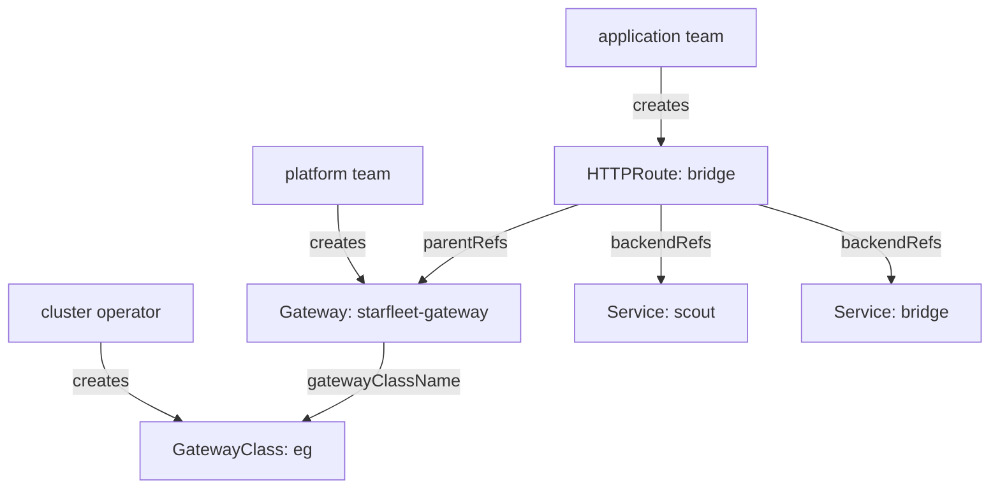

# Gateway Classes, Gateways And Listeners

Before any request can be routed, the cluster needs a place where requests arrive and a program that forwards them. In the Gateway API, the GatewayClass names that program and the Gateway is the place. This part reads the GatewayClass the playground provides, creates a Gateway with one HTTP listener, and finds the address that clients send requests to.

## Why a new API next to Ingress

Kubernetes has an older object for the same job: **Ingress**, one object that holds host and path rules for HTTP traffic. Ingress has two limits. It has very few standard fields, so header matching, traffic splitting and many other features live in controller-specific annotations that differ between products. And one Ingress object mixes the entry point and the routing rules, so the team that owns the load balancer and the team that owns the application must edit the same object.

The Gateway API fixes both. Header matches, weights and request filters are standard fields that every conformant controller reads the same way. The entry point and the rules are separate objects, so each team edits only its own. Ingress still works and is not removed, but new features go into the Gateway API.

## Three objects, three roles

The Gateway API is role-oriented: each object matches one job in a platform team.

- **GatewayClass** is a cluster-wide object that names a controller in `spec.controllerName`. The infrastructure provider or cluster operator creates it, usually when the controller is installed.
- **Gateway** is a namespaced object that asks a GatewayClass for an entry point. Its `listeners` say which port and protocol to accept, and which routes may attach. The platform or cluster operator owns it.
- **HTTPRoute** is a namespaced object with HTTP routing rules. It names the Gateway it wants to attach to in `parentRefs` and the Services to send requests to in `backendRefs`. The application developer owns it.



The diagram shows who creates each object and how each one points at the next: the route points up at the Gateway and down at the Services.

## The GatewayClass in the playground

The CustomResourceDefinitions (CRDs) for these objects are installed in the playground. A CRD adds a new object kind to the Kubernetes API. The objects do nothing on their own: a controller must watch them and program a proxy. List the GatewayClasses to see which controller is installed:

<!-- astrona:playground:renew -->

```sh
kubectl get gatewayclass
```

You should see something like:

```text
NAME   CONTROLLER                                      ACCEPTED   AGE
eg     gateway.envoyproxy.io/gatewayclass-controller   True       13s
```

The class is called `eg`, and its controller is Envoy Gateway, which runs Envoy proxies as the data plane. On another cluster the name and the controller differ, so always read the class name from the cluster before you write a Gateway. `ACCEPTED True` means the controller has seen the class and will serve it. Envoy Gateway is only plumbing in this course; everything you write below is a standard Gateway API object that works the same with any conformant controller.

## A Gateway with one listener

A **listener** is one entry in `spec.listeners`: a name, a protocol and a port on which the Gateway accepts traffic. This Gateway accepts plain HTTP on port 80 and uses the `eg` class.

Save this as `gateway-starfleet.yaml`:

```yaml
apiVersion: gateway.networking.k8s.io/v1
kind: Gateway
metadata:
  name: starfleet-gateway
  namespace: starfleet
spec:
  gatewayClassName: eg
  listeners:
    - name: http
      protocol: HTTP
      port: 80
```

Apply it:

```sh
kubectl apply -f gateway-starfleet.yaml
```

Then check the result. The controller needs a few seconds to start a proxy for the new Gateway:

```sh
kubectl -n starfleet get gateway
```

You should see something like:

```text
NAME                CLASS   ADDRESS        PROGRAMMED   AGE
starfleet-gateway   eg      10.96.70.133   True         20s
```

The `CLASS` column shows `eg`, and `PROGRAMMED True` means the controller has configured a proxy for this Gateway. The `ADDRESS` column is the address that clients send requests to. In this playground it is a cluster-internal IP address. On a cloud cluster it would usually be the external address of a load balancer; on `kind` there is no load balancer, so the playground's controller gives the Gateway an internal address instead.

## Reading Gateway status

The `PROGRAMMED` column is a short view of the Gateway's conditions. The full status also has one entry per listener. Print the Gateway's conditions and the listener status:

```sh
kubectl -n starfleet get gateway starfleet-gateway -o jsonpath='{range .status.conditions[*]}{.type}={.status} {.reason}{"\n"}{end}'
kubectl -n starfleet get gateway starfleet-gateway -o yaml | sed -n '/^  listeners:/,$p'
```

You should see something like (the listener status shortened to its main fields):

```text
Accepted=True Accepted
Programmed=True Programmed
  listeners:
  - attachedRoutes: 0
    conditions:
    - message: Sending translated listener configuration to the data plane
      reason: Programmed
      status: "True"
      type: Programmed
    - message: Listener has been successfully translated
      reason: Accepted
      status: "True"
      type: Accepted
    - message: Listener references have been resolved
      reason: ResolvedRefs
      status: "True"
      type: ResolvedRefs
    name: http
    supportedKinds:
    - group: gateway.networking.k8s.io
      kind: HTTPRoute
    - group: gateway.networking.k8s.io
      kind: GRPCRoute
```

`Accepted` means the controller accepted the Gateway's configuration, and `Programmed` means the proxy received it. The listener named `http` has its own conditions, a list of route kinds it supports, and `attachedRoutes: 0`. That counter is the quickest check of whether your routes reached this listener.

## Sending the first request

Store the Gateway's address in a variable, then send a request to it from the `shuttle` pod:

```sh
GATEWAY=$(kubectl -n starfleet get gateway starfleet-gateway -o jsonpath='{.status.addresses[0].value}')
echo $GATEWAY
kubectl -n starfleet exec deploy/shuttle -- curl -s -i http://$GATEWAY/
```

You should see something like:

```text
10.96.70.133
HTTP/1.1 404 Not Found
date: Sat, 10 Oct 2026 17:09:10 GMT
content-length: 0
```

The proxy answers, so the listener is open. It returns `404 Not Found` because no route is attached: the Gateway knows where requests arrive, but not where to send them. Keep the `GATEWAY` variable in your terminal; every request in this module uses it.

You can now find the GatewayClass on a cluster, create a Gateway with a listener, and read its conditions, its listener status and its address. The open question is how to tell the Gateway where each request should go.

## Common pitfalls

> [!WARNING]
> - **Guessing the class name.** `gatewayClassName` must match a GatewayClass on the cluster; read it with `kubectl get gatewayclass` first.
> - **Expecting the CRDs alone to route traffic.** Without a controller the Gateway is never `Programmed` and has no address.
> - **Waiting for an external address on `kind`.** A cluster without a load balancer has no external IP address; send requests from inside the cluster.
> - **Reading `404` as a broken Gateway.** A Gateway with no attached route answers `404`; check `attachedRoutes` on the listener.
