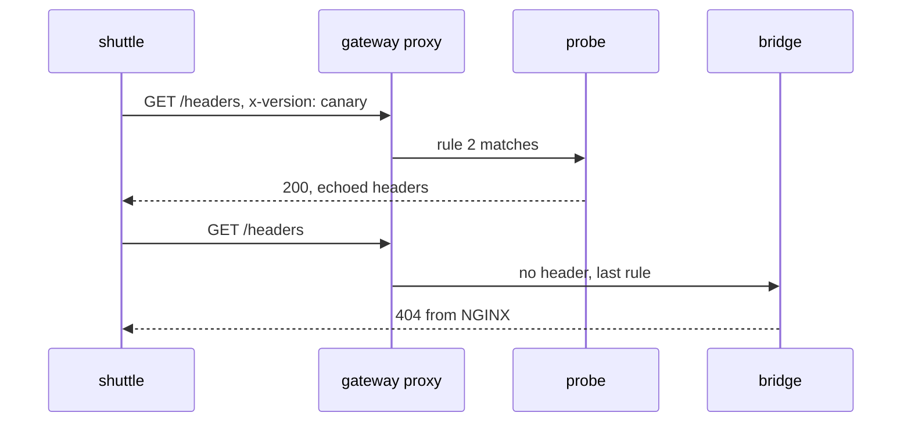

# HTTPRoute Matches, Backends And Weights

The Gateway now accepts requests on port 80 but answers every one with `404`. An HTTPRoute fills that gap: it attaches to the Gateway and says which Service gets which request. This part writes one route that chooses a backend by path and by header, and a second route that splits requests between two Services by weight.

## How an HTTPRoute is built

An HTTPRoute has three main fields. `parentRefs` names the Gateway (and optionally the listener) the route wants to attach to. `hostnames` limits the route to requests for certain host names; without it, the route matches every host. `rules` is a list, and each rule has `matches` (the conditions), optional `filters` (changes to the request) and `backendRefs` (the Services that receive matching requests).

A match can test the path, headers, query parameters and the HTTP method. Inside one match all conditions must be true. Between several matches of one rule, any one is enough. A path match has a `type`: `PathPrefix` matches the path and everything below it, `Exact` matches only that path. When several rules match one request, the controller picks the most specific one: an exact path before a prefix, a longer prefix before a shorter one, and then the rule with more header matches.

## Routing by path and by header

This route sends `/api` and everything under it to `scout`, sends requests that carry the header `x-version: canary` to `probe`, and sends everything else to `bridge`. The last rule has no `matches`, which means "match every request".

<!-- astrona:playground:renew -->

Save this as `httproute-bridge.yaml`:

```yaml
apiVersion: gateway.networking.k8s.io/v1
kind: HTTPRoute
metadata:
  name: bridge
  namespace: starfleet
spec:
  parentRefs:
    - name: starfleet-gateway
  rules:
    - matches:
        - path:
            type: PathPrefix
            value: /api
      backendRefs:
        - name: scout
          port: 80
    - matches:
        - path:
            type: PathPrefix
            value: /
          headers:
            - name: x-version
              value: canary
      backendRefs:
        - name: probe
          port: 80
    - backendRefs:
        - name: bridge
          port: 80
```

Apply it:

```sh
kubectl apply -f httproute-bridge.yaml
```

Then check that the Gateway accepted it. The route's status has one entry per parent, and each entry has conditions:

```sh
kubectl -n starfleet get httproute
kubectl -n starfleet get httproute bridge -o jsonpath='{range .status.parents[*].conditions[*]}{.type}={.status} {.reason}: {.message}{"\n"}{end}'
```

You should see something like:

```text
NAME     HOSTNAMES   AGE
bridge               5s
Accepted=True Accepted: Route is accepted
ResolvedRefs=True ResolvedRefs: Resolved all the Object references for the Route
```

`Accepted=True` means the Gateway let the route attach. `ResolvedRefs=True` means every Service in `backendRefs` exists and may be used. Both must be `True` before a request can reach a backend. Now send one request for each rule. The `GATEWAY` variable holds the Gateway's address; if you opened a new terminal, set it again with `GATEWAY=$(kubectl -n starfleet get gateway starfleet-gateway -o jsonpath='{.status.addresses[0].value}')`.

```sh
kubectl -n starfleet exec deploy/shuttle -- curl -s http://$GATEWAY/
kubectl -n starfleet exec deploy/shuttle -- curl -s http://$GATEWAY/api/info
```

You should see something like (the `podinfo` JSON shortened):

```text
bridge front end
{
  "hostname": "scout-6db96cb88c-hvkk5",
  "version": "6.15.0",
  "message": "greetings from podinfo v6.15.0",
  ...
}
```

The path `/` fell through to the last rule and reached `bridge`. The path `/api/info` matched the `/api` prefix and reached `scout`, which answered with its pod name and version. Now send a request with the header, and one without it, to a path that only `probe` knows:

```sh
kubectl -n starfleet exec deploy/shuttle -- curl -s -H 'x-version: canary' http://$GATEWAY/headers
kubectl -n starfleet exec deploy/shuttle -- curl -s -i http://$GATEWAY/headers
```

You should see something like (shortened):

```text
{
  "headers": {
    "Host": [
      "10.96.70.133"
    ],
    "X-Envoy-External-Address": [
      "10.244.0.9"
    ],
    "X-Forwarded-For": [
      "10.244.0.9"
    ],
    "X-Version": [
      "canary"
    ]
  }
}
HTTP/1.1 404 Not Found
server: nginx/1.31.6
```

With the header, `probe` answered and echoed the request back. The `X-Forwarded-For` and `X-Envoy-External-Address` headers show that the request passed through the Gateway's proxy, which added them. Without the header, the same path went to `bridge`, and NGINX answered `404` because it has no `/headers` page. The route did its job: the header decided the backend.



The diagram shows two requests for the same path: the proxy compares each request with the route's rules and forwards it to the Service of the rule that matches.

## Splitting traffic by weight

A rule can list more than one backend. Each `backendRef` then gets a `weight`, and the proxy sends each request to one backend at random, in proportion to the weights. This is how a team sends a small share of traffic to a new version. The route below uses a host name, so it only gets requests for `split.starfleet.example` and does not change the `bridge` route.

Save this as `httproute-split.yaml`:

```yaml
apiVersion: gateway.networking.k8s.io/v1
kind: HTTPRoute
metadata:
  name: split
  namespace: starfleet
spec:
  parentRefs:
    - name: starfleet-gateway
  hostnames:
    - split.starfleet.example
  rules:
    - backendRefs:
        - name: scout
          port: 80
          weight: 80
        - name: probe
          port: 80
          weight: 20
```

Apply it:

```sh
kubectl apply -f httproute-split.yaml
```

Then send 20 requests with that host name and count which backend answered. `scout` answers `/` with JSON that contains the word `podinfo`; `probe` answers with an HTML page that does not:

```sh
for i in $(seq 1 20); do
  kubectl -n starfleet exec deploy/shuttle -- curl -s -H "Host: split.starfleet.example" http://$GATEWAY/ | grep -q podinfo && echo scout || echo probe
done | sort | uniq -c
```

You should see something like:

```text
   5 probe
  15 scout
```

About 80 percent of the requests reached `scout` and about 20 percent reached `probe`. The split is random per request, so a small sample is never exact; 50 requests in the same playground gave 41 and 9. A weight of `0` sends no traffic to that backend, which is a quick way to drain it without deleting the reference.

You can now attach an HTTPRoute to a Gateway, choose a backend by path, header and host name, and split traffic by weight. So far every route attached at once. The open question is what a route looks like when it does not attach, and how a route in another namespace gets in.

## Common pitfalls

> [!WARNING]
> - **Putting two conditions in two matches when you meant both.** Conditions in one match are ANDed; separate matches are ORed.
> - **Forgetting `port` in a `backendRef`.** A Service backend needs the Service port, not the container port.
> - **Expecting an exact split in a small sample.** Weights are probabilities per request; count many requests.
> - **Adding a catch-all rule and expecting it to win.** The most specific match wins, whatever the order of the rules in the file.
