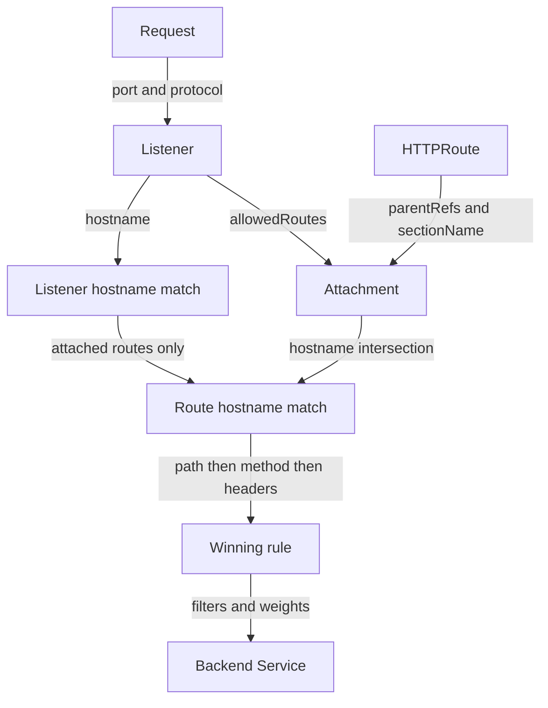
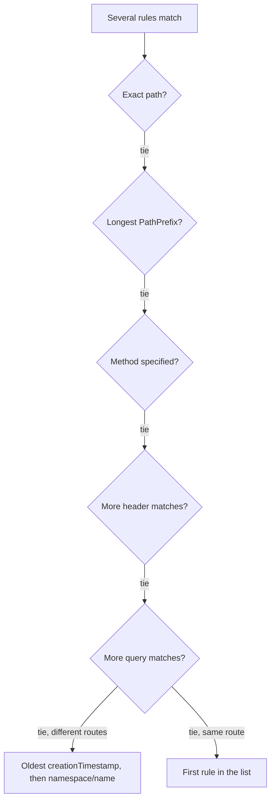

# Request Matching And Precedence

A canary header does not always override a path rule. If a request to `/api/info` carries `x-version: canary`, a longer path prefix can still win. The Gateway API defines in which order listeners, routes and rules narrow the choice, and which rule wins when several match. You need that order before you can explain which Service receives a request, and before you can write two overlapping rules on purpose.

This part needs the Gateway `starfleet-gateway` in `starfleet` with its listener `http` on port 80, and the `GATEWAY` variable from the first part. If you opened a new terminal, set it again with `GATEWAY=$(kubectl -n starfleet get gateway starfleet-gateway -o jsonpath='{.status.addresses[0].value}')`.

## Two rules that both match

The route below has a header rule on `/` and a path rule on `/api`. A request to `/api/info` with the canary header matches both. The header rule is first in the file, but it does not win.

<!-- astrona:playground:renew -->

Save this as `httproute-priority.yaml`:

```yaml
apiVersion: gateway.networking.k8s.io/v1
kind: HTTPRoute
metadata:
  name: priority
  namespace: starfleet
spec:
  parentRefs:
    - name: starfleet-gateway
      sectionName: http
  hostnames:
    - priority.starfleet.example
  rules:
    - matches:
        - path:
            type: PathPrefix
            value: /
          headers:
            - name: x-version
              value: canary
      backendRefs:
        - name: probe
          port: 80
    - matches:
        - path:
            type: PathPrefix
            value: /api
      backendRefs:
        - name: scout
          port: 80
```

Apply it:

```sh
kubectl apply -f httproute-priority.yaml
```

Then check the result:

```sh
kubectl -n starfleet get gateway starfleet-gateway -o jsonpath='{.status.addresses[0].value}{"\n"}'
kubectl -n starfleet get httproute priority -o yaml
kubectl -n starfleet exec deploy/shuttle -- curl -sS -H 'Host: priority.starfleet.example' -H 'x-version: canary' http://$GATEWAY/api/info
kubectl -n starfleet exec deploy/shuttle -- curl -sS -H 'Host: priority.starfleet.example' -H 'x-version: canary' http://$GATEWAY/headers
```

Look for `Accepted=True` and `ResolvedRefs=True` under the route's parent status. The `/api/info` response should identify `scout` with its `podinfo` JSON; `/headers` should echo the headers from `probe`. The controller translates the route into proxy configuration, and the proxy then chooses one rule for each request. The rule placed first in the file does not override a more specific path.

## From listener to rule

The proxy narrows the choice in a fixed order. Attachment is decided by the controller when it reconciles the objects, before any request arrives; matching is done by the proxy for every request.

1. **Port and protocol.** A request arrives on a listener's port. For HTTP, the listener's optional `hostname` constrains the request's `Host` header. For HTTPS, the TLS (Transport Layer Security) server name selects the listener as well.
2. **Listener hostname.** When several listeners on one port differ only by hostname, an exact hostname is processed before a wildcard, a wildcard before the empty fallback hostname, and among wildcards the one with more dots to the right of the `*` wins. The listener in this playground has no hostname, so it is the fallback for every request.
3. **Attachment.** `parentRefs.name` selects a Gateway and `namespace` defaults to the route's namespace. `sectionName` selects a listener by its **name**, not by its port or protocol; `port` selects every listener on that port; with both set, a listener must match both. With neither set, the route asks for every listener, and attachment succeeds if at least one listener accepts it. The listener's `allowedRoutes` must allow the route's namespace and kind.
4. **Route hostname.** A route with `hostnames` and a listener with a `hostname` must intersect, or the route is not accepted for that listener and reports `Accepted=False` with the reason `NoMatchingListenerHostname`. Between routes whose hostnames both match a request, the route with more characters in a matching non-wildcard hostname wins, then the one with more characters in a matching hostname. Rule precedence breaks the remaining ties.
5. **Rule.** Among the rules of the routes that survive, the most specific match wins, by the order in the next section.



The diagram separates attachment, which the controller checks, from request matching, which the configured proxy performs.

## How ties are resolved

Within one match, path, method, headers and query parameters must all match. Separate entries in `matches` are alternatives. Header names are compared case-insensitively; an `Exact` header value is compared as written. A `PathPrefix` matches whole path elements split by `/`: `/api` matches `/api`, `/api/` and `/api/info`, but not `/apiculture`.

For routes with equal hostname priority, the proxy compares matching rules in this order and moves down only when tied:

1. An `Exact` path wins over a `PathPrefix`.
2. The `PathPrefix` with the largest number of characters wins.
3. A match that specifies the request method wins over one without a method.
4. The match with the largest number of header matches wins.
5. The match with the largest number of query parameter matches wins.



The diagram reads top down: a test decides only when the tests above it are tied, and the file order of rules is the very last test.

Thus a `GET` match beats a header-only match when their paths tie, even if the latter names two headers. For matching rules on different routes still tied after these tests, the oldest route by `creationTimestamp` wins. Equal timestamps use alphabetical `namespace/name`. Within one route, a remaining tie uses the first matching rule in its list. Regular expression path precedence is implementation-specific; use `Exact` and `PathPrefix` for predictable choices. A request that matches no rule of any attached route gets `404` from the proxy.

## Weights apply inside the winning rule

A backend weight is a relative share among the backend references of one rule. It never helps a rule win. To isolate that behaviour, use a separate hostname and two valid backend references.

Save this as `httproute-weight-check.yaml`:

```yaml
apiVersion: gateway.networking.k8s.io/v1
kind: HTTPRoute
metadata:
  name: weight-check
  namespace: starfleet
spec:
  parentRefs:
    - name: starfleet-gateway
      sectionName: http
  hostnames:
    - weights.starfleet.example
  rules:
    - backendRefs:
        - name: bridge
          port: 80
          weight: 3
        - name: scout
          port: 80
          weight: 1
```

Apply it:

```sh
kubectl apply -f httproute-weight-check.yaml
```

Then send a sample of requests:

```sh
kubectl -n starfleet get httproute weight-check -o yaml
kubectl -n starfleet exec deploy/shuttle -- sh -c "for request in 1 2 3 4 5 6 7 8 9 10 11 12; do curl -fsS -H 'Host: weights.starfleet.example' http://$GATEWAY/; done"
```

The double quotes let your shell insert the `GATEWAY` value inside the loop. Look for responses from both applications over repeated samples: `bridge front end` lines and `podinfo` JSON. Each share is its weight divided by the sum, so 3 and 1 express the same split as 75 and 25. The rule was chosen first, by hostname; the weights only split what that rule receives. Remove both test routes so that the listener's route count in later checks stays the same:

```sh
kubectl -n starfleet delete httproute priority weight-check
```

You can now explain why a request reaches one Service even when another rule also matches. The next diagnostic question is whether the route was eligible for matching at all; status conditions answer that before you change any rules.

## Common pitfalls

> [!WARNING]
> - **Using a header as a global override.** Path specificity is compared before method and header counts.
> - **Treating the rule list as a firewall.** List order resolves a final tie within one route, not every overlap.
> - **Writing `sectionName: HTTP`.** The value is the listener name, here `http`; names are case sensitive.
> - **Expecting a weight to pick a rule.** Weights split the traffic of the rule that already won; they are never compared across rules.
