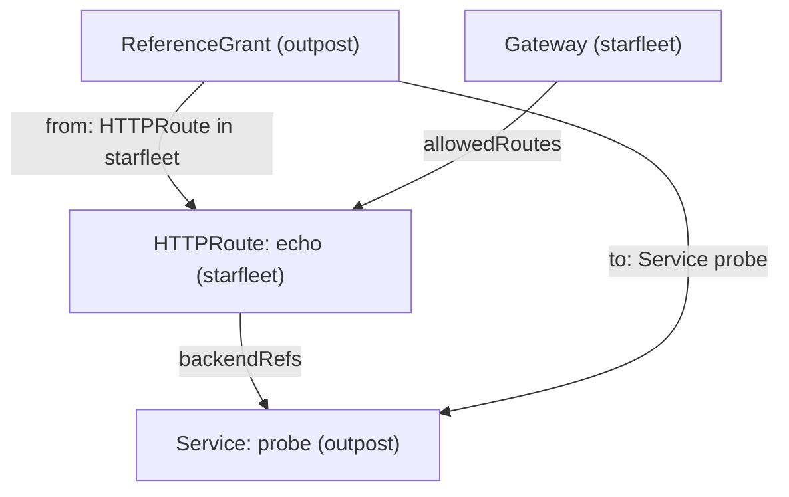

# Route Status And Cross-Namespace Routing

`kubectl apply` accepts an HTTPRoute even when it can never work. The API server only checks that the YAML is valid; it does not check that the Gateway lets the route in or that the Service exists. The controller does those checks later and writes the answer into the route's status. This part breaks a route on purpose, reads the two conditions that explain it, and then lets a route and a backend from another namespace in.

## Two conditions per parent

Every HTTPRoute has `status.parents`, one entry for each Gateway in its `parentRefs`. Each entry carries two conditions that you will read again and again:

- **`Accepted`** says whether the Gateway allowed the route to attach. When it is `False`, the Gateway ignores the whole route.
- **`ResolvedRefs`** says whether every `backendRef` points at an object that exists and that the route may use. When it is `False`, the route is attached, but the broken backend gets no traffic.

The `reason` field names the exact problem, and the `message` field explains it in words.

## A backend that does not exist

This route sends requests for `broken.starfleet.example` to a Service called `scout-v2`, which does not exist.

<!-- astrona:playground:renew -->

Save this as `httproute-broken.yaml`:

```yaml
apiVersion: gateway.networking.k8s.io/v1
kind: HTTPRoute
metadata:
  name: broken
  namespace: starfleet
spec:
  parentRefs:
    - name: starfleet-gateway
  hostnames:
    - broken.starfleet.example
  rules:
    - backendRefs:
        - name: scout-v2
          port: 80
```

Apply it:

```sh
kubectl apply -f httproute-broken.yaml
```

Then check the route's conditions and send a request to it. If you opened a new terminal, set `GATEWAY=$(kubectl -n starfleet get gateway starfleet-gateway -o jsonpath='{.status.addresses[0].value}')` first:

```sh
kubectl -n starfleet get httproute broken -o jsonpath='{range .status.parents[*].conditions[*]}{.type}={.status} {.reason}: {.message}{"\n"}{end}'
kubectl -n starfleet exec deploy/shuttle -- curl -s -i -H 'Host: broken.starfleet.example' http://$GATEWAY/
```

You should see something like:

```text
Accepted=True Accepted: Route is accepted
ResolvedRefs=False BackendNotFound: Failed to process route rule 0 backendRef 0: service starfleet/scout-v2 not found.
HTTP/1.1 500 Internal Server Error
date: Sat, 10 Oct 2026 17:10:00 GMT
content-length: 0
```

The route is attached (`Accepted=True`), but `ResolvedRefs=False` with the reason `BackendNotFound` names the missing Service. The proxy answers `500 Internal Server Error`, because it found the rule but has nowhere to send the request. This is different from `404`, which means that no rule matched at all. Leave the route as it is; it does no harm to the other routes.

## A route from another namespace

The team in `outpost` wants its own `probe` behind the same Gateway. It writes an HTTPRoute in its own namespace, and points `parentRefs` at the Gateway in `starfleet` with the `namespace` field.

Save this as `httproute-outpost.yaml`:

```yaml
apiVersion: gateway.networking.k8s.io/v1
kind: HTTPRoute
metadata:
  name: outpost
  namespace: outpost
spec:
  parentRefs:
    - name: starfleet-gateway
      namespace: starfleet
  hostnames:
    - outpost.starfleet.example
  rules:
    - backendRefs:
        - name: probe
          port: 80
```

Apply it:

```sh
kubectl apply -f httproute-outpost.yaml
```

Then check the result:

```sh
kubectl -n outpost get httproute outpost -o jsonpath='{range .status.parents[*].conditions[*]}{.type}={.status} {.reason}: {.message}{"\n"}{end}'
kubectl -n starfleet exec deploy/shuttle -- curl -s -i -H 'Host: outpost.starfleet.example' http://$GATEWAY/get | head -1
```

You should see something like:

```text
Accepted=False NotAllowedByListeners: No listeners included by this parent ref allowed this attachment.
ResolvedRefs=True ResolvedRefs: Resolved all the Object references for the Route
HTTP/1.1 404 Not Found
```

The Gateway refused the route with the reason `NotAllowedByListeners`. A listener's `allowedRoutes.namespaces.from` field decides which namespaces may attach routes, and its default is `Same`: only routes in the Gateway's own namespace. The route is not attached, so the request finds no rule and gets `404`.

## Opening the listener with allowedRoutes

`from` has three values: `Same` (the default), `All` (every namespace) and `Selector` (namespaces whose labels match a `selector`). `Selector` is the safe choice for a shared Gateway, because the platform team decides exactly which tenants may attach. Every namespace carries the label `kubernetes.io/metadata.name` with its own name, so you can select namespaces by name without adding labels.

A common first attempt selects only the new namespace. Save this as `gateway-starfleet-shared.yaml`:

```yaml
apiVersion: gateway.networking.k8s.io/v1
kind: Gateway
metadata:
  name: starfleet-gateway
  namespace: starfleet
spec:
  gatewayClassName: eg
  listeners:
    - name: http
      protocol: HTTP
      port: 80
      allowedRoutes:
        namespaces:
          from: Selector
          selector:
            matchLabels:
              kubernetes.io/metadata.name: outpost
```

Apply it:

```sh
kubectl apply -f gateway-starfleet-shared.yaml
```

Then check both the new route and an old one:

```sh
kubectl -n outpost get httproute outpost -o jsonpath='{range .status.parents[*].conditions[*]}{.type}={.status} {.reason}{"\n"}{end}'
kubectl -n starfleet get httproute bridge -o jsonpath='{range .status.parents[*].conditions[*]}{.type}={.status} {.reason}{"\n"}{end}'
kubectl -n starfleet exec deploy/shuttle -- curl -s -i http://$GATEWAY/ | head -1
```

You should see something like:

```text
Accepted=True Accepted
ResolvedRefs=True ResolvedRefs
Accepted=False NotAllowedByListeners
ResolvedRefs=True ResolvedRefs
HTTP/1.1 404 Not Found
```

The `outpost` route is in, but the `bridge` route in `starfleet` is now out. Once `from` is `Selector`, the Gateway's own namespace is allowed only if the selector matches it too. Change the selector in `gateway-starfleet-shared.yaml` so that it matches both namespaces:

```yaml
apiVersion: gateway.networking.k8s.io/v1
kind: Gateway
metadata:
  name: starfleet-gateway
  namespace: starfleet
spec:
  gatewayClassName: eg
  listeners:
    - name: http
      protocol: HTTP
      port: 80
      allowedRoutes:
        namespaces:
          from: Selector
          selector:
            matchExpressions:
              - key: kubernetes.io/metadata.name
                operator: In
                values:
                  - starfleet
                  - outpost
```

Apply it again:

```sh
kubectl apply -f gateway-starfleet-shared.yaml
```

Then check the listener and both teams' routes:

```sh
kubectl -n starfleet get gateway starfleet-gateway -o jsonpath='{range .status.listeners[*]}{.name}: attachedRoutes={.attachedRoutes}{"\n"}{end}'
kubectl -n starfleet exec deploy/shuttle -- curl -s http://$GATEWAY/
kubectl -n starfleet exec deploy/shuttle -- curl -s -H 'Host: outpost.starfleet.example' http://$GATEWAY/get
```

You should see something like (the echo shortened):

```text
http: attachedRoutes=4
bridge front end
{
  "args": {},
  "headers": {
    "Host": [
      "outpost.starfleet.example"
    ],
    ...
  },
  "method": "GET",
  "origin": "10.244.0.9",
  "url": "http://outpost.starfleet.example/get"
}
```

Four routes are attached: `bridge`, `split`, `broken` (attached, but with a missing backend) and `outpost`. Both teams' requests work again.

## A backend in another namespace

`allowedRoutes` controls which routes may attach to a Gateway. A different rule controls which Services a route may send traffic to. A route in `starfleet` that names a Service in `outpost` crosses a namespace boundary, and the owner of `outpost` must allow it with a **ReferenceGrant**: a namespaced object, created in the target namespace, that lists which kinds from which namespaces may refer to which objects there.



The diagram shows that the Gateway decides on the route, while the ReferenceGrant in the target namespace decides on the cross-namespace backend.

Save this as `httproute-echo.yaml`:

```yaml
apiVersion: gateway.networking.k8s.io/v1
kind: HTTPRoute
metadata:
  name: echo
  namespace: starfleet
spec:
  parentRefs:
    - name: starfleet-gateway
  hostnames:
    - echo.starfleet.example
  rules:
    - backendRefs:
        - name: probe
          namespace: outpost
          port: 80
```

Apply it:

```sh
kubectl apply -f httproute-echo.yaml
```

Then check the result:

```sh
kubectl -n starfleet get httproute echo -o jsonpath='{range .status.parents[*].conditions[*]}{.type}={.status} {.reason}: {.message}{"\n"}{end}'
kubectl -n starfleet exec deploy/shuttle -- curl -s -i -H 'Host: echo.starfleet.example' http://$GATEWAY/get | head -1
```

You should see something like:

```text
Accepted=True Accepted: Route is accepted
ResolvedRefs=False RefNotPermitted: Failed to process route rule 0 backendRef 0: Backend ref to Service outpost/probe not permitted by any ReferenceGrant.
HTTP/1.1 500 Internal Server Error
```

The reason is `RefNotPermitted`: the Service exists, but nothing in `outpost` allows the reference. Now give the permission from the `outpost` side.

Save this as `referencegrant-outpost.yaml`:

```yaml
apiVersion: gateway.networking.k8s.io/v1
kind: ReferenceGrant
metadata:
  name: allow-starfleet-routes
  namespace: outpost
spec:
  from:
    - group: gateway.networking.k8s.io
      kind: HTTPRoute
      namespace: starfleet
  to:
    - group: ""
      kind: Service
      name: probe
```

Apply it:

```sh
kubectl apply -f referencegrant-outpost.yaml
```

Then check the route again:

```sh
kubectl -n starfleet get httproute echo -o jsonpath='{range .status.parents[*].conditions[*]}{.type}={.status} {.reason}: {.message}{"\n"}{end}'
kubectl -n starfleet exec deploy/shuttle -- curl -s -i -H 'Host: echo.starfleet.example' http://$GATEWAY/get | head -1
```

You should see something like:

```text
Accepted=True Accepted: Route is accepted
ResolvedRefs=True ResolvedRefs: Resolved all the Object references for the Route
HTTP/1.1 200 OK
```

`ResolvedRefs` is `True`, and the request reaches the `probe` in `outpost`. The `to` list names one Service; without `name`, the grant would allow every Service in `outpost`. The group of a Service is the core group, written as an empty string. The ReferenceGrant is served as `v1` on this cluster's Gateway API version; older clusters only have `v1beta1`, so check with `kubectl api-resources | grep -i referencegrant`.

You can now read the two route conditions, tell `BackendNotFound`, `NotAllowedByListeners` and `RefNotPermitted` apart, open a listener to chosen namespaces, and allow a cross-namespace backend with a ReferenceGrant. Together with Gateways and route rules, that is the whole path of a request from the entry point to a pod in any namespace.

## Common pitfalls

> [!WARNING]
> - **Trusting `kubectl apply`.** "created" only means the YAML is valid; read `status.parents` for `Accepted` and `ResolvedRefs`.
> - **Locking out your own namespace.** With `from: Selector`, the Gateway's namespace is allowed only if the selector matches it.
> - **Creating the ReferenceGrant in the wrong namespace.** It lives in the namespace of the target Service, not of the route.
> - **Mixing up `404` and `500`.** `404` means no rule matched (often a route that is not attached); `500` means the rule matched but its backend is not usable.
