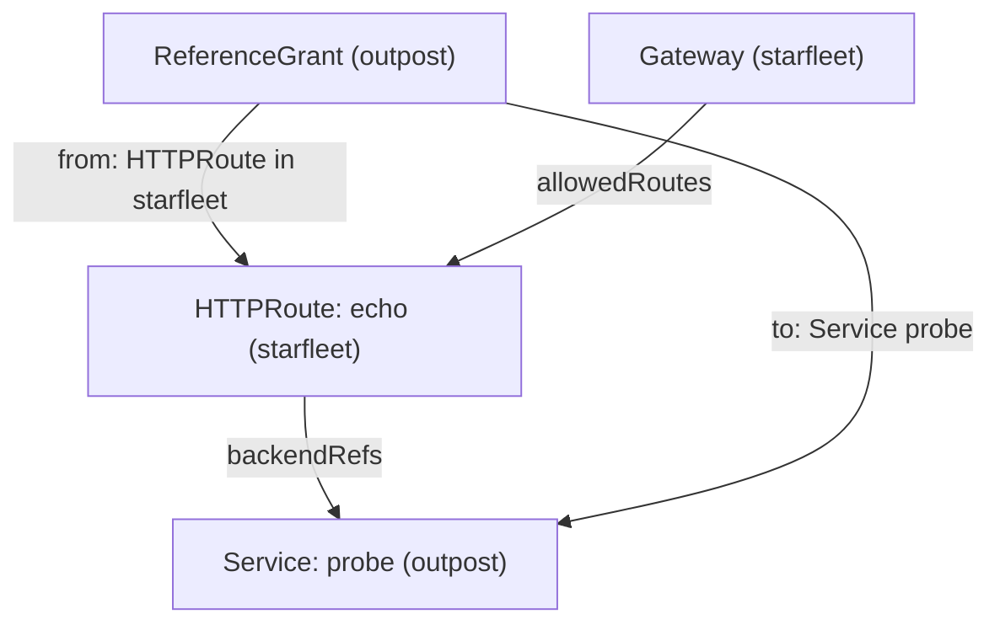

# Cross-Namespace Backends With ReferenceGrant

An HTTPRoute is the Gateway API object that holds the routing rules for one application, and it sends matching requests to the Services in its `backendRefs` list. A route can name a Service in any namespace, and the API server accepts the YAML without a check. If that were enough, one team could send traffic to the Services of another team without asking. Kubernetes closes this gap with a rule that the owner of the target namespace must agree. This part makes a route point at a Service in another namespace, reads the refusal, and gives the permission.

## A backend in another namespace

A Gateway's `allowedRoutes` field controls which routes may attach to it. A different rule controls which Services a route may send traffic to. A route in `starfleet` that names a Service in `outpost` crosses a namespace boundary, and the owner of `outpost` must allow it with a **ReferenceGrant**: a namespaced object, created in the target namespace, that lists which kinds from which namespaces may refer to which objects there.



The diagram shows that the Gateway decides on the route, while the ReferenceGrant in the target namespace decides on the cross-namespace backend.

The commands below need the Gateway `starfleet-gateway` in `starfleet`, with its listener `http` on port 80 open to routes from `starfleet`, and the `outpost` namespace with its `probe` Service. They also need the `GATEWAY` variable: set `GATEWAY=$(kubectl -n starfleet get gateway starfleet-gateway -o jsonpath='{.status.addresses[0].value}')` if you opened a new terminal. A route reports its state in `status.parents`; the condition `Accepted` says whether the Gateway took the route, and `ResolvedRefs` says whether every `backendRef` points at an object the route may use.

<!-- astrona:playground:renew -->

Save this as `httproute-echo.yaml`:

```yaml
apiVersion: gateway.networking.k8s.io/v1
kind: HTTPRoute
metadata:
  name: echo
  namespace: starfleet
spec:
  parentRefs:
    - name: starfleet-gateway
  hostnames:
    - echo.starfleet.example
  rules:
    - backendRefs:
        - name: probe
          namespace: outpost
          port: 80
```

Apply it:

```sh
kubectl apply -f httproute-echo.yaml
```

Then check the result:

```sh
kubectl -n starfleet get httproute echo -o jsonpath='{range .status.parents[*].conditions[*]}{.type}={.status} {.reason}: {.message}{"\n"}{end}'
kubectl -n starfleet exec deploy/shuttle -- curl -s -i -H 'Host: echo.starfleet.example' http://$GATEWAY/get | head -1
```

You should see something like:

```text
Accepted=True Accepted: Route is accepted
ResolvedRefs=False RefNotPermitted: Failed to process route rule 0 backendRef 0: Backend ref to Service outpost/probe not permitted by any ReferenceGrant.
HTTP/1.1 500 Internal Server Error
```

The reason is `RefNotPermitted`: the Service exists, but nothing in `outpost` allows the reference. Now give the permission from the `outpost` side.

Save this as `referencegrant-outpost.yaml`:

```yaml
apiVersion: gateway.networking.k8s.io/v1
kind: ReferenceGrant
metadata:
  name: allow-starfleet-routes
  namespace: outpost
spec:
  from:
    - group: gateway.networking.k8s.io
      kind: HTTPRoute
      namespace: starfleet
  to:
    - group: ""
      kind: Service
      name: probe
```

Apply it:

```sh
kubectl apply -f referencegrant-outpost.yaml
```

Then check the route again:

```sh
kubectl -n starfleet get httproute echo -o jsonpath='{range .status.parents[*].conditions[*]}{.type}={.status} {.reason}: {.message}{"\n"}{end}'
kubectl -n starfleet exec deploy/shuttle -- curl -s -i -H 'Host: echo.starfleet.example' http://$GATEWAY/get | head -1
```

You should see something like:

```text
Accepted=True Accepted: Route is accepted
ResolvedRefs=True ResolvedRefs: Resolved all the Object references for the Route
HTTP/1.1 200 OK
```

`ResolvedRefs` is `True`, and the request reaches the `probe` in `outpost`. The `to` list names one Service; without `name`, the grant would allow every Service in `outpost`. The group of a Service is the core group, written as an empty string. The ReferenceGrant is served as `v1` on this cluster's Gateway API version; older clusters only have `v1beta1`, so check with `kubectl api-resources | grep -i referencegrant`.

You can now read the reason `RefNotPermitted` in the `ResolvedRefs` condition and allow a cross-namespace backend with a ReferenceGrant. The Gateway decides which routes attach, and the ReferenceGrant in the target namespace decides which Services a route may reach. Together, they cover the whole path of a request from the entry point to a pod in any namespace.

## Common pitfalls

> [!WARNING]
> - **Creating the ReferenceGrant in the wrong namespace.** It lives in the namespace of the target Service, not of the route.
> - **Granting too much.** Without `name` in the `to` list, the grant allows every Service of that kind in the namespace.
> - **Reading only `Accepted`.** A route can be `Accepted=True` and still send `500`; check `ResolvedRefs` as well.
