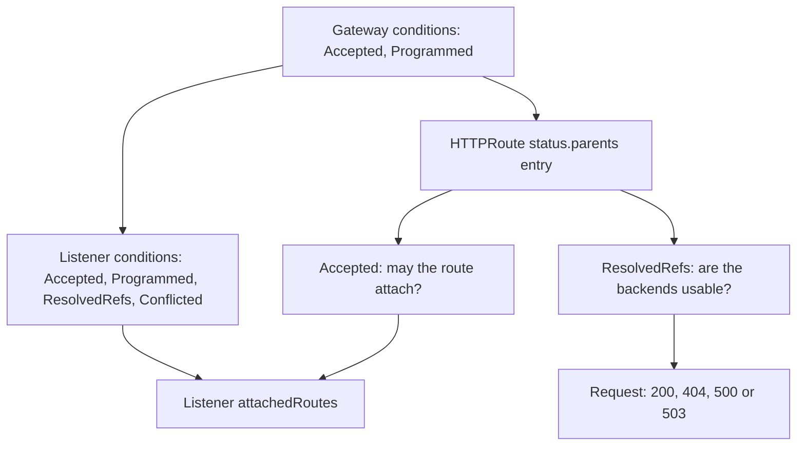

# Diagnosing Gateway And Route Status

`kubectl apply` accepts an HTTPRoute even when it can never work. The API server only checks that the YAML is valid; it does not check that the Gateway lets the route in, that the listener it names exists, or that the Service exists. The controller does those checks later and writes the answer into status, at three levels: the Gateway, each listener, and each parent entry of the route. A Gateway can be `Programmed=True` while an application route is rejected. This part breaks two routes on purpose, reads the conditions that explain each one, and then proves the data path with a request.

A **condition** is one named status entry with a `status` of `True`, `False` or `Unknown`, a short `reason`, a human-readable `message`, an `observedGeneration` and a `lastTransitionTime`. The parts below need the Gateway `starfleet-gateway` with the listener `http` on port 80 and the `GATEWAY` variable. If you opened a new terminal, set `GATEWAY=$(kubectl -n starfleet get gateway starfleet-gateway -o jsonpath='{.status.addresses[0].value}')` first.

## Two conditions per parent

Every HTTPRoute has `status.parents`, one entry for each Gateway in its `parentRefs` that a controller reported on. Each entry names the `parentRef`, the `controllerName` that wrote it, and two conditions that you will read again and again:

- **`Accepted`** says whether the Gateway allowed the route to attach. When it is `False`, the Gateway ignores the whole route.
- **`ResolvedRefs`** says whether every `backendRef` points at an object that exists and that the route may use. When it is `False`, the route is attached, but the broken backend gets no traffic.

The `reason` field names the exact problem, and the `message` field explains it in words. These two are the portable route conditions; do not wait for a route-level `Programmed` condition as proof of attachment.

## A backend that does not exist

This route sends requests for `broken.starfleet.example` to a Service called `scout-v2`, which does not exist.

<!-- astrona:playground:renew -->

Save this as `httproute-broken.yaml`:

```yaml
apiVersion: gateway.networking.k8s.io/v1
kind: HTTPRoute
metadata:
  name: broken
  namespace: starfleet
spec:
  parentRefs:
    - name: starfleet-gateway
  hostnames:
    - broken.starfleet.example
  rules:
    - backendRefs:
        - name: scout-v2
          port: 80
```

Apply it:

```sh
kubectl apply -f httproute-broken.yaml
```

Then check the route's conditions and send a request to it:

```sh
kubectl -n starfleet get httproute broken -o jsonpath='{range .status.parents[*].conditions[*]}{.type}={.status} {.reason}: {.message}{"\n"}{end}'
kubectl -n starfleet exec deploy/shuttle -- curl -s -i -H 'Host: broken.starfleet.example' http://$GATEWAY/
```

You should see something like:

```text
Accepted=True Accepted: Route is accepted
ResolvedRefs=False BackendNotFound: Failed to process route rule 0 backendRef 0: service starfleet/scout-v2 not found.
HTTP/1.1 500 Internal Server Error
date: Sat, 10 Oct 2026 17:10:00 GMT
content-length: 0
```

The route is attached (`Accepted=True`), but `ResolvedRefs=False` with the reason `BackendNotFound` names the missing Service. The proxy answers `500 Internal Server Error`, because it found the rule but has nowhere to send the request. This is different from `404`, which means that no rule matched at all. Leave the route as it is; it does no harm to the other routes.

## A parent that does not exist

The second route names a listener that the Gateway does not have.

Save this as `httproute-status-check.yaml`:

```yaml
apiVersion: gateway.networking.k8s.io/v1
kind: HTTPRoute
metadata:
  name: status-check
  namespace: starfleet
spec:
  parentRefs:
    - name: starfleet-gateway
      sectionName: web
  hostnames:
    - status.starfleet.example
  rules:
    - backendRefs:
        - name: bridge
          port: 80
```

Apply it:

```sh
kubectl apply -f httproute-status-check.yaml
```

Then check the result:

```sh
kubectl -n starfleet get gateway starfleet-gateway -o yaml
kubectl -n starfleet get httproute status-check -o yaml
kubectl -n starfleet describe httproute status-check
```

Look for `Accepted=False` on the route with the reason `NoMatchingParent`: no listener is named `web`. The Gateway still shows `Programmed=True`, because the proxy is configured for its valid listener. When several faults exist, fix the reported one and read status again; the controller need not expose every fault at once.

Change `sectionName: web` to `sectionName: http` in the saved file. Apply it:

```sh
kubectl apply -f httproute-status-check.yaml
```

Then check the result:

```sh
kubectl -n starfleet get httproute status-check -o jsonpath='{range .status.parents[*]}{.parentRef.name}{"/"}{.parentRef.sectionName}{" "}{.controllerName}{"\n"}{range .conditions[*]}{.type}{"="}{.status}{" "}{.reason}{" generation="}{.observedGeneration}{" "}{.message}{"\n"}{end}{end}'
kubectl -n starfleet get gateway starfleet-gateway -o jsonpath='{range .status.listeners[*]}{.name}{" attached="}{.attachedRoutes}{"\n"}{range .conditions[*]}{.type}{"="}{.status}{" "}{.reason}{"\n"}{end}{end}'
```

The route should now have `Accepted=True` and `ResolvedRefs=True` for listener `http`. Compare each condition's `observedGeneration` with the object's `metadata.generation` in the full YAML: the API server raises `generation` on every change to `spec`, and the controller stamps the generation it reconciled into each condition. An older generation describes an earlier specification, so a `True` next to a stale generation proves nothing about your latest edit. `lastTransitionTime` records when the condition last changed its `status`; it is not the time of every reconciliation.

## Read the right status level

The controller reports status at three levels, and a fault at one level does not show at the others.



The diagram shows where to look next when a level reports success: a programmed Gateway says nothing about a route, and an accepted route says nothing about its backends.

`Gateway.status.conditions` summarises the Gateway, while `Gateway.status.listeners` names each listener with its own conditions. `attachedRoutes` counts the routes with `Accepted=True` on that listener, whatever the listener's own conditions say; it does not count healthy backends. `HTTPRoute.status.parents` has a separate entry for each reported parent. Check the entry for the intended Gateway and listener.

| Location and condition | What to establish | Reasons to inspect |
| --- | --- | --- |
| Gateway `Accepted` | The controller accepts the Gateway specification | `Accepted`, `ListenersNotValid`, `InvalidParameters`, `UnsupportedAddress`, `Pending` |
| Gateway `Programmed` | Configuration has reached the data plane | `Programmed`, `Pending`, `Invalid`, `NoResources`, `AddressNotAssigned`, `AddressNotUsable` |
| Listener `Accepted` | This listener is supported | `Accepted`, `UnsupportedProtocol`, `PortUnavailable`, `UnsupportedValue` |
| Listener `Programmed` | This listener is configured in the data plane | `Programmed`, `Pending`, `Invalid` |
| Listener `Conflicted` | Another listener claims the same port and hostname or protocol | `NoConflicts`, `HostnameConflict`, `ProtocolConflict` |
| Listener `ResolvedRefs` | Its references, such as a certificate, resolve | `ResolvedRefs`, `InvalidCertificateRef`, `RefNotPermitted`, `InvalidRouteKinds` |
| HTTPRoute parent `Accepted` | This parent accepts the route | `Accepted`, `NoMatchingParent`, `NotAllowedByListeners`, `NoMatchingListenerHostname`, `UnsupportedValue`, `IncompatibleFilters`, `Pending` |
| HTTPRoute parent `ResolvedRefs` | Referenced backends exist and are permitted | `ResolvedRefs`, `BackendNotFound`, `RefNotPermitted`, `InvalidKind`, `UnsupportedProtocol` |

`NoMatchingParent` points to a wrong Gateway name, namespace, `sectionName` or `port`. `NotAllowedByListeners` points to route kind or namespace permissions on the listener. `NoMatchingListenerHostname` points to a missing intersection between route and listener hostnames. `BackendNotFound` calls for checking the Service name, namespace and port. `RefNotPermitted` calls for permission in the target namespace, not a new Service.

The experimental channel in Gateway API v1.6.1 also defines a Gateway-level `ResolvedRefs` condition with the reasons `ListenersNotResolved`, `InvalidClientCertificateRef` and `RefNotPermitted`. A controller need not emit it; read the listener and route conditions even when that summary is absent.

## Prove the data path

Events provide extra clues but are not a required record of every rejection. If there are no events, continue with conditions and the response:

```sh
kubectl -n starfleet get events --field-selector involvedObject.name=starfleet-gateway
kubectl -n starfleet get events --field-selector involvedObject.name=status-check
kubectl -n starfleet get endpointslices -l kubernetes.io/service-name=bridge
kubectl -n starfleet get gateway starfleet-gateway -o jsonpath='{.status.addresses[0].value}{"\n"}'
kubectl -n starfleet exec deploy/shuttle -- curl -sS -i -H 'Host: status.starfleet.example' http://$GATEWAY/
```

Look for the `bridge front end` body. A proxy response of `404` can mean no route matched, but a backend can also return `404`. An invalid backend reference makes a matching rule return `500`; a Service with no ready endpoints should answer `503`. The response alone does not identify the fault. Compare it with fresh route conditions and the Service's EndpointSlice. Then remove the repaired route, so that the listener's route count stays the same for the shared-Gateway steps, and keep `broken` as it is:

```sh
kubectl -n starfleet delete httproute status-check
```

You can now separate a Gateway fault, a rejected attachment and an unresolved backend, and tell a stale condition from a fresh one. Once the intended parent has fresh positive conditions, requests prove whether the programmed data path actually serves the application.

## Common pitfalls

> [!WARNING]
> - **Trusting `kubectl apply`.** "created" only means the YAML is valid; read `status.parents` for `Accepted` and `ResolvedRefs`.
> - **Stopping at Gateway `Programmed=True`.** A rejected HTTPRoute can coexist with a healthy Gateway.
> - **Reading stale success.** Compare `observedGeneration` with `metadata.generation` after an edit.
> - **Mixing up `404` and `500`.** `404` means no rule matched (often a route that is not attached); `500` means the rule matched but its backend is not usable.
> - **Waiting for events instead of reading conditions.** A controller may explain a rejection only in status.
