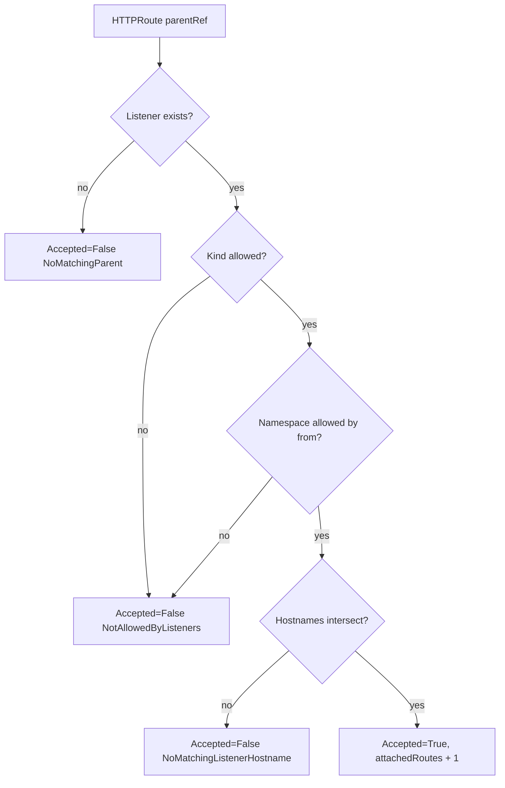

# Allowed Routes On A Shared Gateway

One Gateway usually serves several teams, each in its own namespace. By default a listener takes routes only from the Gateway's own namespace, so the first route another team writes is refused. The platform team decides who may attach with the listener's `allowedRoutes` field, and the most common mistake with it locks the Gateway's own team out. This part lets a route from `outpost` in, reads the refusal before and the lock-out after, and ends with both teams served by one listener.

This part needs the Gateway `starfleet-gateway` in `starfleet`, the `bridge` and `broken` routes already applied, and the `GATEWAY` variable. If you opened a new terminal, set `GATEWAY=$(kubectl -n starfleet get gateway starfleet-gateway -o jsonpath='{.status.addresses[0].value}')` first.

## How a listener decides

When the controller reconciles a route, it runs the same checks for every listener the route's `parentRefs` select:

1. The listener exists on the named Gateway; otherwise the parent entry gets `Accepted=False` with `NoMatchingParent`.
2. The route's kind is in the listener's `allowedRoutes.kinds`, or `kinds` is empty and the listener's protocol determines the kinds (the `supportedKinds` list in the listener status showed HTTPRoute and GRPCRoute for the `http` listener).
3. The route's namespace is allowed by `allowedRoutes.namespaces.from`: `Same` (the default) allows only the Gateway's namespace, `All` allows every namespace, and `Selector` allows the namespaces whose labels match `allowedRoutes.namespaces.selector`.
4. The route's hostnames intersect the listener's hostname, if the listener has one.

A route is attached when at least one selected listener passes all four checks. When none does, the reason is `NotAllowedByListeners` for a kind or namespace refusal, and `NoMatchingListenerHostname` for a hostname refusal.



The diagram is the order in which a refusal is reported: fix the first failing check, then read the status again.

## A route from another namespace

The team in `outpost` wants its own `probe` behind the same Gateway. It writes an HTTPRoute in its own namespace, and points `parentRefs` at the Gateway in `starfleet` with the `namespace` field.

<!-- astrona:playground:renew -->

Save this as `httproute-outpost.yaml`:

```yaml
apiVersion: gateway.networking.k8s.io/v1
kind: HTTPRoute
metadata:
  name: outpost
  namespace: outpost
spec:
  parentRefs:
    - name: starfleet-gateway
      namespace: starfleet
  hostnames:
    - outpost.starfleet.example
  rules:
    - backendRefs:
        - name: probe
          port: 80
```

Apply it:

```sh
kubectl apply -f httproute-outpost.yaml
```

Then check the result:

```sh
kubectl -n outpost get httproute outpost -o jsonpath='{range .status.parents[*].conditions[*]}{.type}={.status} {.reason}: {.message}{"\n"}{end}'
kubectl -n starfleet exec deploy/shuttle -- curl -s -i -H 'Host: outpost.starfleet.example' http://$GATEWAY/get | head -1
```

You should see something like:

```text
Accepted=False NotAllowedByListeners: No listeners included by this parent ref allowed this attachment.
ResolvedRefs=True ResolvedRefs: Resolved all the Object references for the Route
HTTP/1.1 404 Not Found
```

The Gateway refused the route with the reason `NotAllowedByListeners`. The listener has no `allowedRoutes`, so `from` is `Same`: only routes in the Gateway's own namespace. The route is not attached, so the request finds no rule and gets `404`. `ResolvedRefs` is still `True`, because the backend check is independent of attachment.

## Opening the listener with allowedRoutes

`Selector` is the safe choice for a shared Gateway, because the platform team decides exactly which tenants may attach. The selector reads labels on Namespace objects, not on routes. Every namespace carries the label `kubernetes.io/metadata.name` with its own name, so you can select namespaces by name without adding labels.

A common first attempt selects only the new namespace. Save this as `gateway-starfleet-shared.yaml`:

```yaml
apiVersion: gateway.networking.k8s.io/v1
kind: Gateway
metadata:
  name: starfleet-gateway
  namespace: starfleet
spec:
  gatewayClassName: eg
  listeners:
    - name: http
      protocol: HTTP
      port: 80
      allowedRoutes:
        namespaces:
          from: Selector
          selector:
            matchLabels:
              kubernetes.io/metadata.name: outpost
```

Apply it:

```sh
kubectl apply -f gateway-starfleet-shared.yaml
```

Then check both the new route and an old one:

```sh
kubectl -n outpost get httproute outpost -o jsonpath='{range .status.parents[*].conditions[*]}{.type}={.status} {.reason}{"\n"}{end}'
kubectl -n starfleet get httproute bridge -o jsonpath='{range .status.parents[*].conditions[*]}{.type}={.status} {.reason}{"\n"}{end}'
kubectl -n starfleet exec deploy/shuttle -- curl -s -i http://$GATEWAY/ | head -1
```

You should see something like:

```text
Accepted=True Accepted
ResolvedRefs=True ResolvedRefs
Accepted=False NotAllowedByListeners
ResolvedRefs=True ResolvedRefs
HTTP/1.1 404 Not Found
```

The `outpost` route is in, but the `bridge` route in `starfleet` is now out. Once `from` is `Selector`, the Gateway's own namespace is allowed only if the selector matches it too; there is no implicit exception for the Gateway's namespace. The controller re-evaluates every route when the Gateway changes, so a Gateway edit can detach routes that were working a second ago. Change the selector in `gateway-starfleet-shared.yaml` so that it matches both namespaces:

```yaml
apiVersion: gateway.networking.k8s.io/v1
kind: Gateway
metadata:
  name: starfleet-gateway
  namespace: starfleet
spec:
  gatewayClassName: eg
  listeners:
    - name: http
      protocol: HTTP
      port: 80
      allowedRoutes:
        namespaces:
          from: Selector
          selector:
            matchExpressions:
              - key: kubernetes.io/metadata.name
                operator: In
                values:
                  - starfleet
                  - outpost
```

Apply it again:

```sh
kubectl apply -f gateway-starfleet-shared.yaml
```

Then check the listener and both teams' routes:

```sh
kubectl -n starfleet get gateway starfleet-gateway -o jsonpath='{range .status.listeners[*]}{.name}: attachedRoutes={.attachedRoutes}{"\n"}{end}'
kubectl -n starfleet exec deploy/shuttle -- curl -s http://$GATEWAY/
kubectl -n starfleet exec deploy/shuttle -- curl -s -H 'Host: outpost.starfleet.example' http://$GATEWAY/get
```

You should see something like (the echo shortened):

```text
http: attachedRoutes=4
bridge front end
{
  "args": {},
  "headers": {
    "Host": [
      "outpost.starfleet.example"
    ],
    ...
  },
  "method": "GET",
  "origin": "10.244.0.9",
  "url": "http://outpost.starfleet.example/get"
}
```

Four routes are attached: `bridge`, `split`, `broken` (attached, but with a missing backend) and `outpost`. Both teams' requests work again. The counter confirms the rule from the status part: `attachedRoutes` counts accepted routes, and `broken` is accepted even though its backend does not resolve.

You can now tell `NotAllowedByListeners` from `NoMatchingParent`, and open a listener to chosen namespaces with `allowedRoutes` without locking out the Gateway's own team. A route that attaches can still point at a Service in a namespace that never agreed to receive its traffic. The Gateway does not decide that; another object does.

## Common pitfalls

> [!WARNING]
> - **Locking out your own namespace.** With `from: Selector`, the Gateway's namespace is allowed only if the selector matches it.
> - **Selecting routes instead of namespaces.** The selector reads the labels of Namespace objects; a label on the HTTPRoute changes nothing.
> - **Opening with `All` on a shared Gateway.** Every namespace may then attach routes and claim hostnames; prefer `Selector` and name the tenants.
> - **Reading only `Accepted`.** Attachment says nothing about backends; a route can be `Accepted=True` and still answer `500`.
