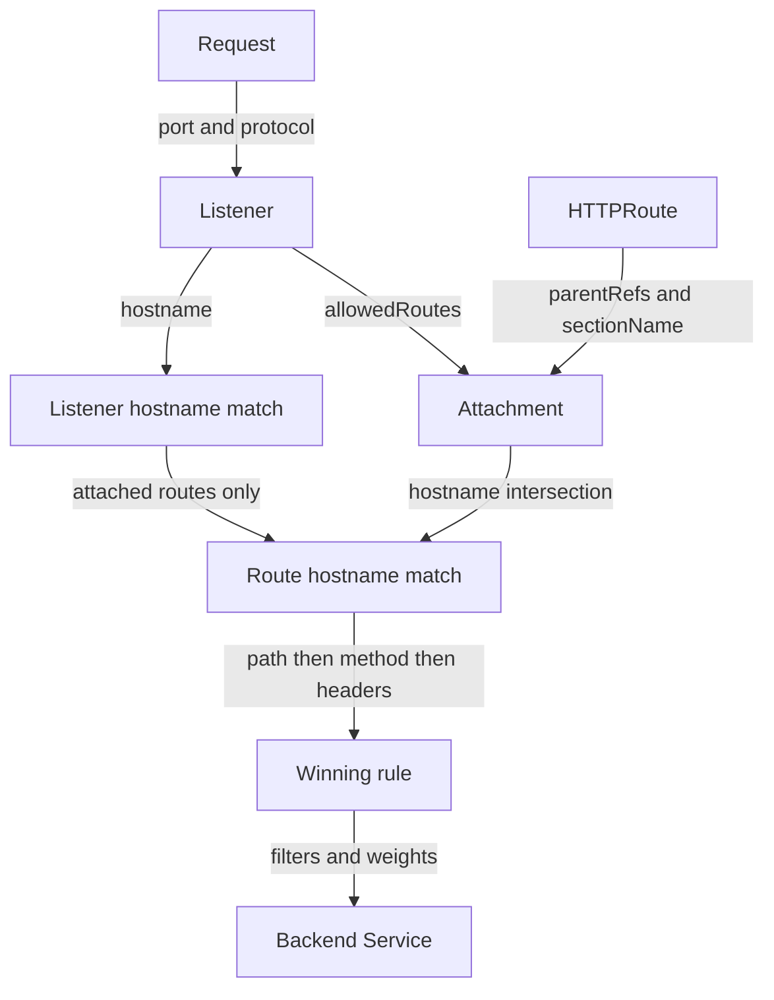

# Request Matching And Precedence

A canary header does not always override a path rule. If a request to `/api/info` carries `x-version: canary`, a longer path prefix can still win. The Gateway API (Application Programming Interface) defines how listeners, routes and rules narrow the choice. You need that order before you can explain which Service receives a request.

The playground needs a GatewayClass named `eg`. The controller is Envoy Gateway, installed as plumbing by the playground. A Gateway defines the entry point; a listener defines its port, protocol and optional hostname. An HTTPRoute defines the request matches and backend Services.

<!-- astrona:playground:renew -->

Read the installed class before creating the Gateway:

```sh
kubectl get gatewayclass
```

Look for the accepted class `eg`; use its name in `gatewayClassName` below.

Save this as `gateway-starfleet.yaml`:

```yaml
apiVersion: gateway.networking.k8s.io/v1
kind: Gateway
metadata:
  name: starfleet-gateway
  namespace: starfleet
spec:
  gatewayClassName: eg
  listeners:
    - name: http
      protocol: HTTP
      port: 80
      allowedRoutes:
        namespaces:
          from: Selector
          selector:
            matchExpressions:
              - key: kubernetes.io/metadata.name
                operator: In
                values: [starfleet, outpost]
```

Apply it:

```sh
kubectl apply -f gateway-starfleet.yaml
```

The selector reads labels on Namespace objects, not on routes. Here it permits both named namespaces. With no `allowedRoutes` namespace setting, the default is `Same`: only the Gateway's namespace. With `Selector`, even that namespace must match the selector.

Save this as `httproute-priority.yaml`:

```yaml
apiVersion: gateway.networking.k8s.io/v1
kind: HTTPRoute
metadata:
  name: priority
  namespace: starfleet
spec:
  parentRefs:
    - name: starfleet-gateway
      sectionName: http
  hostnames:
    - priority.starfleet.example
  rules:
    - matches:
        - path:
            type: PathPrefix
            value: /
          headers:
            - name: x-version
              value: canary
      backendRefs:
        - name: probe
          port: 80
    - matches:
        - path:
            type: PathPrefix
            value: /api
      backendRefs:
        - name: scout
          port: 80
```

Apply it:

```sh
kubectl apply -f httproute-priority.yaml
```

Then check the result. Read the Gateway address and replace `<GATEWAY_ADDRESS>` in the requests with that value:

```sh
kubectl -n starfleet get gateway starfleet-gateway -o jsonpath='{.status.addresses[0].value}{"\n"}'
kubectl -n starfleet get httproute priority -o yaml
kubectl -n starfleet exec deploy/shuttle -- curl -sS -H 'Host: priority.starfleet.example' -H 'x-version: canary' http://<GATEWAY_ADDRESS>/api/info
kubectl -n starfleet exec deploy/shuttle -- curl -sS -H 'Host: priority.starfleet.example' -H 'x-version: canary' http://<GATEWAY_ADDRESS>/headers
```

Look for `Accepted=True` and `ResolvedRefs=True` under the route's parent status. The `/api/info` response should identify `scout`; `/headers` should echo the headers from `probe`. The controller builds the proxy configuration. The proxy then chooses a matching rule for each request. The rule placed first in the file does not override a more specific path.

## From listener to rule

The proxy first handles traffic on a listener's port and protocol. For HTTP (Hypertext Transfer Protocol), its hostname constrains the request's Host header. For HTTPS (HTTP over TLS), the TLS (Transport Layer Security) handshake also uses the server name to select a listener. Among listeners distinguished by hostname on one port, an exact hostname wins over a wildcard. A more specific wildcard wins over a less specific one, and an empty hostname is the fallback. The listener here has no hostname restriction.

Attachment happens when the controller reconciles the objects, before requests arrive. `parentRefs.name` selects a Gateway; `namespace` defaults to the route's namespace. `sectionName` selects a listener by its **name**, not its protocol or port. If `port` and `sectionName` are both present, both must match. Omitting them asks to attach to all compatible listeners, subject to their permissions. `allowedRoutes.kinds`, if set, must permit HTTPRoute as well as the namespace.

A route and listener with explicit hostnames need an intersection. Only intersecting hostnames are usable. For a matching request, routes with more specific hostnames take priority: first compare the number of characters in a matching non-wildcard hostname, then the total characters in a matching hostname. Rule specificity breaks remaining ties.



The diagram separates attachment, which the controller checks, from request matching, which the configured proxy performs.

## How ties are resolved

Within a match, path, method, headers and query parameters must all match. Separate entries in `matches` are alternatives. Header names are case insensitive; exact header values are case sensitive. A `PathPrefix` matches whole path elements: `/api` matches `/api/info`, but not `/apiculture`.

For routes with equal hostname priority, compare matching rules in this order, moving down only when tied:

1. An `Exact` path wins over a `PathPrefix`.
2. The longest matching `PathPrefix` wins.
3. A match that specifies the request method wins over one without a method.
4. The match with more matching headers wins.
5. The match with more matching query parameters wins.

Thus a `GET` match beats a header-only match when their paths tie, even if the latter names two headers. For matching rules on different routes still tied after these tests, the oldest route by `creationTimestamp` wins. Equal timestamps use alphabetical `namespace/name`. Within one route, a remaining tie uses the first matching rule in its list. Regular expression path precedence is implementation specific; use `Exact` and `PathPrefix` for predictable choices.

You can now explain why a request reaches one Service even when another rule also matches. The next diagnostic question is whether the route was eligible for matching at all; status conditions answer that before you change any rules.

## Common pitfalls

> [!WARNING]
> - **Using a header as a global override.** Path specificity is compared before method and header counts.
> - **Treating the rule list as a firewall.** List order resolves a final tie within one route, not every overlap.
> - **Writing `sectionName: HTTP`.** The value is the listener name, here `http`; names are case sensitive.
