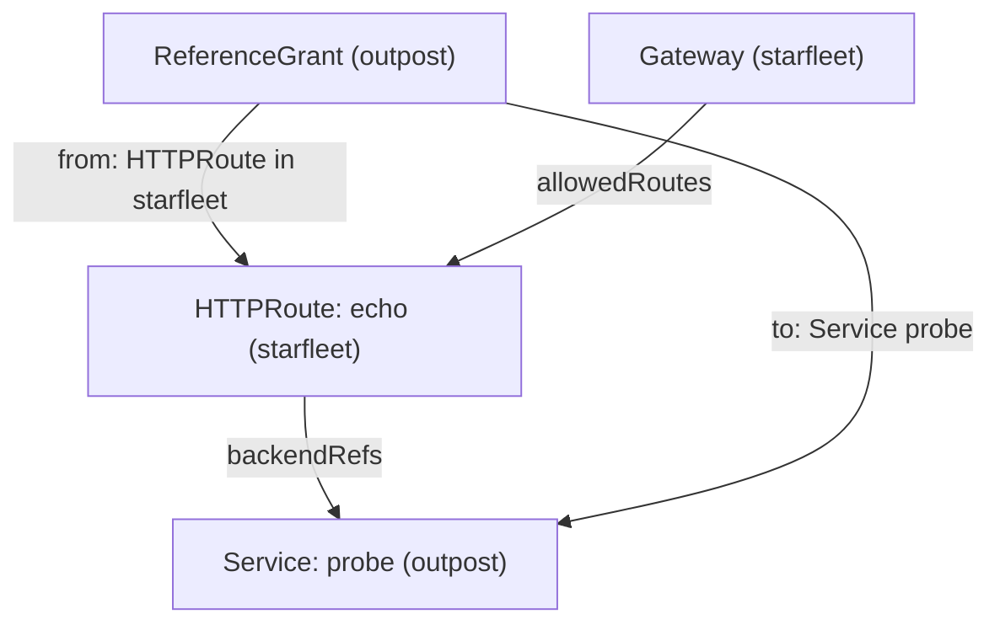
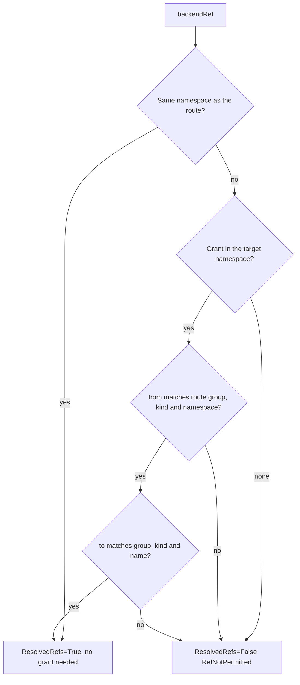

# Cross-Namespace Backends With ReferenceGrant

A route can name a Service in any namespace, and the API server accepts the YAML without a check. If that were enough, one team could send traffic to the Services of another team without asking. The Gateway API closes this gap with a second, independent permission: the Gateway listener authorises attachment through `allowedRoutes`, and the owner of a target Service authorises a cross-namespace backend reference through a **ReferenceGrant**, a namespaced object created in the target namespace. Opening one boundary leaves the other closed. This part crosses the boundary in both directions, reads the refusal each time, grants the permission, and takes it away again.



The diagram shows that the Gateway decides on the route, while the ReferenceGrant in the target namespace decides on the cross-namespace backend.

This part needs the Gateway `starfleet-gateway` in `starfleet`, with its listener `http` open to routes from `starfleet` and `outpost`, the `probe` Service in both namespaces, and the `GATEWAY` variable: set `GATEWAY=$(kubectl -n starfleet get gateway starfleet-gateway -o jsonpath='{.status.addresses[0].value}')` if you opened a new terminal.

## A backend in another namespace

A route in `starfleet` that names the `probe` Service in `outpost` crosses the namespace boundary.

<!-- astrona:playground:renew -->

Save this as `httproute-echo.yaml`:

```yaml
apiVersion: gateway.networking.k8s.io/v1
kind: HTTPRoute
metadata:
  name: echo
  namespace: starfleet
spec:
  parentRefs:
    - name: starfleet-gateway
  hostnames:
    - echo.starfleet.example
  rules:
    - backendRefs:
        - name: probe
          namespace: outpost
          port: 80
```

Apply it:

```sh
kubectl apply -f httproute-echo.yaml
```

Then check the result:

```sh
kubectl -n starfleet get httproute echo -o jsonpath='{range .status.parents[*].conditions[*]}{.type}={.status} {.reason}: {.message}{"\n"}{end}'
kubectl -n starfleet exec deploy/shuttle -- curl -s -i -H 'Host: echo.starfleet.example' http://$GATEWAY/get | head -1
```

You should see something like:

```text
Accepted=True Accepted: Route is accepted
ResolvedRefs=False RefNotPermitted: Failed to process route rule 0 backendRef 0: Backend ref to Service outpost/probe not permitted by any ReferenceGrant.
HTTP/1.1 500 Internal Server Error
```

The reason is `RefNotPermitted`: the Service exists, but nothing in `outpost` allows the reference. The route is attached, and the proxy answers `500` for the share of traffic that the unresolved backend would have received. Now give the permission from the `outpost` side.

Save this as `referencegrant-outpost.yaml`:

```yaml
apiVersion: gateway.networking.k8s.io/v1
kind: ReferenceGrant
metadata:
  name: allow-starfleet-routes
  namespace: outpost
spec:
  from:
    - group: gateway.networking.k8s.io
      kind: HTTPRoute
      namespace: starfleet
  to:
    - group: ""
      kind: Service
      name: probe
```

Apply it:

```sh
kubectl apply -f referencegrant-outpost.yaml
```

Then check the route again:

```sh
kubectl -n starfleet get httproute echo -o jsonpath='{range .status.parents[*].conditions[*]}{.type}={.status} {.reason}: {.message}{"\n"}{end}'
kubectl -n starfleet exec deploy/shuttle -- curl -s -i -H 'Host: echo.starfleet.example' http://$GATEWAY/get | head -1
```

You should see something like:

```text
Accepted=True Accepted: Route is accepted
ResolvedRefs=True ResolvedRefs: Resolved all the Object references for the Route
HTTP/1.1 200 OK
```

`ResolvedRefs` is `True`, and the request reaches the `probe` in `outpost`. The `to` list names one Service; without `name`, the grant would allow every Service in `outpost`. The group of a Service is the core group, written as an empty string. The ReferenceGrant is served as `v1` on this cluster's Gateway API version; older clusters only have `v1beta1`, so check with `kubectl api-resources | grep -i referencegrant`.

## How a grant is evaluated

The controller compares the referring object's group, kind and namespace with the entries in `from`, and the target object's group, kind and optional name with the entries in `to`. There must be a matching `from` entry and a matching `to` entry in one grant that lives in the target's namespace; entries within each list are alternatives. Additional grants add permissions, and there is no deny grant, so an unwanted reference stays allowed until every grant that permits it is removed.



The diagram shows that the grant is read from the target's side: the route's namespace must appear in `from`, and the Service must fit an entry in `to`.

`from` does not select individual route names: a grant allows any HTTPRoute in the named namespace. It does not select ports, pods or network connections either, so a NetworkPolicy can still block traffic after the reference is allowed. Cross-namespace attachment to a Gateway is the one exception: that uses the listener's `allowedRoutes`, not a ReferenceGrant. A backend Service in a different namespace needs a grant even when the route already uses that namespace's Gateway. Other cross-namespace references, such as a listener's certificate Secret, also need a grant in the target namespace.

## The reverse direction

A route in `outpost` is now allowed to attach, but that does not let it use the Services of `starfleet`. Permission depends on the **route's** namespace, so the grant in `outpost` that allows routes from `starfleet` describes the other direction and cannot help here.

Save this as `httproute-outpost-inspect.yaml`:

```yaml
apiVersion: gateway.networking.k8s.io/v1
kind: HTTPRoute
metadata:
  name: outpost-inspect
  namespace: outpost
spec:
  parentRefs:
    - name: starfleet-gateway
      namespace: starfleet
      sectionName: http
  hostnames:
    - inspect.starfleet.example
  rules:
    - backendRefs:
        - name: probe
          namespace: starfleet
          port: 80
```

Apply it:

```sh
kubectl apply -f httproute-outpost-inspect.yaml
```

Then check the result:

```sh
kubectl -n outpost get httproute outpost-inspect -o yaml
kubectl -n starfleet get referencegrants
kubectl -n starfleet get service probe
```

Look for `Accepted=True` and `ResolvedRefs=False` with `RefNotPermitted` in the route's status, and no ReferenceGrant in `starfleet`. The Gateway and the Service share a namespace, and that changes nothing: the referring route is in `outpost`.

Save this as `referencegrant-probe-inspect.yaml`:

```yaml
apiVersion: gateway.networking.k8s.io/v1
kind: ReferenceGrant
metadata:
  name: allow-outpost-probe
  namespace: starfleet
spec:
  from:
    - group: gateway.networking.k8s.io
      kind: HTTPRoute
      namespace: outpost
  to:
    - group: ""
      kind: Service
      name: probe
```

Apply it:

```sh
kubectl apply -f referencegrant-probe-inspect.yaml
```

Then check the result:

```sh
kubectl -n outpost get httproute outpost-inspect -o yaml
kubectl -n starfleet get gateway starfleet-gateway -o jsonpath='{.status.addresses[0].value}{"\n"}'
kubectl -n starfleet exec deploy/shuttle -- curl -sS -i -H 'Host: inspect.starfleet.example' http://$GATEWAY/headers
```

The route should report `ResolvedRefs=True`, and the response should contain the headers echoed by `probe` in `starfleet`. The controller re-checks the reference whenever a grant changes and updates the proxy configuration. ReferenceGrant has no status of its own in this version; the route's `ResolvedRefs` condition is the place to read the result. Remove the permission and inspect the route again:

```sh
kubectl -n starfleet delete referencegrant allow-outpost-probe
kubectl -n outpost get httproute outpost-inspect -o yaml
```

After reconciliation, `ResolvedRefs` should return to `False` with `RefNotPermitted`, unless another grant still permits the reference. The attachment stays accepted. Restore the permission by applying the saved grant file again if you want the route to keep serving.

You can now identify which namespace owns each permission and why acceptance alone does not authorise a backend. This distinction keeps repairs narrow: change the listener for attachment, and the target namespace's grant for the backend reference. Together, the two objects cover the whole path of a request from the entry point to a pod in any namespace.

## Common pitfalls

> [!WARNING]
> - **Creating the ReferenceGrant in the wrong namespace.** It lives in the namespace of the target Service, not of the route.
> - **Using the Gateway namespace as the source.** `from.namespace` names the namespace of the referring HTTPRoute.
> - **Granting too much.** Without `name` in the `to` list, the grant allows every Service of that kind in the namespace.
> - **Trying to deny with a second grant.** Grants are additive; remove every grant that permits an unwanted reference.
> - **Expecting a grant to bypass NetworkPolicy.** Object reference permission does not authorise network packets.
