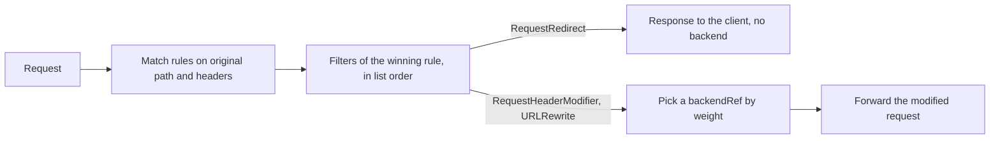

# Filters: Headers, Rewrites And Redirects

A public path often differs from the backend's path. Sending `/inspect/headers` unchanged to `probe` does not ask for its `/headers` endpoint, and a backend that expects a header the client never sends needs someone to add it. An HTTPRoute **filter** is an operation that runs after a rule has matched and before the request is forwarded, or that answers the client directly. This part writes one route with three filters, reads what the backend received, and states the rules the API enforces on filter combinations.

This part needs `starfleet-gateway` in `starfleet` with its listener `http`, the `probe` Service in the same namespace, and the `GATEWAY` variable: set `GATEWAY=$(kubectl -n starfleet get gateway starfleet-gateway -o jsonpath='{.status.addresses[0].value}')` if you opened a new terminal.

## Where a filter runs

The proxy matches the original request against the rules first. Then it applies the filters of the winning rule in the order they are listed, and only then does it pick a backend by weight and forward the modified request. A filter never changes which rule won, because matching is already over when it runs.



The diagram shows that header and path filters change what the backend receives, while a redirect ends the request at the proxy.

## Three filters on one route

<!-- astrona:playground:renew -->

Save this as `httproute-filters.yaml`:

```yaml
apiVersion: gateway.networking.k8s.io/v1
kind: HTTPRoute
metadata:
  name: filters
  namespace: starfleet
spec:
  parentRefs:
    - name: starfleet-gateway
      sectionName: http
  hostnames:
    - filters.starfleet.example
  rules:
    - matches:
        - path:
            type: PathPrefix
            value: /inspect
      filters:
        - type: RequestHeaderModifier
          requestHeaderModifier:
            set:
              - name: x-route-owner
                value: starfleet
            add:
              - name: x-route-tag
                value: inspected
            remove:
              - x-debug-token
        - type: URLRewrite
          urlRewrite:
            path:
              type: ReplacePrefixMatch
              replacePrefixMatch: /
      backendRefs:
        - name: probe
          port: 80
    - matches:
        - path:
            type: Exact
            value: /old-inspect
      filters:
        - type: RequestRedirect
          requestRedirect:
            path:
              type: ReplaceFullPath
              replaceFullPath: /inspect/headers
            statusCode: 302
```

Apply it:

```sh
kubectl apply -f httproute-filters.yaml
```

Then check the result:

```sh
kubectl -n starfleet get httproute filters -o yaml
kubectl -n starfleet get gateway starfleet-gateway -o jsonpath='{.status.addresses[0].value}{"\n"}'
kubectl -n starfleet exec deploy/shuttle -- curl -sS -H 'Host: filters.starfleet.example' -H 'x-route-owner: caller' -H 'x-debug-token: temporary' http://$GATEWAY/inspect/headers
kubectl -n starfleet exec deploy/shuttle -- curl -sS -i -H 'Host: filters.starfleet.example' http://$GATEWAY/old-inspect
```

In the first response, look for `X-Route-Owner` set to `starfleet`, `X-Route-Tag` containing `inspected`, and no `X-Debug-Token`. The successful echo comes from the `/headers` endpoint: the proxy replaced the matched prefix `/inspect` with `/`. In the second response, look for status `302` and a `Location` header ending in `/inspect/headers`. Do not use `curl -L` here; following the redirect would hide that first response.

## Header modification

`RequestHeaderModifier` has three operations. `set` replaces the value of a header, or creates it when the request has none. `add` appends a value to a header, keeping any value the client sent. `remove` deletes the named headers. Header names are case-insensitive. One header name may appear in only one operation of a filter: a filter that names the same header under `set` and `add`, or twice under `set`, is invalid. `ResponseHeaderModifier` has the same three operations and runs on the backend's response instead. Because matching uses the original headers, adding a canary header with this filter does not make the request select a different rule.

## Rewrites and redirects

`URLRewrite` changes the request that is forwarded upstream. The client keeps its original address and sees the backend's response. `ReplacePrefixMatch` replaces only the part of the path that the `PathPrefix` match covered and keeps the rest: with a prefix match of `/foo` and a replacement of `/xyz`, a request to `/foo/bar` becomes `/xyz/bar`. The API requires exactly one `PathPrefix` match in a rule that uses `ReplacePrefixMatch`. `ReplaceFullPath` replaces the entire path. A rewrite can also set `hostname`, which replaces the `Host` header that the backend receives.

`RequestRedirect` returns a response to the client; the request is not forwarded. The response carries a `Location` header built from the filter's `scheme`, `hostname`, `port` and `path`; each field that is empty is taken from the request. `statusCode` defaults to `302` and must be one of `301`, `302`, `303`, `307` or `308`. A redirect to `https` does not create a TLS (Transport Layer Security) listener or certificate; those must already exist if the new address is to serve traffic. A redirect rule has no `backendRefs`: the API rejects a rule that combines them.

The API also rejects a rule that combines `URLRewrite` and `RequestRedirect`, and a rule that repeats `RequestHeaderModifier`, `ResponseHeaderModifier`, `RequestRedirect`, `URLRewrite` or `CORS`, because those filters may appear only once per rule. `kubectl apply` reports those errors before the object is stored, so read the API server message first. A combination that passes the schema but that the controller cannot implement appears later in status: `Accepted=False` with the reason `IncompatibleFilters`, or `UnsupportedValue` for a field value the controller does not support. `RequestHeaderModifier` and `RequestRedirect` are core features that every conformant controller implements; `ResponseHeaderModifier`, `URLRewrite`, `RequestMirror` and `CORS` are extended, so check the controller's conformance report before relying on them elsewhere.

A filter can also be listed under one `backendRef` instead of the rule. A rule-level filter applies to every request that matches the rule; a backend-level filter applies only when that backend is chosen, where the implementation supports it.

You can now distinguish a client-visible redirect from an upstream rewrite, and explain why a filter never changes rule selection. Fresh conditions and a response that exposes the changed path or header together give stronger evidence than either one alone.

## Common pitfalls

> [!WARNING]
> - **Using `curl -L` to inspect a redirect.** Read the first status and `Location` before following it.
> - **Rewriting a prefix on an `Exact` match.** `ReplacePrefixMatch` requires exactly one `PathPrefix` match in the rule.
> - **Naming one header in two operations.** A header may appear under `set`, `add` or `remove`, never under two of them.
> - **Adding a header to steer matching.** Filters run after the rule is chosen; the original request decides the rule.
