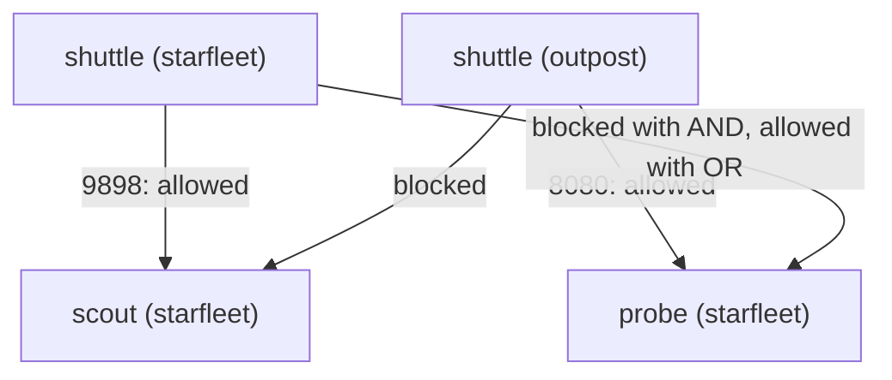

# Allowing Flows With Pod And Namespace Selectors

A default deny closes a namespace. Real workloads still need some traffic: the client must reach the API, and another team may need one service. This part opens single flows again, one policy at a time. It uses `podSelector` for pods in the same namespace, `namespaceSelector` for pods in another namespace, and `ports` to limit the flow to one port. It ends with the most common NetworkPolicy mistake on the exam.

## The parts of an ingress rule

Each item in `spec.ingress` is one rule with two optional fields. `from` lists the allowed sources, and `ports` lists the allowed destination ports on the selected pods. A packet is allowed when it matches any source in `from` and any port in `ports`. A source can be one of three kinds:

- `podSelector`: pods with these labels, in the policy's own namespace.
- `namespaceSelector`: all pods in the namespaces with these labels.
- `ipBlock`: a range of IP addresses in CIDR notation, with optional `except` ranges, mainly for traffic from outside the cluster.

## One flow from the client to scout

The `shuttle` pod should reach `scout`, and nothing else should. The `scout` Service listens on port `80` and forwards to container port `9898`. A first attempt often uses the Service port.

<!-- astrona:playground:renew -->

Save this as `networkpolicy-scout-allow-shuttle.yaml`:

```yaml
apiVersion: networking.k8s.io/v1
kind: NetworkPolicy
metadata:
  name: scout-allow-shuttle
  namespace: starfleet
spec:
  podSelector:
    matchLabels:
      app: scout
  policyTypes:
    - Ingress
  ingress:
    - from:
        - podSelector:
            matchLabels:
              app: shuttle
      ports:
        - protocol: TCP
          port: 80
```

Apply it:

```sh
kubectl apply -f networkpolicy-scout-allow-shuttle.yaml
```

Then check the result:

```sh
kubectl -n starfleet exec deploy/shuttle -- curl -sS -m 3 http://scout/version
```

You should see something like:

```text
curl: (28) Connection timed out after 3001 milliseconds
command terminated with exit code 28
```

The request still times out. The Service changes the destination to the pod's IP address and port `9898` before the packet reaches the pod, and the network plugin checks the policy against that pod port. Ports in a NetworkPolicy are always the pod's ports, never the Service's ports. Change `port: 80` to `port: 9898` in `networkpolicy-scout-allow-shuttle.yaml`:

```yaml
apiVersion: networking.k8s.io/v1
kind: NetworkPolicy
metadata:
  name: scout-allow-shuttle
  namespace: starfleet
spec:
  podSelector:
    matchLabels:
      app: scout
  policyTypes:
    - Ingress
  ingress:
    - from:
        - podSelector:
            matchLabels:
              app: shuttle
      ports:
        - protocol: TCP
          port: 9898
```

Apply it again:

```sh
kubectl apply -f networkpolicy-scout-allow-shuttle.yaml
```

Then check the allowed flow and two flows that must stay blocked, from `outpost` to `scout` and from `shuttle` to `probe`:

```sh
kubectl -n starfleet exec deploy/shuttle -- curl -sS -m 3 http://scout/version
kubectl -n outpost exec deploy/shuttle -- curl -sS -m 3 http://scout.starfleet/version
kubectl -n starfleet exec deploy/shuttle -- curl -sS -m 3 -o /dev/null -w '%{http_code}\n' http://probe/get
```

You should see something like:

```text
{
  "commit": "dd507173b7b75b2312a36cabe0de5f09c1ce69c8",
  "version": "6.15.0"
}
curl: (28) Connection timed out after 3002 milliseconds
command terminated with exit code 28
curl: (28) Connection timed out after 3001 milliseconds
000
command terminated with exit code 28
```

Only the one flow works. The `shuttle` in `outpost` has the same label `app: shuttle`, but it is still blocked: a `podSelector` without a `namespaceSelector` only matches pods in the policy's own namespace. And `probe` stays closed, because no policy that selects `probe` allows anything yet.

## A flow from another namespace

The team in `outpost` needs its `shuttle` to reach `probe` in `starfleet`. The source is in another namespace, so the rule needs a `namespaceSelector`. Every namespace has the label `kubernetes.io/metadata.name` with its own name, set by Kubernetes, so the selector can name the namespace directly. The rule below puts the namespace selector and a pod selector in **one** item of `from`.

Save this as `networkpolicy-probe-allow-outpost.yaml`:

```yaml
apiVersion: networking.k8s.io/v1
kind: NetworkPolicy
metadata:
  name: probe-allow-outpost
  namespace: starfleet
spec:
  podSelector:
    matchLabels:
      app: probe
  policyTypes:
    - Ingress
  ingress:
    - from:
        - namespaceSelector:
            matchLabels:
              kubernetes.io/metadata.name: outpost
          podSelector:
            matchLabels:
              app: shuttle
      ports:
        - protocol: TCP
          port: 8080
```

Apply it:

```sh
kubectl apply -f networkpolicy-probe-allow-outpost.yaml
```

Then send a request from each `shuttle` and read the policy back:

```sh
kubectl -n outpost exec deploy/shuttle -- curl -sS -m 3 -o /dev/null -w '%{http_code}\n' http://probe.starfleet/get
kubectl -n starfleet exec deploy/shuttle -- curl -sS -m 3 -o /dev/null -w '%{http_code}\n' http://probe/get
kubectl -n starfleet describe networkpolicy probe-allow-outpost | sed -n '/^Spec:/,$p'
```

You should see something like:

```text
200
curl: (28) Connection timed out after 3002 milliseconds
000
command terminated with exit code 28
Spec:
  PodSelector:     app=probe
  Allowing ingress traffic:
    To Port: 8080/TCP
    From:
      NamespaceSelector: kubernetes.io/metadata.name=outpost
      PodSelector: app=shuttle
  Not affecting egress traffic
  Policy Types: Ingress
```

The `shuttle` in `outpost` gets `200`, and the `shuttle` in `starfleet` is blocked. `kubectl describe` shows one `From:` block with both selectors in it: the source must be in `outpost` **and** carry `app: shuttle`.

## AND versus OR in the from list

Now move the pod selector into its own item. The only change is one dash in front of `podSelector`, which makes it a second item of the `from` list.

Save this as `networkpolicy-probe-allow-outpost-or.yaml`:

```yaml
apiVersion: networking.k8s.io/v1
kind: NetworkPolicy
metadata:
  name: probe-allow-outpost
  namespace: starfleet
spec:
  podSelector:
    matchLabels:
      app: probe
  policyTypes:
    - Ingress
  ingress:
    - from:
        - namespaceSelector:
            matchLabels:
              kubernetes.io/metadata.name: outpost
        - podSelector:
            matchLabels:
              app: shuttle
      ports:
        - protocol: TCP
          port: 8080
```

Apply it. It has the same name, so it replaces the policy you applied before:

```sh
kubectl apply -f networkpolicy-probe-allow-outpost-or.yaml
```

Then send the same two requests and read the policy back:

```sh
kubectl -n outpost exec deploy/shuttle -- curl -sS -m 3 -o /dev/null -w '%{http_code}\n' http://probe.starfleet/get
kubectl -n starfleet exec deploy/shuttle -- curl -sS -m 3 -o /dev/null -w '%{http_code}\n' http://probe/get
kubectl -n starfleet describe networkpolicy probe-allow-outpost | sed -n '/^Spec:/,$p'
```

You should see something like:

```text
200
200
Spec:
  PodSelector:     app=probe
  Allowing ingress traffic:
    To Port: 8080/TCP
    From:
      NamespaceSelector: kubernetes.io/metadata.name=outpost
    From:
      PodSelector: app=shuttle
  Not affecting egress traffic
  Policy Types: Ingress
```

Now both requests succeed, and `kubectl describe` shows two `From:` blocks. Two items are ORed: **any** pod in `outpost`, **or** any pod with `app: shuttle` in `starfleet`. That is much more than the task asked for. On the exam, read the indentation of every `from` list twice, and confirm with `kubectl describe`.



The diagram shows the flows in `starfleet` after these policies: one item with both selectors keeps the `starfleet` client away from `probe`, two items let it in.

Put the AND form back before you go on:

```sh
kubectl apply -f networkpolicy-probe-allow-outpost.yaml
```

You can now allow one flow by pod labels, by namespace, and by pod port, and you can tell an AND rule from an OR rule by its indentation and by `kubectl describe`. All of this controlled traffic coming in. The open question is the other direction: what happens when a namespace also blocks traffic going out.

## Common pitfalls

> [!WARNING]
> - **Using the Service port.** NetworkPolicy ports are the pod's container ports (`9898`), not the Service port (`80`).
> - **Expecting `podSelector` to match other namespaces.** Without `namespaceSelector`, it only selects pods in the policy's own namespace.
> - **One dash too many.** `namespaceSelector` and `podSelector` in one item mean AND; as two items they mean OR.
> - **Inventing namespace labels.** Use `kubernetes.io/metadata.name`, which every namespace already has.
