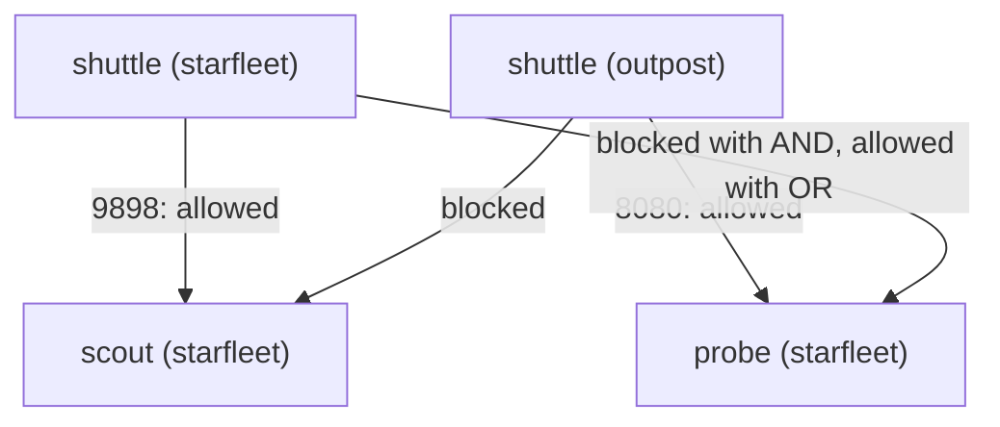
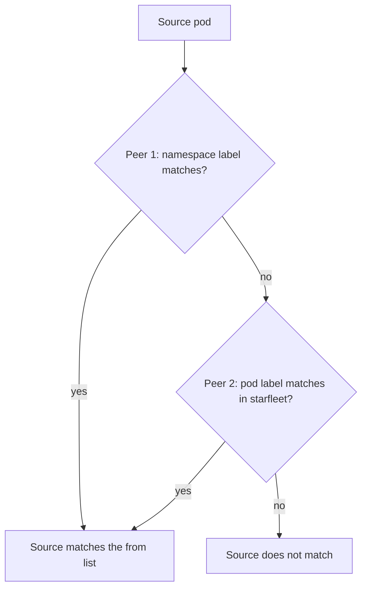

# One Peer Or Two: Selector Scope

The `probe-allow-outpost` policy admits exactly one source: the `shuttle` pod in `outpost`. One extra dash in that policy admits every pod in `outpost` and every `shuttle` in `starfleet` as well, and the file still looks almost the same. A **peer** is one entry in a `from` or `to` list, and the indentation decides whether two selectors describe one peer or two alternatives. This part makes that mistake on purpose, reads it back with `kubectl describe`, and then states how far each empty selector reaches.

## AND versus OR in the from list

Move the pod selector into its own item. The only change is one dash in front of `podSelector`, which makes it a second item of the `from` list.

<!-- astrona:playground:renew -->

Save this as `networkpolicy-probe-allow-outpost-or.yaml`:

```yaml
apiVersion: networking.k8s.io/v1
kind: NetworkPolicy
metadata:
  name: probe-allow-outpost
  namespace: starfleet
spec:
  podSelector:
    matchLabels:
      app: probe
  policyTypes:
    - Ingress
  ingress:
    - from:
        - namespaceSelector:
            matchLabels:
              kubernetes.io/metadata.name: outpost
        - podSelector:
            matchLabels:
              app: shuttle
      ports:
        - protocol: TCP
          port: 8080
```

Apply it. It has the same name, so it replaces the policy you applied before:

```sh
kubectl apply -f networkpolicy-probe-allow-outpost-or.yaml
```

Then send the same two requests and read the policy back:

```sh
kubectl -n outpost exec deploy/shuttle -- curl -sS -m 3 -o /dev/null -w '%{http_code}\n' http://probe.starfleet/get
kubectl -n starfleet exec deploy/shuttle -- curl -sS -m 3 -o /dev/null -w '%{http_code}\n' http://probe/get
kubectl -n starfleet describe networkpolicy probe-allow-outpost | sed -n '/^Spec:/,$p'
```

You should see something like:

```text
200
200
Spec:
  PodSelector:     app=probe
  Allowing ingress traffic:
    To Port: 8080/TCP
    From:
      NamespaceSelector: kubernetes.io/metadata.name=outpost
    From:
      PodSelector: app=shuttle
  Not affecting egress traffic
  Policy Types: Ingress
```

Now both requests succeed, and `kubectl describe` shows two `From:` blocks. Two items are ORed: **any** pod in `outpost`, **or** any pod with `app: shuttle` in `starfleet`. That is much more than the task asked for. On the exam, read the indentation of every `from` list twice, and confirm with `kubectl describe`.



The diagram shows the flows in `starfleet` after these policies: one item with both selectors keeps the `starfleet` client away from `probe`, two items let it in.

Put the AND form back before you go on:

```sh
kubectl apply -f networkpolicy-probe-allow-outpost.yaml
```

The mechanism behind the two results is short. Inside one peer, every selector present must match the same source pod: a `namespaceSelector` tests the labels of the pod's namespace, a `podSelector` tests the pod's labels, and the pod must pass both. Between peers of one `from` list, any one match is enough. A `podSelector` that stands alone in a peer only looks at the policy's own namespace, which is why the second peer above admits the `starfleet` `shuttle` and not a pod with the same label elsewhere.



The diagram walks the OR form: the source passes as soon as one peer accepts it, and each peer is tested on its own.

## How far an empty selector reaches

The empty selector `{}` matches everything within its scope, and the scope depends on where the selector stands. These are the four places you meet it:

| Field | Meaning |
| --- | --- |
| `spec.podSelector: {}` | Every pod in the policy's namespace |
| Peer `podSelector: {}` alone | Every pod in the policy's namespace |
| Peer `namespaceSelector: {}` alone | Every pod in every namespace |
| Namespace selector plus `podSelector: {}` in one peer | Every pod in the selected namespaces |

The list itself has three shapes with three meanings. An empty rule, `ingress: [{}]`, is one rule with no `from` and no `ports`, and it allows every source on every port. An empty list, `ingress: []`, has no rule at all and grants nothing; together with `policyTypes` it is the shape of a default deny. An omitted `from` leaves the source unrestricted and an omitted `ports` leaves the port unrestricted, so a rule with only `ports` allows that port from everywhere.

A `namespaceSelector: {}` on its own is the most common surprise. It reads as "this namespace" but means "all namespaces", including `kube-system`. To mean one namespace, select it by its `kubernetes.io/metadata.name` label, which every namespace carries. Check what you wrote with `kubectl describe networkpolicy`: a `From:` block that prints `NamespaceSelector: <none>` is an empty namespace selector.

You can now tell one peer from two by its indentation, predict the reach of each empty selector, and read the difference between no rule and an empty rule. Every policy so far controlled traffic coming in. The open question is the other direction: what happens when a namespace also blocks traffic going out.

## Common pitfalls

> [!WARNING]
> - **One dash too many.** `namespaceSelector` and `podSelector` in one item mean AND; as two items they mean OR.
> - **Using an empty namespace selector for one namespace.** It matches every namespace; select by `kubernetes.io/metadata.name`.
> - **Confusing `ingress: [{}]` with `ingress: []`.** The first allows everything; the second allows nothing.
> - **Trusting the file instead of the stored object.** `kubectl describe` prints one `From:` block per peer, so count the blocks.
