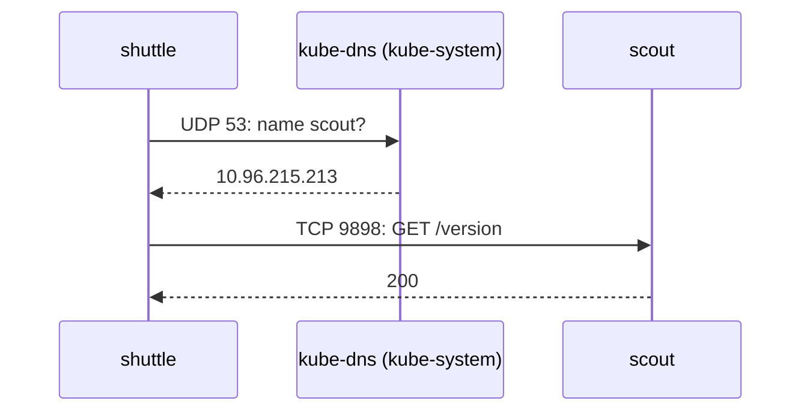

# Egress Rules And DNS

Ingress policies protect a pod from its callers. Egress policies limit where a pod may send requests, which matters when a pod is compromised and tries to reach other services or the internet. A namespace with a default deny in both directions is the usual starting point for a tenant. This part adds the egress half, shows the first thing that breaks, and opens exactly the outgoing traffic the client needs.

## A default deny for outgoing traffic

The egress default deny looks like the ingress one, with `Egress` as the policy type.

<!-- astrona:playground:renew -->

Save this as `networkpolicy-default-deny-egress.yaml`:

```yaml
apiVersion: networking.k8s.io/v1
kind: NetworkPolicy
metadata:
  name: default-deny-egress
  namespace: starfleet
spec:
  podSelector: {}
  policyTypes:
    - Egress
```

Apply it:

```sh
kubectl apply -f networkpolicy-default-deny-egress.yaml
```

Then send a request from `shuttle` to `scout`, which worked a minute ago, and one to `probe` in `outpost`:

```sh
kubectl -n starfleet exec deploy/shuttle -- curl -sS -m 5 http://scout/version
kubectl -n starfleet exec deploy/shuttle -- curl -sS -m 5 http://probe.outpost/get
```

You should see something like:

```text
curl: (28) Resolving timed out after 5000 milliseconds
command terminated with exit code 28
curl: (28) Resolving timed out after 5002 milliseconds
command terminated with exit code 28
```

Read the message closely: `Resolving timed out`, not `Connection timed out`. The requests failed before they were sent. To turn the name `scout` into an IP address, the pod asks the cluster DNS (Domain Name System) server, CoreDNS, which runs in `kube-system` behind the Service `kube-dns`. That DNS query is egress traffic too, and the default deny drops it.

The two default denies can also be one object: `podSelector: {}` with `policyTypes: [Ingress, Egress]` and no rules isolates every pod in both directions at once. Two separate objects, as in this namespace, behave the same and are easier to remove one at a time.

Find the resolver the pod uses and the pods that answer for it before you write the rule:

```sh
kubectl -n starfleet exec deploy/shuttle -- cat /etc/resolv.conf
kubectl -n kube-system get service kube-dns -o wide
kubectl -n kube-system get pods -l k8s-app=kube-dns --show-labels
```

Look for the `nameserver` line in `resolv.conf`, which carries the ClusterIP address of the `kube-dns` Service, and for ready CoreDNS pods with the label `k8s-app=kube-dns`. The egress rule must select those pods: a NetworkPolicy matches the pod that finally receives the packet, not the Service address in front of it. A cluster that runs a node-local DNS cache sends queries to a different resolver, so the rule there must select whatever `resolv.conf` points at; this playground has no such cache.



The diagram shows that one request by name is two connections, and that each one needs its own egress allow while both replies come back for free.

## The DNS egress rule

Every namespace with an egress default deny needs a rule that allows DNS. DNS uses port 53, mostly over UDP (User Datagram Protocol), and over TCP (Transmission Control Protocol) for answers too large for one UDP packet or after a truncated response, so allow both. The rule below allows every pod in `starfleet` to reach the CoreDNS pods, and only on port 53.

Save this as `networkpolicy-allow-dns.yaml`:

```yaml
apiVersion: networking.k8s.io/v1
kind: NetworkPolicy
metadata:
  name: allow-dns
  namespace: starfleet
spec:
  podSelector: {}
  policyTypes:
    - Egress
  egress:
    - to:
        - namespaceSelector:
            matchLabels:
              kubernetes.io/metadata.name: kube-system
          podSelector:
            matchLabels:
              k8s-app: kube-dns
      ports:
        - protocol: UDP
          port: 53
        - protocol: TCP
          port: 53
```

Apply it:

```sh
kubectl apply -f networkpolicy-allow-dns.yaml
```

Then check that names resolve again, and try the request to `scout`:

```sh
kubectl -n starfleet exec deploy/shuttle -- nslookup scout.starfleet.svc.cluster.local
kubectl -n starfleet exec deploy/shuttle -- curl -sS -m 3 http://scout/version
```

You should see something like:

```text
Server:		10.96.0.10
Address:	10.96.0.10:53

Name:	scout.starfleet.svc.cluster.local
Address: 10.96.215.213

curl: (28) Connection timed out after 3001 milliseconds
command terminated with exit code 28
```

DNS works: `nslookup` gets the Service's IP address from `10.96.0.10`, the `kube-dns` Service. The request to `scout` now fails later, with `Connection timed out`. The name resolves, but the connection itself is egress traffic that no policy allows. The egress rule uses the same AND form as before: one item with a namespace selector and a pod selector, so only the DNS pods in `kube-system` are reachable. Split into two items, it would open port 53 to every pod in `kube-system` and to every local pod labelled `k8s-app=kube-dns`.

## Opening one outgoing flow

The `shuttle` pod needs to reach `scout` and nothing else. The egress rule names the destination pods with `to` and, as for ingress, the pod's container port `9898`.

Save this as `networkpolicy-shuttle-egress.yaml`:

```yaml
apiVersion: networking.k8s.io/v1
kind: NetworkPolicy
metadata:
  name: shuttle-egress
  namespace: starfleet
spec:
  podSelector:
    matchLabels:
      app: shuttle
  policyTypes:
    - Egress
  egress:
    - to:
        - podSelector:
            matchLabels:
              app: scout
      ports:
        - protocol: TCP
          port: 9898
```

Apply it:

```sh
kubectl apply -f networkpolicy-shuttle-egress.yaml
```

Then check the allowed flow, a flow that must stay blocked, and a flow into `starfleet` from the other namespace:

```sh
kubectl -n starfleet exec deploy/shuttle -- curl -sS -m 3 http://scout/version
kubectl -n starfleet exec deploy/shuttle -- curl -sS -m 3 -o /dev/null -w '%{http_code}\n' http://probe.outpost/get
kubectl -n outpost exec deploy/shuttle -- curl -sS -m 3 -o /dev/null -w '%{http_code}\n' http://probe.starfleet/get
```

You should see something like:

```text
{
  "commit": "dd507173b7b75b2312a36cabe0de5f09c1ce69c8",
  "version": "6.15.0"
}
curl: (28) Connection timed out after 3001 milliseconds
000
command terminated with exit code 28
200
```

The request to `scout` passes two checks: egress out of `shuttle` (allowed by `shuttle-egress`) and ingress into `scout` (allowed by `scout-allow-shuttle`). A flow between two isolated pods always needs both. The request to `outpost` stays blocked. The request from `outpost` into `probe` still works, even though `probe` is now isolated for egress: the answer belongs to a connection that the ingress rule allowed, and replies are always allowed.

## Reading the full set

List every policy in the namespace with its selector and direction:

```sh
kubectl -n starfleet get networkpolicy -o custom-columns=NAME:.metadata.name,POD-SELECTOR:.spec.podSelector.matchLabels,TYPES:.spec.policyTypes
```

You should see something like:

```text
NAME                   POD-SELECTOR       TYPES
allow-dns              <none>             [Egress]
default-deny-egress    <none>             [Egress]
default-deny-ingress   <none>             [Ingress]
probe-allow-outpost    map[app:probe]     [Ingress]
scout-allow-shuttle    map[app:scout]     [Ingress]
shuttle-egress         map[app:shuttle]   [Egress]
```

To find what controls one pod, take every row whose selector is `<none>` (all pods) or matches the pod's labels, and split them by direction. For `shuttle`, egress is decided by `default-deny-egress`, `allow-dns` and `shuttle-egress`, and ingress by `default-deny-ingress` alone. This short table is the fastest way to diagnose a blocked request.

You can now isolate a namespace in both directions, restore DNS with an egress rule to `kube-dns` on port 53 over UDP and TCP, and open single outgoing flows. With the ingress rules, that is a complete least-privilege setup for one namespace: deny everything, then allow each flow by name, namespace and port. Every port so far was a number; the open question is what a named port and an address range add to a rule.

## Common pitfalls

> [!WARNING]
> - **Forgetting DNS.** An egress default deny breaks name lookups first; `Resolving timed out` points at a missing port 53 rule.
> - **Allowing only UDP for DNS.** Large DNS answers switch to TCP; allow port 53 on both protocols.
> - **Opening only one side.** Between two isolated pods, the sender needs an egress rule and the receiver an ingress rule.
> - **Writing rules for replies.** Return traffic of an allowed connection is always allowed; do not open extra ports for it.
> - **Selecting the DNS Service instead of its pods.** The rule matches the CoreDNS pods by label; read `resolv.conf` and `kube-dns` to find which pods answer.
