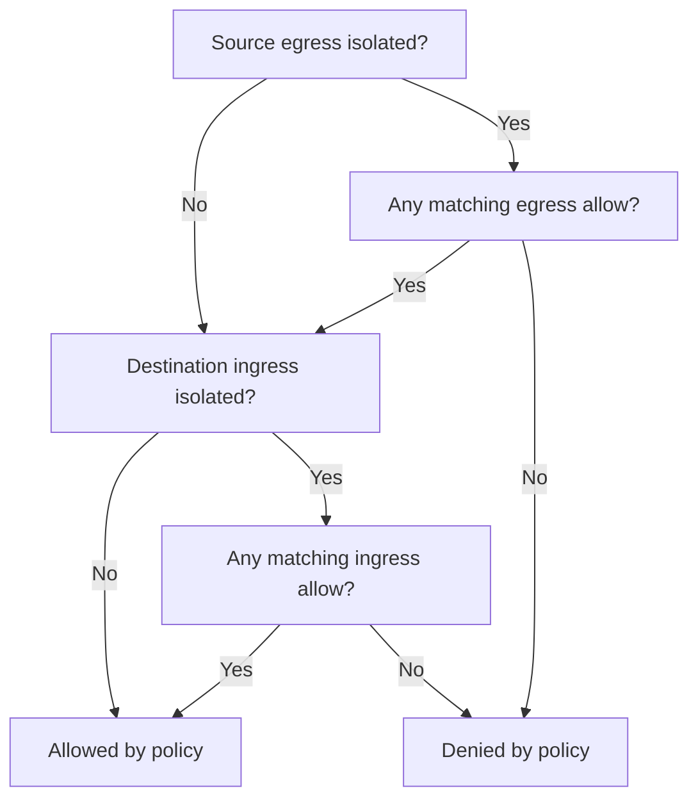

# How Policies Combine

A default-deny policy can exist while an unwanted request still succeeds. For example, a broad allow policy can keep `outpost` reaching `scout` even after you add a narrower policy. A NetworkPolicy is a namespaced object that lists allowed connections for selected Pods. To explain a result, collect every policy that selects each endpoint, then evaluate each direction separately.

<!-- astrona:playground:renew -->

Save this as `networkpolicy-scout-observers.yaml`:

```yaml
apiVersion: networking.k8s.io/v1
kind: NetworkPolicy
metadata:
  name: scout-observers
  namespace: starfleet
spec:
  podSelector:
    matchLabels:
      app: scout
  policyTypes: [Ingress]
  ingress:
    - from:
        - namespaceSelector:
            matchLabels:
              kubernetes.io/metadata.name: outpost
      ports:
        - protocol: TCP
          port: 9898
```

Apply it:

```sh
kubectl apply -f networkpolicy-scout-observers.yaml
```

Then check the result:

```sh
kubectl -n outpost exec deploy/shuttle -- curl -fsS --max-time 3 http://scout.starfleet/version
kubectl -n starfleet get networkpolicy -o yaml
kubectl -n starfleet get pods --show-labels
```

Look for a version response. Compare `scout`'s labels with every policy's `spec.podSelector`. The `scout-observers` policy adds a source; an existing empty ingress list does not cancel it. The request also needs permission to leave its source, but `outpost` starts without egress restrictions.

## Isolation and the union of allows

Ingress means connections entering a Pod; egress means connections leaving it. A Pod is isolated for a direction only if at least one NetworkPolicy selects it and lists that direction in `policyTypes`. An ingress-only policy leaves egress unchanged. Set `policyTypes` explicitly, especially for an empty egress policy: otherwise an object without egress rules defaults to ingress isolation.

For an isolated direction, take the union of all allowed traffic from selecting policies. A union includes anything allowed by any member. Within a rule, the peer and the destination port must both match. Different rules and different policies add alternatives. There is no priority, deny action or first-match order in this API.

A default deny establishes isolation with no allowed connections of its own. It cannot subtract a connection that another policy allows. To remove an unwanted permission, change or remove every rule that grants it. Creating a second, narrower policy leaves the broad permission in place.



The diagram evaluates a new Pod-to-Pod connection after resolving its destination; both directions must permit it, and permission does not prove that the server is listening.

## What proves enforcement

The API server stores the object. The network plugin watches policies and endpoint labels, then updates packet filtering on the nodes. This playground uses kindnet with NetworkPolicy enforcement; the section's lab and capstone use the same default plugin. These exercises use ordinary Pods and TCP (Transmission Control Protocol) or UDP (User Datagram Protocol) ports. They do not depend on Calico-specific policy kinds, ordered rules or application-level filtering.

A Kubernetes 1.35 NetworkPolicy has no enforcement `status.conditions`. A successful apply proves API acceptance only. `kubectl describe networkpolicy` explains the stored rules; it does not prove that node filtering has converged. Use a fresh connection after a change, allow time for reconciliation, and repeat the test. Do not expect a Kubernetes Event for each dropped packet.

You can now reason about all selecting policies instead of looking for a single policy to blame. Once both directions permit the connection, the next question is whether the peer selectors describe exactly the intended Pods.

## Common pitfalls

> [!WARNING]
> - **Adding a narrower allow beside a broad one.** The broad permission remains until you change it.
> - **Omitting `Egress` on an empty policy.** List both directions when you intend isolation in both.
> - **Treating API acceptance as enforcement.** Test a fresh connection from an ordinary Pod; node-local and host-network traffic have different considerations.
