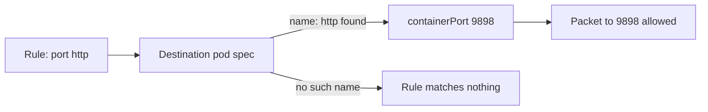
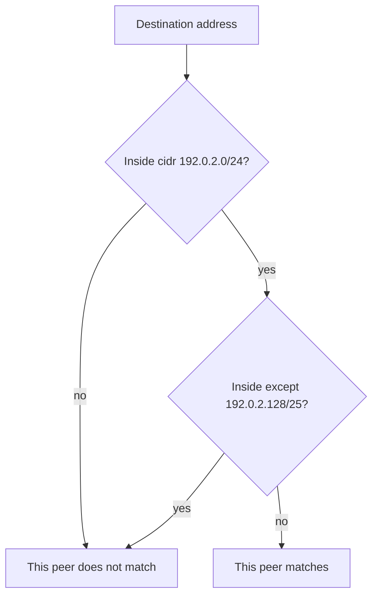

# Named Ports And Address Ranges

Every rule so far named a port by number. A rule can also name a port by the name the container gives it, and a peer can be an address range instead of a set of pods. Both look simple and both hide a boundary: a named port resolves on the receiving pod, not on the Service, and an `except` list removes addresses from one allow without denying them anywhere else. This part applies one example of each and reads the stored object back.

## A named port resolves on the receiving pod

A monitoring client in `outpost` should reach `scout` on its HTTP port. The `scout` Deployment names its container port `http`, so the policy can use that name instead of `9898`.

<!-- astrona:playground:renew -->

Save this as `networkpolicy-scout-allow-outpost-shuttle.yaml`:

```yaml
apiVersion: networking.k8s.io/v1
kind: NetworkPolicy
metadata:
  name: scout-allow-outpost-shuttle
  namespace: starfleet
spec:
  podSelector:
    matchLabels:
      app: scout
  policyTypes: [Ingress]
  ingress:
    - from:
        - namespaceSelector:
            matchLabels:
              kubernetes.io/metadata.name: outpost
          podSelector:
            matchLabels:
              app: shuttle
      ports:
        - protocol: TCP
          port: http
```

Apply it:

```sh
kubectl apply -f networkpolicy-scout-allow-outpost-shuttle.yaml
```

Then check the result:

```sh
kubectl -n starfleet describe networkpolicy scout-allow-outpost-shuttle
kubectl -n starfleet get deploy scout -o yaml
kubectl -n outpost exec deploy/shuttle -- curl -fsS --max-time 3 http://scout.starfleet/version
```

Look for both selectors in one `From:` block, for `name: http` next to `containerPort: 9898` in the Deployment's pod template, and for a version answer from `scout`. The `outpost` client has no egress policy, so the only check on this request is the ingress of `scout`, and the new policy allows it.

The name `http` is resolved by the network plugin against the declared container ports of the destination pod. It is not a Service port name and not the client's source port. The resolution works the same for an egress rule: a named port in `to` is looked up on the pod the packet goes to. When the receiving pod declares no port with that name, the rule matches nothing, and the request times out as if the rule did not exist. Use a numeric port when the receiver does not declare a matching name.



The diagram shows that the plugin turns the name into a number on the destination pod before it compares the packet.

## Address ranges and exclusions

An `ipBlock` matches an IP (Internet Protocol) address range in CIDR (Classless Inter-Domain Routing) notation, such as `192.0.2.0/24`. Its `except` list subtracts smaller ranges from that one peer. An `ipBlock` is the right peer for addresses outside the cluster; pod labels remain the better choice for pods, because pod addresses change on every replacement.

Save this as `networkpolicy-shuttle-address-range.yaml`:

```yaml
apiVersion: networking.k8s.io/v1
kind: NetworkPolicy
metadata:
  name: shuttle-address-range
  namespace: starfleet
spec:
  podSelector:
    matchLabels:
      app: shuttle
  policyTypes: [Egress]
  egress:
    - to:
        - ipBlock:
            cidr: 192.0.2.0/24
            except:
              - 192.0.2.128/25
      ports:
        - protocol: TCP
          port: 443
```

Apply it:

```sh
kubectl apply -f networkpolicy-shuttle-address-range.yaml
```

Then check the stored boundaries and remove this example permission:

```sh
kubectl -n starfleet describe networkpolicy shuttle-address-range
kubectl -n starfleet delete networkpolicy shuttle-address-range
```

The documentation address range is not a live server in this playground. Look for the enclosing range and the exclusion in the description; this checks interpretation, not external connectivity. The API server enforces two shape rules: every `except` range must be inside `cidr`, and an `ipBlock` cannot share a peer entry with a pod or namespace selector. A peer is either a set of pods or an address range, never both.

An exclusion is not a global deny. The `except` list only shrinks this one allow: a different peer, rule or policy can still allow an excluded address. Address translation around Services can also change which source address a plugin sees, so do not assume that matching external addresses behaves the same on every cluster.



The diagram shows that `except` is tested after `cidr` and only decides whether this peer matches, not whether the packet is dropped.

You can now use a named port and say where it resolves, and write an address range with an exclusion and say what it does not do. The `scout` pod now has two ingress policies, one for each `shuttle`. The open question is what happens when a third, broader policy lands beside them.

## Common pitfalls

> [!WARNING]
> - **Naming a Service port in a policy.** A named policy port resolves on the receiving pod, not on the Service.
> - **Naming a port the receiver does not declare.** The rule matches nothing and the request times out.
> - **Treating `except` as a deny rule.** It only removes addresses from that one `ipBlock` allow.
> - **Mixing `ipBlock` with a selector in one peer.** The API server rejects it; use two peers.
