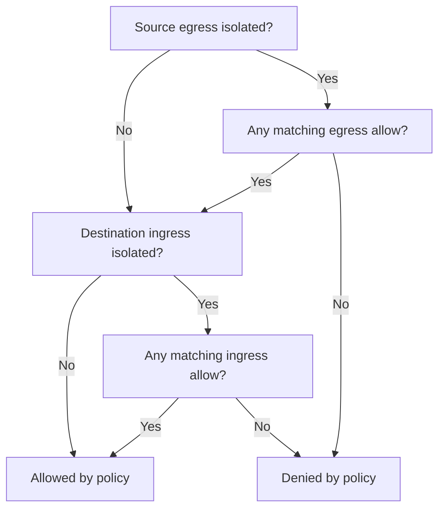
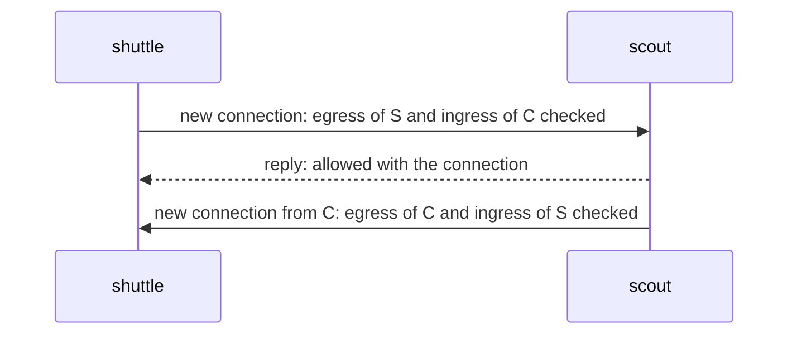

# How Policies Combine

A default-deny policy can exist while an unwanted request still succeeds. The usual cause is a broad allow policy that nobody removed: it keeps every pod in `outpost` reaching `scout` even after a narrower policy for one client was added beside it. To explain any result, collect every policy that selects each endpoint, then evaluate each direction on its own. This part adds such a broad policy, reads the whole set, and states the rule that joins them.

## A broad allow beside a narrow one

The `scout` pod already accepts the `shuttle` in `outpost` through `scout-allow-outpost-shuttle`. Suppose a second team adds a policy that admits the whole `outpost` namespace.

<!-- astrona:playground:renew -->

Save this as `networkpolicy-scout-observers.yaml`:

```yaml
apiVersion: networking.k8s.io/v1
kind: NetworkPolicy
metadata:
  name: scout-observers
  namespace: starfleet
spec:
  podSelector:
    matchLabels:
      app: scout
  policyTypes: [Ingress]
  ingress:
    - from:
        - namespaceSelector:
            matchLabels:
              kubernetes.io/metadata.name: outpost
      ports:
        - protocol: TCP
          port: 9898
```

Apply it:

```sh
kubectl apply -f networkpolicy-scout-observers.yaml
```

Then check the result:

```sh
kubectl -n outpost exec deploy/shuttle -- curl -fsS --max-time 3 http://scout.starfleet/version
kubectl -n outpost run tester --rm -i --restart=Never --image=curlimages/curl -- curl -fsS --max-time 3 http://scout.starfleet/version
kubectl -n starfleet get networkpolicy -o yaml
kubectl -n starfleet get pods --show-labels
```

Look for a version answer from both `outpost` clients. The `tester` pod is a one-off pod from the same `curl` image as `shuttle`; `kubectl run` labels it `run=tester`, not `app: shuttle`, so the narrow policy does not admit it and the broad policy does. Compare `scout`'s labels with every policy's `spec.podSelector`: three policies select it for ingress (`default-deny-ingress`, `scout-allow-outpost-shuttle`, `scout-observers`), and the request passes as soon as one of them allows it. The request also needs permission to leave its source, but `outpost` has no egress policy.

## Isolation and the union of allows

A pod is isolated for a direction only if at least one NetworkPolicy selects it and lists that direction in `policyTypes`. For an isolated direction, the allowed traffic is the union of every rule of every selecting policy: a packet that any rule allows is allowed. Within one rule the peer and the port must both match; different rules and different policies add alternatives. There is no priority, no deny action and no first-match order in this API.

A default deny therefore does only one thing: it makes the pods isolated with no allows of its own. It cannot subtract a connection that another policy allows. To remove an unwanted permission, change or remove every rule that grants it. Creating a second, narrower policy leaves the broad permission in place.



The diagram evaluates a new pod-to-pod connection after its destination is resolved: both directions must permit it, and permission does not prove that the server is listening.

Now remove the broad policy and run the one-off test pod again:

```sh
kubectl -n starfleet delete networkpolicy scout-observers
kubectl -n outpost run tester --rm -i --restart=Never --image=curlimages/curl -- curl -fsS --max-time 3 http://scout.starfleet/version
kubectl -n outpost exec deploy/shuttle -- curl -fsS --max-time 3 http://scout.starfleet/version
```

Look for a timeout from `tester` and a version answer from `shuttle`. Only the narrow policy is left, so only the labelled client gets in. This is the repair the exam asks for: find the policy that grants too much and change it, instead of adding another one.

## Replies do not need reverse allows

For a new `shuttle` to `scout` connection, the plugin checks the sender's egress and the receiver's ingress. Once that connection is allowed, its replies are allowed with it. `scout` needs no egress permission to send the response, and `shuttle` needs no ingress permission to receive it. The same rule lets DNS answers return to a client that is isolated for ingress.

A connection that `scout` opens back to `shuttle` is different. It is a new connection, so it needs its own permissions in the opposite direction. Do not open all ingress on the client to fix replies. Use fresh test connections after a policy change: how the plugin treats connections that already exist can differ between implementations.



The diagram shows that the direction of the first packet decides which policies are consulted, and that a reply never starts a new check.

The enforcement itself is the network plugin's work, kindnet in this playground. A NetworkPolicy in Kubernetes 1.35 has no status that reports enforcement and no Event for a dropped packet, so the proof of a combination is always a fresh request from an ordinary pod after the change.

You can now reason about all selecting policies instead of looking for one policy to blame, and you know that a reply never needs a rule of its own. The open question is how to prove a policy when a timeout can also come from DNS, from a wrong Service or from a server that is not ready.

## Common pitfalls

> [!WARNING]
> - **Adding a narrower allow beside a broad one.** The broad permission remains until you change it.
> - **Looking for a deny rule or an order.** Allows add up; nothing in one policy cancels another.
> - **Opening reverse traffic for replies.** Responses to an allowed connection are permitted with it; a new reverse connection is not.
> - **Treating API acceptance as enforcement.** Test a fresh connection from an ordinary pod after every change.
