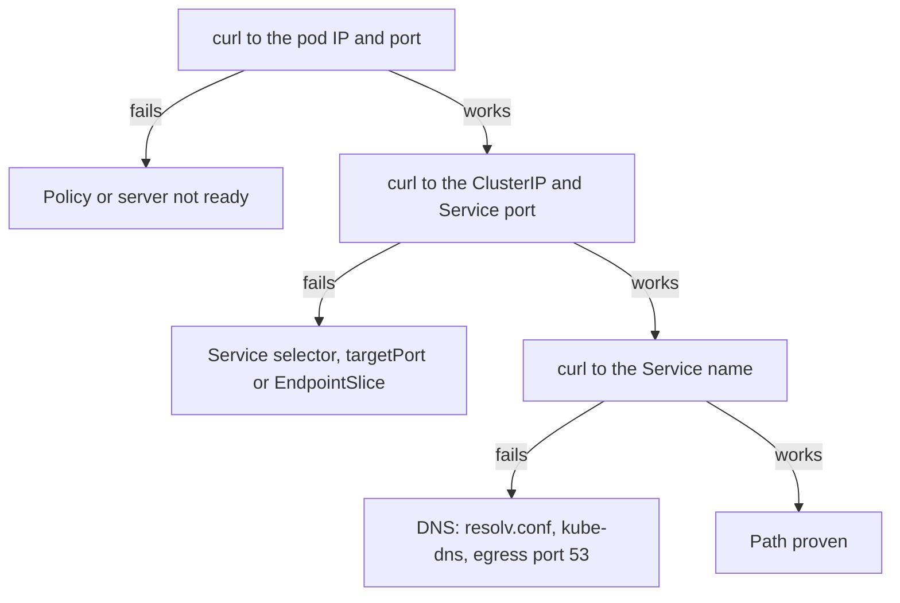
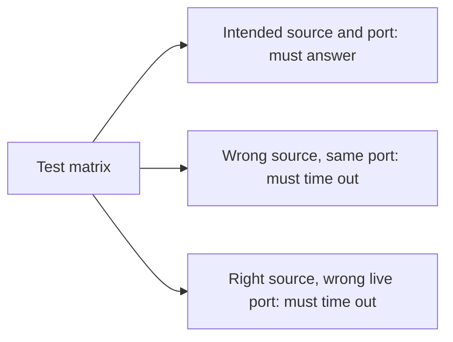

# Prove A Policy With Connection Tests

A timeout alone does not prove isolation. A wrong Service selector, a missing listener or a failed DNS query can also prevent a response. Prove a policy with a working allowed connection and a denied connection to the same live listener, from a client inside the cluster, and climb the request path one stage at a time: pod address, then Service address, then name. This part sets up one narrow boundary and walks that ladder.



The diagram is the order of the tests below: each stage adds one thing that can fail, so the first failing stage names the cause.

<!-- astrona:playground:renew -->

Save this as `networkpolicy-probe-test-boundary.yaml`:

```yaml
apiVersion: networking.k8s.io/v1
kind: NetworkPolicy
metadata:
  name: probe-test-boundary
  namespace: starfleet
spec:
  podSelector:
    matchLabels:
      app: probe
  policyTypes: [Ingress]
  ingress:
    - from:
        - podSelector:
            matchLabels:
              app: shuttle
      ports:
        - protocol: TCP
          port: 8080
---
apiVersion: networking.k8s.io/v1
kind: NetworkPolicy
metadata:
  name: shuttle-probe-test-egress
  namespace: starfleet
spec:
  podSelector:
    matchLabels:
      app: shuttle
  policyTypes: [Egress]
  egress:
    - to:
        - podSelector:
            matchLabels:
              app: probe
      ports:
        - protocol: TCP
          port: 8080
```

Apply it:

```sh
kubectl apply -f networkpolicy-probe-test-boundary.yaml
```

The file grants receiver ingress and sender egress on Transmission Control Protocol (TCP) port 8080. Remove the existing `probe-allow-outpost` permission, if present, so it cannot keep granting access beside the narrower rule:

```sh
kubectl -n starfleet delete networkpolicy probe-allow-outpost --ignore-not-found
```

Then find the live Pod address and inspect the stored policy:

```sh
kubectl -n starfleet get pods -l app=probe -o wide
kubectl -n starfleet get service probe -o yaml
kubectl -n starfleet get endpointslices -l kubernetes.io/service-name=probe -o yaml
kubectl -n starfleet get networkpolicy -o yaml
```

An EndpointSlice records the addresses, ports and readiness of a Service's backends. Look for a ready address matching the Pod and port 8080. Copy that Pod's IP address into `<PROBE_IP>` below. Pod addresses change on replacement, so always read a fresh value.

## Separate the three paths

Test the direct Pod first. The file explicitly permits `shuttle` egress to `probe` on TCP 8080. The `outpost` client starts without egress isolation. Inspect every ingress allow for `probe`; remove any additional rule that still allows `outpost` before expecting that source to be denied. A new narrow allow cannot remove an older permission.

```sh
kubectl -n starfleet exec deploy/shuttle -- curl -fsS --connect-timeout 2 --max-time 3 http://<PROBE_IP>:8080/get
kubectl -n outpost exec deploy/shuttle -- curl -fsS --connect-timeout 2 --max-time 3 http://<PROBE_IP>:8080/get
```

Look for a response from the allowed source and a timeout from the denied one. `--connect-timeout` bounds connection setup; `--max-time` bounds the whole transfer. Each command creates a fresh connection. In this kindnet environment, a policy drop produces a timeout. Exit code 28 means a timeout, but it does not identify the cause by itself. Exit code 7 means connection failure, not proof of a policy drop.

Now compare the Service's ClusterIP address and name. A ClusterIP is the virtual address that Kubernetes assigns to an internal Service. Read it from the Service and replace `<SERVICE_IP>`:

```sh
kubectl -n starfleet exec deploy/shuttle -- curl -fsS --max-time 3 http://<SERVICE_IP>:80/get
kubectl -n starfleet exec deploy/shuttle -- curl -v --max-time 3 http://probe.starfleet.svc.cluster.local/get
```

If the Pod address works but the Service address fails, inspect the Service selector, ready EndpointSlice addresses and `targetPort` before blaming policy. If the Service address works but the name fails, inspect `/etc/resolv.conf`, the DNS endpoints and egress port 53 permissions. Verbose curl shows whether it resolved a name and began a connection; an HTTP (Hypertext Transfer Protocol) error proves a server answered, even when the application rejected the request.

## Check readiness and filtering separately

Read the server's readiness conditions and events when even an allowed direct request fails:

```sh
kubectl -n starfleet describe pods -l app=probe
kubectl -n starfleet logs deploy/probe
kubectl -n starfleet describe networkpolicy probe-test-boundary
```

Look for ready containers and a listening application. Kubernetes readiness or scheduling events can explain a missing backend. NetworkPolicy has no Kubernetes 1.35 enforcement condition, and no standard Event proves each dropped connection. The network plugin applies filtering asynchronously, so repeat fresh connections after a rule or label change.

Use a small test matrix: the intended source and port must work, a wrong source must fail, and a wrong port with a known live listener must fail. Test each namespace involved. A failed request to a port where nothing listens proves nothing about the policy.



The diagram lists the three requests that together prove one rule: one that shows the server is alive, and two that show the policy is the thing blocking.

You can now locate a failure among name resolution, Service forwarding, server readiness and policy filtering. The strongest proof pairs allowed and denied requests to a live target while checking both endpoints' policy directions.

## Common pitfalls

> [!WARNING]
> - **Testing from the node or through port-forward.** Use an ordinary client Pod on the path the policy controls.
> - **Accepting every nonzero curl exit as a deny.** Rule out DNS failure, a missing Pod and an unavailable listener first.
> - **Testing only the allowed path.** Include a wrong source and a wrong port that would otherwise answer.
