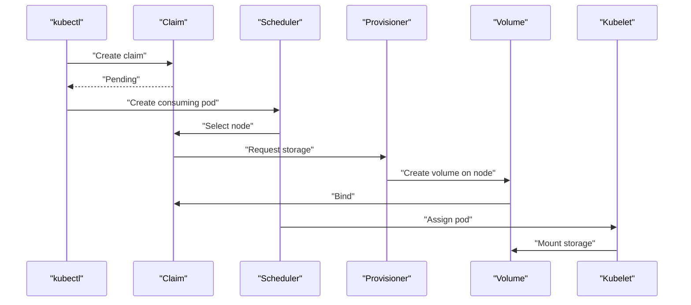

# StorageClasses And Dynamic Provisioning

The `scout-storage` pod needs a place to keep a file after the pod is replaced. A **PersistentVolumeClaim** (PVC) requests that storage in the pod's namespace. A **PersistentVolume** (PV) represents the storage itself and belongs to the cluster. Start by reading the classes available to this claim.

## Read the storage rules

A **StorageClass** is a cluster-wide object that names a provisioner and describes how new volumes are created. A provisioner is the component that creates storage when a claim asks for it. Inspect the playground's two classes before selecting one.

<!-- astrona:playground:renew -->

```sh
kubectl get storageclass
```

You should see something like:

```text
NAME                 PROVISIONER             RECLAIMPOLICY   VOLUMEBINDINGMODE      ALLOWVOLUMEEXPANSION   AGE
standard (default)   rancher.io/local-path   Delete          WaitForFirstConsumer   false                  75s
standard-retain      rancher.io/local-path   Retain          WaitForFirstConsumer   false                  57s
```

`standard` is the default class. Both classes delay binding until a pod needs the claim, but they have different reclaim policies. **Binding** assigns one volume to one claim; a **reclaim policy** controls what happens to the volume after the claim is deleted.

The fields mean:

| Field | What it controls |
| --- | --- |
| `provisioner` | Which component creates storage for this class |
| `reclaimPolicy` | Whether a new volume uses `Delete` or `Retain` after claim deletion |
| `volumeBindingMode` | Whether provisioning and binding start immediately or wait for a consuming pod |
| `allowVolumeExpansion` | Whether claims can request a larger volume; expansion also needs support from the storage driver |

The table shows expansion as `false`. The field is absent in these objects, which means expansion is not enabled. Setting it to `true` alone would not add resize support to this playground's storage.

## A claim without a consumer

Ask for 64 mebibytes (`64Mi`) using `standard`. An **access mode** describes how nodes or pods may mount the volume. `ReadWriteOnce` asks for read-write access from one node.

Save this as `persistentvolumeclaim-scout-data.yaml`:

```yaml
apiVersion: v1
kind: PersistentVolumeClaim
metadata:
  name: scout-data
  namespace: starfleet
spec:
  storageClassName: standard
  accessModes:
    - ReadWriteOnce
  resources:
    requests:
      storage: 64Mi
```

Apply it:

```sh
kubectl apply -f persistentvolumeclaim-scout-data.yaml
```

You should see something like:

```text
persistentvolumeclaim/scout-data created
```

Then check the result:

```sh
kubectl -n starfleet get pvc scout-data -o custom-columns=NAME:.metadata.name,PHASE:.status.phase,CLASS:.spec.storageClassName,VOLUME:.spec.volumeName
```

You should see something like:

```text
NAME         PHASE     CLASS      VOLUME
scout-data   Pending   standard   <none>
```

There is no volume name yet. Read the claim's events to distinguish an expected wait from a storage failure:

```sh
kubectl -n starfleet describe pvc scout-data
```

The output, shortened to the relevant lines, is:

```text
Events:
  Type    Reason                Age   From                         Message
  ----    ------                ----  ----                         -------
  Normal  WaitForFirstConsumer  0s    persistentvolume-controller  waiting for first consumer to be created before binding
```

The persistent volume controller reports `WaitForFirstConsumer`. This is normal for this class. With `Immediate` binding, the provisioner would start before a pod exists. With `WaitForFirstConsumer`, the scheduler can first choose storage that fits the pod's node placement rules.

## Mount the claim

A pod consumes the claim by naming it in `spec.volumes`. The container's `volumeMounts` then maps that volume to `/data`. The pod and the claim must be in the same namespace.

Save this as `pod-scout-storage.yaml`:

```yaml
apiVersion: v1
kind: Pod
metadata:
  name: scout-storage
  namespace: starfleet
spec:
  containers:
    - name: writer
      image: busybox:1.37
      command: ["sh", "-c", "while true; do sleep 30; done"]
      resources:
        requests:
          cpu: 5m
          memory: 8Mi
        limits:
          memory: 32Mi
      volumeMounts:
        - name: data
          mountPath: /data
  volumes:
    - name: data
      persistentVolumeClaim:
        claimName: scout-data
```

Apply it:

```sh
kubectl apply -f pod-scout-storage.yaml
```

You should see something like:

```text
pod/scout-storage created
```

Then check the result:

```sh
kubectl -n starfleet wait --for=condition=Ready pod/scout-storage --timeout=120s
kubectl -n starfleet get pvc scout-data -o custom-columns=NAME:.metadata.name,PHASE:.status.phase,CLASS:.spec.storageClassName,VOLUME:.spec.volumeName
```

You should see something like:

```text
pod/scout-storage condition met
NAME         PHASE   CLASS      VOLUME
scout-data   Bound   standard   pvc-5ddc5752-1d1c-4cfd-a294-c087ca4a31e0
```

The claim is now `Bound`. Its generated volume name will differ in your cluster. Kubernetes assigned the pod to a node, the provisioner created storage there, and the kubelet mounted it before starting the container.



The diagram shows delayed provisioning followed by binding and mounting on the selected node.

Read the volume's policy and node affinity, the rule that restricts where a pod using this volume can run:

```sh
SCOUT_VOLUME=$(kubectl -n starfleet get pvc scout-data -o jsonpath='{.spec.volumeName}')
kubectl get pv "$SCOUT_VOLUME" -o custom-columns=NAME:.metadata.name,PHASE:.status.phase,RECLAIM:.spec.persistentVolumeReclaimPolicy,CLAIM:.spec.claimRef.name
kubectl get pv "$SCOUT_VOLUME" -o jsonpath='{.spec.nodeAffinity.required.nodeSelectorTerms[0].matchExpressions[0]}{"\n"}'
```

You should see something like:

```text
NAME                                       PHASE   RECLAIM   CLAIM
pvc-5ddc5752-1d1c-4cfd-a294-c087ca4a31e0   Bound   Delete    scout-data
{"key":"kubernetes.io/hostname","operator":"In","values":["astro-ats-017-playground-020-03-control-plane"]}
```

The volume copied `Delete` from its class. Its node affinity names the playground node, because the files are local to that node. This storage does not replicate data to another node, and it is not a backup.

You can now distinguish a claim waiting for a consumer from a bound claim, and identify the components that create and mount its volume. Binding proves that storage exists. Reading a file after replacing the pod proves that the application can keep its data.

## Common pitfalls

> [!WARNING]
> - **Treating every `Pending` claim as a failure.** Read events; `WaitForFirstConsumer` needs a pod before provisioning starts.
> - **Setting `nodeName` on a consumer with delayed binding.** That bypasses the scheduler and can leave the claim waiting. Use node selectors or affinity instead.
> - **Naming a claim in another namespace.** A pod's claim reference resolves only in its own namespace.
> - **Assuming a class guarantees expansion.** The field and the storage driver must both support it.
