# Delete And Retain Reclaim Policies

Deleting a pod leaves its PersistentVolumeClaim (PVC), a namespaced storage request, in place. Deleting the claim is a separate action with a different risk. A **reclaim policy** tells Kubernetes whether to remove or keep the PersistentVolume (PV), the cluster object representing the storage, after its claim is gone.

## Create storage with Retain

The playground has a `standard-retain` StorageClass, a cluster object that selects a provisioner and volume rules. Its `reclaimPolicy: Retain` is copied into each new volume. Create a claim and a consuming pod, then put a file on that volume before comparing the policies.

<!-- astrona:playground:renew -->

Save this as `persistentvolumeclaim-probe-data.yaml`:

```yaml
apiVersion: v1
kind: PersistentVolumeClaim
metadata:
  name: probe-data
  namespace: starfleet
spec:
  storageClassName: standard-retain
  accessModes:
    - ReadWriteOnce
  resources:
    requests:
      storage: 64Mi
```

Apply it:

```sh
kubectl apply -f persistentvolumeclaim-probe-data.yaml
```

You should see something like:

```text
persistentvolumeclaim/probe-data created
```

With `WaitForFirstConsumer` binding, the claim needs a pod before the provisioner creates a volume.

Save this as `pod-probe-storage.yaml`:

```yaml
apiVersion: v1
kind: Pod
metadata:
  name: probe-storage
  namespace: starfleet
spec:
  containers:
    - name: writer
      image: busybox:1.37
      command: ["sh", "-c", "while true; do sleep 30; done"]
      resources:
        requests:
          cpu: 5m
          memory: 8Mi
        limits:
          memory: 32Mi
      volumeMounts:
        - name: data
          mountPath: /data
  volumes:
    - name: data
      persistentVolumeClaim:
        claimName: probe-data
```

Apply it:

```sh
kubectl apply -f pod-probe-storage.yaml
```

You should see something like:

```text
pod/probe-storage created
```

Then check the result:

```sh
kubectl -n starfleet wait --for=condition=Ready pod/probe-storage --timeout=120s
kubectl -n starfleet exec probe-storage -- sh -c 'echo saved-by-probe > /data/message.txt'
kubectl -n starfleet exec probe-storage -- cat /data/message.txt
```

You should see something like:

```text
pod/probe-storage condition met
saved-by-probe
```

The file now belongs to storage whose volume uses `Retain`. The `scout-data` claim, mounted by `scout-storage` and `scout-reader`, uses a volume with `Delete`. The next commands deliberately remove those pods and claims; do not use them against data you need to keep.

## Delete removes the volume

Save the generated volume name before deleting the claim, because the claim will no longer be available to look it up. Remove both consumers first, then delete the claim and wait for the volume to disappear:

```sh
SCOUT_VOLUME=$(kubectl -n starfleet get pvc scout-data -o jsonpath='{.spec.volumeName}')
kubectl -n starfleet delete pod scout-storage scout-reader
kubectl -n starfleet delete pvc scout-data
kubectl wait --for=delete pv/"$SCOUT_VOLUME" --timeout=120s
kubectl get pv "$SCOUT_VOLUME"
```

You should see something like:

```text
pod "scout-storage" deleted from starfleet namespace
pod "scout-reader" deleted from starfleet namespace
persistentvolumeclaim "scout-data" deleted from starfleet namespace
persistentvolume/pvc-5ddc5752-1d1c-4cfd-a294-c087ca4a31e0 condition met
Error from server (NotFound): persistentvolumes "pvc-5ddc5752-1d1c-4cfd-a294-c087ca4a31e0" not found
```

The final `NotFound` is the expected result. The provisioner has removed the volume object and its backing directory. Kubernetes protects a claim that a pod still uses with the `kubernetes.io/pvc-protection` **finalizer**, a marker that delays object removal until cleanup is safe. Deleting a claim first can therefore leave it `Terminating` until its consumers are removed.

`Delete` suits disposable data whose removal is intended. It does not suit the only copy of important application data without a separate recovery plan. The policy concerns claim deletion, not ordinary pod restarts.

## Retain leaves a released volume

Now remove the other consumer and its claim, and inspect the volume that remains:

```sh
PROBE_VOLUME=$(kubectl -n starfleet get pvc probe-data -o jsonpath='{.spec.volumeName}')
kubectl -n starfleet delete pod probe-storage
kubectl -n starfleet delete pvc probe-data
kubectl wait --for=jsonpath='{.status.phase}'=Released pv/"$PROBE_VOLUME" --timeout=120s
kubectl get pv "$PROBE_VOLUME" -o custom-columns=NAME:.metadata.name,PHASE:.status.phase,RECLAIM:.spec.persistentVolumeReclaimPolicy,CLAIM:.spec.claimRef.name
```

You should see something like:

```text
pod "probe-storage" deleted from starfleet namespace
persistentvolumeclaim "probe-data" deleted from starfleet namespace
persistentvolume/pvc-c23a564e-3a44-43e3-9583-279b0ba1ec0d condition met
NAME                                       PHASE      RECLAIM   CLAIM
pvc-c23a564e-3a44-43e3-9583-279b0ba1ec0d   Released   Retain    probe-data
```

`Released` means the claim is gone, but the volume still exists. The volume keeps its reference to the old claim and does not automatically become available for a new one. Its local files remain on the node for an administrator to recover or remove.

A new claim with the old name is a new object with a new unique identifier. It does not automatically regain this volume. Recovery needs an administrator to check the data, the volume's old claim reference and the intended new binding. Do not clear references or delete retained storage without deciding what should happen to the data.

```mermaid
stateDiagram-v2
    state "Claim Pending" as Pending
    state "Claim and volume Bound" as Bound
    state "Volume Released" as Released
    state "Volume and storage removed" as Removed
    Pending --> Bound: "Consumer triggers provisioning"
    Bound --> Removed: "Delete policy; claim deleted"
    Bound --> Released: "Retain policy; claim deleted"
```



The diagram shows how deleting a bound claim leads to removal or to a released volume, depending on the volume's policy.

## Read the policy on the volume

The StorageClass supplies a policy when a volume is created. The volume's `spec.persistentVolumeReclaimPolicy` decides what happens later. Changing a class does not change policies on volumes that already exist; inspect the volume before deleting its claim.

`Retain` prevents automatic cleanup after claim deletion. It does not copy the files, protect against node loss or create a backup. In this playground, destroying the cluster removes the node even when a volume says `Retain`.

You can now predict and observe the two outcomes: `Delete` removes the volume and its storage, while `Retain` leaves a `Released` volume for manual handling. Pod deletion, claim deletion and cluster destruction are different events. The remaining configuration choice is which class new claims use and how a controller creates claims for replicas.

## Common pitfalls

> [!WARNING]
> - **Deleting a claim before checking its volume's policy.** `Delete` removes its backing storage; the class name alone is not enough to confirm the outcome.
> - **Expecting `Released` to mean reusable.** The old claim reference remains, so a new claim does not bind automatically.
> - **Expecting a StorageClass edit to change old volumes.** New volumes copy the policy; existing volumes keep their own field.
> - **Calling `Retain` a backup.** It preserves storage after claim deletion, not after loss of the node holding the files.
