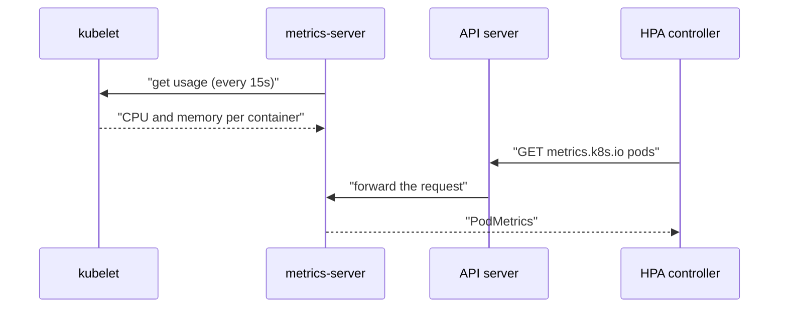

# The Metrics API And kubectl top

An autoscaler cannot decide anything without a number: how much CPU do the pods use right now? Kubernetes does not store that number in the pod object. A separate component measures it and serves it through its own API. This part shows where that number comes from, how to read it with `kubectl top`, and why the HPA in the next part depends on it.

## Who measures the usage

The **kubelet** is the agent on each node that runs the pods. It reads the CPU and memory use of every container from the container runtime. It reports the current values, not a history.

**metrics-server** is a Deployment in the `kube-system` namespace. Every 15 seconds it asks each kubelet for the current usage of the node and its containers, and keeps the latest values in memory. It stores no history either. The playground cluster installs it from an Astrona addon, so you do not install anything.

The **Metrics API** (`metrics.k8s.io`) is the Kubernetes API that serves those values. metrics-server registers it with the API server through an `APIService` object. After that, a request to `/apis/metrics.k8s.io/...` on the API server goes to metrics-server. Two clients use this API: `kubectl top` and the HPA controller.



The diagram shows that metrics-server pulls the values from the kubelets, and that the HPA controller reads them through the API server and never talks to a kubelet itself.

## Check that the Metrics API works

The first thing to check, on any cluster, is that the Metrics API is registered and available. If it is not, `kubectl top` fails and every HPA shows `<unknown>`.

<!-- astrona:playground:renew -->

Look at the `APIService` object:

```sh
kubectl get apiservice v1beta1.metrics.k8s.io
```

You should see something like:

```text
NAME                     SERVICE                      AVAILABLE   AGE
v1beta1.metrics.k8s.io   kube-system/metrics-server   True        12m
```

`AVAILABLE True` means the API server can reach the Service `kube-system/metrics-server`. If this column shows `False` or `MissingEndpoints`, the metrics-server pod is not running or not ready. Then check the Deployment and its start-up arguments:

```sh
kubectl -n kube-system get deployment metrics-server
kubectl -n kube-system get deployment metrics-server -o jsonpath='{.spec.template.spec.containers[0].args}{"\n"}'
```

You should see something like:

```text
NAME             READY   UP-TO-DATE   AVAILABLE   AGE
metrics-server   1/1     1            1           12m
["--cert-dir=/tmp","--secure-port=10250","--kubelet-preferred-address-types=InternalIP,ExternalIP,Hostname","--kubelet-use-node-status-port","--metric-resolution=15s","--kubelet-insecure-tls"]
```

`--metric-resolution=15s` is the collection interval. `--kubelet-insecure-tls` tells metrics-server to accept the kubelet's self-signed serving certificate. A `kind` cluster needs this flag, because its kubelets do not have certificates that a normal certificate authority signed. Production clusters normally do not use it.

## Read the usage with kubectl top

`kubectl top` is a client of the Metrics API. It prints the current usage of nodes or pods. Start with the node and the pods in `starfleet`:

```sh
kubectl top nodes
kubectl top pods -n starfleet
```

You should see something like:

```text
NAME                                            CPU(cores)   CPU(%)   MEMORY(bytes)   MEMORY(%)   
astro-ats-017-playground-030-01-control-plane   92m          1%       640Mi           2%          
NAME                                CPU(cores)   MEMORY(bytes)   
scout-5f745cd74f-sf47b              1m           26Mi            
scout-norequests-6c7cfbb576-dv9jr   1m           14Mi            
shuttle-5c44b786bb-f8wc7            1m           0Mi             
```

The `CPU(%)` column of the node compares usage with the node's capacity. The pod table has no percentage, because a pod has no capacity of its own. Add `--containers` to list the usage per container:

```sh
kubectl top pod -n starfleet -l app=scout --containers
```

```text
POD                      NAME    CPU(cores)   MEMORY(bytes)   
scout-5f745cd74f-sf47b   scout   1m           26Mi            
```

CPU is shown in millicores (`1m` is one thousandth of a core). Memory is the working set of the container, in mebibytes. The pod names on your cluster have other suffixes.

## What the API returns

`kubectl top` rounds the values. The raw object shows exactly what the HPA controller reads. Ask the API server for one `PodMetrics` object:

```sh
kubectl get --raw "/apis/metrics.k8s.io/v1beta1/namespaces/starfleet/pods/$(kubectl -n starfleet get pod -l app=scout -o name | cut -d/ -f2)"
```

You should see something like (one line in the terminal):

```text
{"kind":"PodMetrics","apiVersion":"metrics.k8s.io/v1beta1","metadata":{"name":"scout-5f745cd74f-sf47b","namespace":"starfleet","creationTimestamp":"2026-11-01T20:04:11Z","labels":{"app":"scout","pod-template-hash":"5f745cd74f"}},"timestamp":"2026-11-01T20:03:50Z","window":"15.956s","containers":[{"name":"scout","usage":{"cpu":"55715n","memory":"27592Ki"}}]}
```

Three fields matter. `containers[].usage.cpu` is `55715n`, which is 55715 nanocores, about `56m`. `window` is the time span the CPU value is averaged over, here about 16 seconds. `timestamp` is when the sample was taken. The object holds usage only. It does not contain requests or limits.

That last point is the key to the next part. The Metrics API tells you what a pod uses, and the pod spec tells you what it requested. The HPA divides the first by the second:

```sh
kubectl -n starfleet get pods -l app=scout -o custom-columns='NAME:.metadata.name,CPU_REQUEST:.spec.containers[0].resources.requests.cpu'
```

```text
NAME                     CPU_REQUEST
scout-5f745cd74f-sf47b   100m
```

## Usage under load

At rest, `scout` uses almost nothing. The `shuttle` pod can create load: `podinfo` has no endpoint made to burn CPU, but its `/token` endpoint signs a token for each `POST` request, and a fast stream of requests keeps the CPU busy. Start four parallel `curl` processes inside `shuttle`. Each one sends five million requests to the Service `scout`, and `timeout` stops them after 100 seconds:

```sh
kubectl -n starfleet exec deploy/shuttle -- sh -c 'for i in 1 2 3 4; do timeout 100 curl -s -o /dev/null -X POST "http://scout/token?[1-5000000]" & done; wait'
```

The command waits until the load ends. Open a second terminal, wait about 45 seconds, and sort the pods by CPU:

```sh
kubectl top pods -n starfleet --sort-by=cpu
```

You should see something like:

```text
NAME                                CPU(cores)   MEMORY(bytes)   
shuttle-5c44b786bb-f8wc7            1535m        6Mi             
scout-5f745cd74f-sf47b              1055m        28Mi            
scout-norequests-6c7cfbb576-dv9jr   1m           14Mi            
```

`scout` uses `1055m` of CPU, more than ten times its request of `100m`. `shuttle` also uses a lot, because it creates the requests. `scout-norequests` stays idle. This is the load generator that the next part uses. Metrics-server needs about 15 to 30 seconds to show a change, so `kubectl top` always lags a little behind the real usage.

You now know where the usage numbers come from: the kubelet measures, metrics-server collects every 15 seconds, and the Metrics API serves the latest value to `kubectl top` and to the HPA controller. The Metrics API holds usage only, and the request lives in the pod spec. The open question is how the HPA turns these two numbers into a replica count.

## Common pitfalls

> [!WARNING]
> - **Running `kubectl top` right after a pod starts.** A new pod has no sample yet, and the command answers `metrics not available yet`. Wait about a minute.
> - **Reading `kubectl top` as a request.** It shows usage only. Compare it with the request in the pod spec before you judge a workload.
> - **Treating the Metrics API as monitoring.** It keeps only the latest value. History and graphs need a monitoring system such as Prometheus.
> - **Ignoring a `False` APIService.** When `AVAILABLE` is not `True`, `kubectl top` and every HPA fail. Fix metrics-server first.
