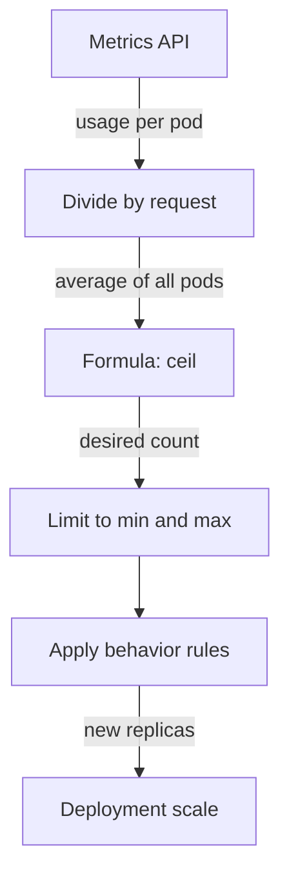

# Writing An HPA And Its Replica Formula

The Metrics API tells you how much CPU a pod uses. A HorizontalPodAutoscaler turns that number into a replica count, and it does so with one formula. This part writes an `autoscaling/v2` HPA for `scout`, loads `scout` from `shuttle`, and checks each step the controller takes against the formula. At the end you also see what the HPA does with a pod that has no CPU request.

## The control loop and the formula

The HPA is a controller in `kube-controller-manager`. By default it runs a loop every 15 seconds. In each loop it reads the usage of the pods of the target workload from the Metrics API, compares it with the target, and writes a new replica count to the workload's `scale` subresource. The Deployment controller then creates or deletes pods.

For a CPU `Utilization` target, the HPA first turns usage into a percentage of the **request** for each pod: a pod that uses `200m` and requests `100m` is at 200 percent. It then takes the average over all pods. Last, it applies this formula:

```text
desiredReplicas = ceil( currentReplicas × currentUtilisation / targetUtilisation )
```

`ceil` rounds up to the next whole number. If the ratio of current to target utilisation is within 10 percent of 1.0 (the default tolerance), the HPA changes nothing, so small changes do not cause constant scaling. After the formula, the HPA limits the result to `minReplicas` and `maxReplicas`, and then to the rules in `behavior`.



The diagram shows that the formula is only one step: the minimum, the maximum and the `behavior` rules can change its result before the Deployment gets a new count.

## Write the HPA

The HPA below scales the Deployment `scout` between 1 and 5 replicas to keep the average CPU utilisation at 50 percent of the request.

<!-- astrona:playground:renew -->

Save this as `hpa-scout.yaml`:

```yaml
apiVersion: autoscaling/v2
kind: HorizontalPodAutoscaler
metadata:
  name: scout
  namespace: starfleet
spec:
  scaleTargetRef:
    apiVersion: apps/v1
    kind: Deployment
    name: scout
  minReplicas: 1
  maxReplicas: 5
  metrics:
    - type: Resource
      resource:
        name: cpu
        target:
          type: Utilization
          averageUtilization: 50
```

`scaleTargetRef` names the workload to scale. `metrics` is a list. A `Resource` metric reads CPU or memory from the Metrics API, and `type: Utilization` with `averageUtilization` is a percentage of the request.

Apply it:

```sh
kubectl apply -f hpa-scout.yaml
```

Then check the result. Run the first command right away and the other two about 30 seconds later:

```sh
kubectl -n starfleet get hpa scout
kubectl -n starfleet get hpa scout
kubectl -n starfleet describe hpa scout
```

You should see something like:

```text
NAME    REFERENCE          TARGETS              MINPODS   MAXPODS   REPLICAS   AGE
scout   Deployment/scout   cpu: <unknown>/50%   1         5         0          0s
NAME    REFERENCE          TARGETS       MINPODS   MAXPODS   REPLICAS   AGE
scout   Deployment/scout   cpu: 1%/50%   1         5         1          30s
Name:                                                  scout
Namespace:                                             starfleet
Labels:                                                <none>
Annotations:                                           <none>
CreationTimestamp:                                     Sun, 01 Nov 2026 21:08:50 +0100
Reference:                                             Deployment/scout
Metrics:                                               ( current / target )
  resource cpu on pods  (as a percentage of request):  1% (1m) / 50%
Min replicas:                                          1
Max replicas:                                          5
Deployment pods:                                       1 current / 1 desired
Conditions:
  Type            Status  Reason              Message
  ----            ------  ------              -------
  AbleToScale     True    ReadyForNewScale    recommended size matches current size
  ScalingActive   True    ValidMetricFound    the HPA was able to successfully calculate a replica count from cpu resource utilization (percentage of request)
  ScalingLimited  False   DesiredWithinRange  the desired count is within the acceptable range
Events:           <none>
```

In the first second the HPA has not read any metric yet, so the target is `<unknown>`. After one loop it shows `1%`: `scout` uses `1m` of CPU and requests `100m`. The `Conditions` block is the part to learn. `ScalingActive True` means the HPA can read a metric. `ScalingLimited False` means `minReplicas` and `maxReplicas` do not hold the result back.

You can also create the same kind of object with one command, `kubectl autoscale deployment scout --cpu=50% --min=1 --max=5`. The next sections use it once.

## Scale up under load

Start the load from `shuttle`. The command sends `POST` requests to the `/token` endpoint of the Service `scout` from four `curl` processes and stops after 150 seconds:

```sh
kubectl -n starfleet exec deploy/shuttle -- sh -c 'for i in 1 2 3 4; do timeout 150 curl -s -o /dev/null -X POST "http://scout/token?[1-5000000]" & done; wait'
```

The command keeps your terminal busy. In a second terminal, watch the HPA. The `--watch` flag prints a new line each time a value changes:

```sh
kubectl -n starfleet get hpa scout --watch
```

You should see something like (shortened, because the watch prints more lines):

```text
NAME    REFERENCE          TARGETS          MINPODS   MAXPODS   REPLICAS   AGE
scout   Deployment/scout   cpu: 1%/50%      1         5         1          35s
scout   Deployment/scout   cpu: 831%/50%    1         5         1          60s
scout   Deployment/scout   cpu: 1071%/50%   1         5         4          75s
scout   Deployment/scout   cpu: 262%/50%    1         5         5          90s
scout   Deployment/scout   cpu: 268%/50%    1         5         5          105s
scout   Deployment/scout   cpu: 215%/50%    1         5         5          2m
```

At 60 seconds the one pod runs at `831%` of its request. Apply the formula: `ceil(1 × 831 / 50) = ceil(16.62) = 17`. The HPA wants 17 replicas, but `maxReplicas` is 5. In this run the controller first moved to 4 replicas and 15 seconds later to 5. On your cluster it may reach 5 in one step.

With 5 replicas the average is still `215%`. The formula gives `ceil(5 × 215 / 50) = ceil(21.5) = 22`, which is far above the maximum, so the HPA stays at 5. The HPA also says this in its conditions and events:

```sh
kubectl top pods -n starfleet -l app=scout
kubectl -n starfleet describe hpa scout | sed -n '/^Metrics/,$p'
```

You should see something like:

```text
NAME                     CPU(cores)   MEMORY(bytes)   
scout-5f745cd74f-6ds5v   1m           13Mi            
scout-5f745cd74f-ddzzr   1m           13Mi            
scout-5f745cd74f-fzz7h   1m           13Mi            
scout-5f745cd74f-mqs77   1m           13Mi            
scout-5f745cd74f-sf47b   1061m        29Mi            
Metrics:                                               ( current / target )
  resource cpu on pods  (as a percentage of request):  213% (213m) / 50%
Min replicas:                                          1
Max replicas:                                          5
Deployment pods:                                       5 current / 5 desired
Conditions:
  Type            Status  Reason            Message
  ----            ------  ----------------  -------
  AbleToScale     True    ReadyForNewScale  recommended size matches current size
  ScalingActive   True    ValidMetricFound  the HPA was able to successfully calculate a replica count from cpu resource utilization (percentage of request)
  ScalingLimited  True    TooManyReplicas   the desired replica count is more than the maximum replica count
Events:
  Type    Reason             Age   From                       Message
  ----    ------             ----  ----                       -------
  Normal  SuccessfulRescale  75s   horizontal-pod-autoscaler  New size: 4; reason: cpu resource utilization (percentage of request) above target
  Normal  SuccessfulRescale  60s   horizontal-pod-autoscaler  New size: 5; reason: cpu resource utilization (percentage of request) above target
```

`ScalingLimited True` with the reason `TooManyReplicas` is the sign that the maximum holds the result back. The events record each rescale. The `top` output shows something else worth knowing: one pod carries all the load, and the other four are idle. The four `curl` processes keep one connection each, and kube-proxy chooses a pod once per connection, not once per request. The average is `(1061 + 1 + 1 + 1 + 1) / 5 ≈ 213` percent, which matches the table. More replicas did not help here, because the load never reached the new pods. A real client population opens many connections, and the load spreads.

## Scale back down

After the 150 seconds the load stops, and the utilisation falls to `1%`. The formula now gives `ceil(5 × 1 / 50) = ceil(0.1) = 1`, but the HPA does not scale down at once. By default it waits for a stabilization window of 300 seconds and uses the highest replica count it recommended in that time. The watch shows the delay:

```text
scout   Deployment/scout   cpu: 139%/50%    1         5         5          3m30s
scout   Deployment/scout   cpu: 1%/50%      1         5         5          3m45s
scout   Deployment/scout   cpu: 1%/50%      1         5         5          8m30s
scout   Deployment/scout   cpu: 1%/50%      1         5         1          8m45s
```

The line at `8m30s` is almost five minutes after the load ended, and the replica count is still 5. At `8m45s` the count drops from 5 to 1 in one step, and the HPA records the event `New size: 1; reason: All metrics below target`. Scale-up is fast and scale-down is slow on purpose: removing pods too early costs more than keeping them a few minutes.

## A pod without a CPU request

The formula divides by the request. See what happens when there is no request. The Deployment `scout-norequests` runs the same image without any resources. Create an HPA for it with `kubectl autoscale`, wait about 40 seconds, and read its status:

```sh
kubectl -n starfleet autoscale deployment scout-norequests --cpu=50% --min=1 --max=5
kubectl -n starfleet describe hpa scout-norequests | sed -n '/^Metrics/,$p'
```

You should see something like:

```text
horizontalpodautoscaler.autoscaling/scout-norequests autoscaled
Metrics:                                               ( current / target )
  resource cpu on pods  (as a percentage of request):  <unknown> / 50%
Min replicas:                                          1
Max replicas:                                          5
Deployment pods:                                       1 current / 0 desired
Conditions:
  Type           Status  Reason                   Message
  ----           ------  ------                   -------
  AbleToScale    True    SucceededGetScale        the HPA controller was able to get the target's current scale
  ScalingActive  False   FailedGetResourceMetric  the HPA was unable to compute the replica count: failed to get cpu utilization: missing request for cpu in container scout of Pod scout-norequests-6c7cfbb576-dv9jr
Events:
  Type     Reason                        Age                From                       Message
  ----     ------                        ----               ----                       -------
  Warning  FailedGetResourceMetric       10s (x2 over 25s)  horizontal-pod-autoscaler  failed to get cpu utilization: missing request for cpu in container scout of Pod scout-norequests-6c7cfbb576-dv9jr
  Warning  FailedComputeMetricsReplicas  10s (x2 over 25s)  horizontal-pod-autoscaler  invalid metrics (1 invalid out of 1), first error is: failed to get cpu resource metric value: failed to get cpu utilization: missing request for cpu in container scout of Pod scout-norequests-6c7cfbb576-dv9jr
```

The HPA reads the usage fine, so `kubectl top` works for this pod. It cannot divide, so `ScalingActive` is `False` with the reason `FailedGetResourceMetric`, and the message names the container: `missing request for cpu in container scout`. This HPA never scales, however high the load goes.

The fix is a CPU request on the container. Set one, wait for the rollout, and read the HPA again after about 45 seconds:

```sh
kubectl -n starfleet set resources deployment/scout-norequests --requests=cpu=100m,memory=32Mi
kubectl -n starfleet rollout status deployment/scout-norequests
kubectl -n starfleet get hpa scout-norequests
```

You should see something like:

```text
deployment.apps/scout-norequests resource requirements updated
deployment "scout-norequests" successfully rolled out
NAME               REFERENCE                     TARGETS       MINPODS   MAXPODS   REPLICAS   AGE
scout-norequests   Deployment/scout-norequests   cpu: 1%/50%   1         5         1          91s
```

The rollout step printed two more lines that this output leaves out. The target now shows `1%/50%`, and the conditions are the same as for `scout`.

You can now write an `autoscaling/v2` HPA, predict its replica count with `ceil(current × utilisation / target)`, and read `ScalingActive` and `ScalingLimited` to see why it did or did not scale. You also know that a missing CPU request breaks the formula. The open questions are what else makes a target `<unknown>`, and how to change the pace at which the HPA scales.

## Common pitfalls

> [!WARNING]
> - **Creating an HPA for pods without a CPU request.** The target stays `<unknown>`, and the HPA never scales. The message `missing request for cpu` names the container.
> - **Reading the formula with the wrong current count.** The HPA uses the current replicas, not `minReplicas`. Use the `REPLICAS` column.
> - **Expecting an instant scale-down.** The default stabilization window is 300 seconds. The replicas stay for about five minutes after the load ends.
> - **Judging the HPA by one pod.** `kubectl top` can show one hot pod and several idle ones. The HPA uses the average.
