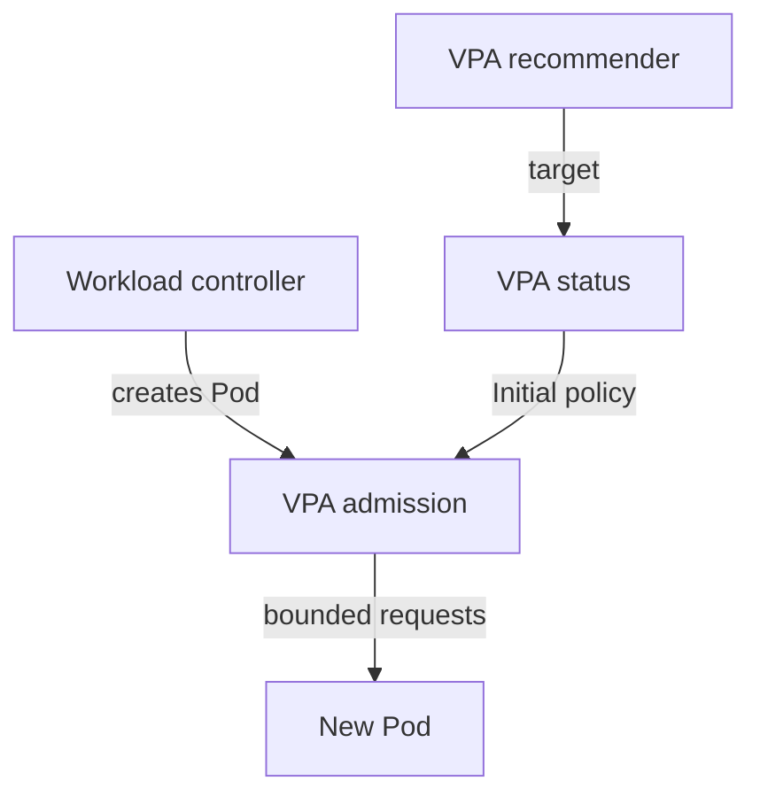

# Apply Recommendations At Pod Creation

A recommendation for `scout` is useful only if you can control when it changes the application. The **Vertical Pod Autoscaler (VPA)** can apply requests during Pod creation while leaving running Pods alone. A **Deployment** creates replacement Pods from a template; VPA admission can change their requests before the API server stores them.

Switch the recommendation-only `scout` object to bounded `Initial` updates. A **request** is a container's reserved CPU or memory. The named container policy below sets the same budget for every new `scout` Pod and preserves its limits.

<!-- astrona:playground:renew -->
Save this as `vpa-scout.yaml`:

```yaml
apiVersion: autoscaling.k8s.io/v1
kind: VerticalPodAutoscaler
metadata:
  name: scout
  namespace: starfleet
spec:
  targetRef:
    apiVersion: apps/v1
    kind: Deployment
    name: scout
  updatePolicy:
    updateMode: Initial
  resourcePolicy:
    containerPolicies:
    - containerName: scout
      controlledResources:
      - cpu
      - memory
      controlledValues: RequestsOnly
      minAllowed:
        cpu: 50m
        memory: 64Mi
      maxAllowed:
        cpu: 300m
        memory: 256Mi
```

Apply it:

```sh
kubectl apply -f vpa-scout.yaml
```

Then check the result:

```sh
kubectl -n starfleet wait --for=condition=RecommendationProvided vpa/scout --timeout=600s
kubectl -n starfleet get vpa scout -o yaml
kubectl -n starfleet get pods -l app=scout -o yaml
```

Read the bounded `target` and note the existing Pod's UID and requests. The old Pod should remain unchanged. Now ask the Deployment to replace its Pods:

```sh
kubectl -n starfleet rollout restart deployment/scout
kubectl -n starfleet rollout status deployment/scout --timeout=180s
kubectl -n starfleet get pods -l app=scout -o yaml
kubectl -n starfleet get deployment scout -o yaml
```

Look for a new UID, a Ready container, and the `vpaUpdates` annotation. Compare `spec.containers[0].resources.requests` with `status.containerStatuses[0].resources.requests`, the resources reported for the running container. The request must be within your policy bounds; the limits and template requests stay unchanged. Recommendations can change between reads, so inspect the admission annotation and actual Pod values rather than assuming a later status target is an exact historical record.



The workload controller starts creation; admission uses the recommendation to set requests on that new Pod.

## Choose an update mode

VPA 1.7.3 supports these update modes. Set the mode explicitly so the workload's disruption policy is visible.

| Mode | What VPA does |
| --- | --- |
| `Off` | Computes recommendations; does not apply resource changes |
| `Initial` | Applies recommendations only when a Pod is created |
| `Recreate` | Also evicts eligible running Pods so the workload controller replaces them with new requests |
| `InPlaceOrRecreate` | Tries an in-place update; falls back to eviction and replacement if that cannot complete |
| `InPlace` | Alpha; uses in-place updates without eviction fallback; needs the VPA `InPlace` feature gate on admission and updater |
| `Auto` | Deprecated; equivalent to `Recreate` in this version; use an explicit mode instead |

The pinned version defaults to `Recreate` when `updateMode` is omitted. The in-place modes need Kubernetes in-place Pod vertical scaling, available by default in Kubernetes 1.35. This playground does not enable the additional VPA `InPlace` gate. You practise `Initial`; do not switch modes to force a running Pod to change during that exercise.

**In-place Pod resize** changes an existing Pod through its `resize` subresource. The kubelet applies the new resources, and the Pod keeps its UID. The `Initial` workflow above creates a new Pod and a new UID instead. Kubernetes supporting resize does not make every VPA mode use it: the VPA update policy still decides the path.

## Keep autoscaler ownership clear

A **Horizontal Pod Autoscaler (HPA)** changes replica count from measured load. For a CPU utilisation target, it divides usage by the CPU request. If VPA changes that request while HPA uses it as a denominator, the utilisation changes even when traffic does not. Each controller can react to changes caused by the other. The same problem applies to memory utilisation targets.

Avoid automatic VPA resource updates and HPA utilisation scaling on the same resource for the same Pods. `Initial` still changes requests when Pods are created, including replicas added by HPA, so it is not an exception. A safe practice layout uses VPA `Initial` for `probe`, and an HPA for `scout` with manually chosen, fixed requests. A VPA in `Off` can still advise on `scout` without applying those requests. Other combinations need separate resource ownership or HPA metrics such as an external queue length, with their metrics pipeline already available.

You can now choose when recommendations take effect and show who applied the change. Keep the distinction clear: VPA recommends container sizes, the workload controller creates Pods, and HPA chooses how many replicas should run.

## Common pitfalls

> [!WARNING]
> Restarting a container inside the same Pod does not trigger creation-time admission. Replace the Pod. `Auto` is deprecated, and `Initial` can still conflict with HPA resource utilisation when new replicas receive different requests.
