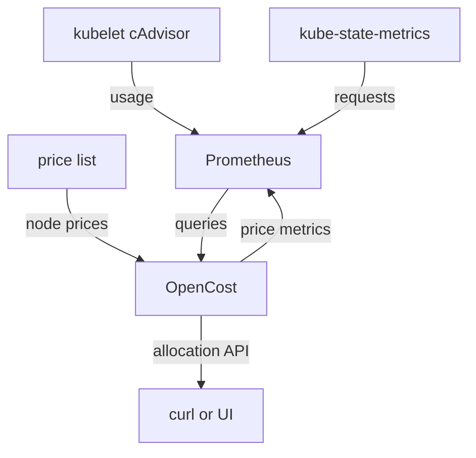

# How OpenCost Computes Cost Allocation

A cluster has one bill. The company pays for the nodes, the disks and the network, and it receives a single number at the end of the month. Several teams share those nodes, and each team wants to know what its own workloads cost. Without that split, nobody can decide which team should shrink its requests, and nobody can charge a team for what it uses.

**Cost allocation** is the work of splitting the cost of the cluster across namespaces, controllers, pods and labels. **OpenCost** is a CNCF (Cloud Native Computing Foundation) project that does this split for a Kubernetes cluster. It runs as a pod, reads metrics from Prometheus, multiplies them by a price list, and answers questions about cost through an HTTP API. This part shows which data OpenCost reads and how it turns that data into a dollar amount.

## The three inputs

OpenCost needs three kinds of data for each resource of each container: a price, a request and a usage figure. The price says what one unit costs for one hour. The **request** is the amount of CPU or memory that the scheduler reserves for the container on a node. The **usage** is the amount the container really consumes.

Each input has its own source, and Prometheus stores all of them. The kubelet exposes the usage of every container through its cAdvisor endpoint, and Prometheus scrapes it. kube-state-metrics reads the pod objects from the Kubernetes API and exposes their requests as metrics. OpenCost itself exports the node prices as metrics, because it knows the price list, and Prometheus scrapes OpenCost to store them. On a cluster in a public cloud, OpenCost gets the node prices from the cloud provider. A `kind` cluster has no cloud bill, so OpenCost uses a fixed on-premises price list instead.



OpenCost reads from Prometheus and writes the price metrics that Prometheus keeps. The diagram shows that the answer to a cost question is built from three streams of metrics that meet in one place.

## Reading the inputs from Prometheus

The playground runs all four components, so you can read each input yourself. The shell function `query_prometheus` below sends a PromQL (Prometheus Query Language) query to Prometheus from the `shuttle` pod and prints the JSON answer. The `jq` command at the end of each line picks out the fields that matter.

<!-- astrona:playground:renew -->

Define the function and ask for the two node prices:

```sh
query_prometheus() {
  kubectl -n starfleet exec deploy/shuttle -- \
    curl -s --get http://prometheus-server.monitoring.svc/api/v1/query \
    --data-urlencode "query=$1"
  echo
}
query_prometheus 'node_cpu_hourly_cost' | jq -c '.data.result[] | {node: .metric.node, usd_per_core_hour: .value[1]}'
query_prometheus 'node_ram_hourly_cost' | jq -c '.data.result[] | {node: .metric.node, usd_per_gb_hour: .value[1]}'
```

You should see something like:

```text
{"node":"astro-ats-017-playground-040-01-control-plane","usd_per_core_hour":"0.031611"}
{"node":"astro-ats-017-playground-040-01-control-plane","usd_per_gb_hour":"0.004237"}
```

One CPU core costs `0.031611` dollars for one hour, and one gibibyte of memory costs `0.004237` dollars for one hour. These two numbers come from the OpenCost default on-premises price list. They are not a real bill. Every cost in this module is the product of a quantity and these prices.

Next, read the requests of the `scout` Deployment. The metric `kube_pod_container_resource_requests` comes from kube-state-metrics. It has one series for each resource, so the query groups by `resource`:

```sh
query_prometheus 'max by (pod, resource) (kube_pod_container_resource_requests{namespace="starfleet",container="scout"})' | jq -c '.data.result[] | {pod: .metric.pod, resource: .metric.resource, request: .value[1]}'
```

You should see something like:

```text
{"pod":"scout-9db9c5f65-82gkh","resource":"cpu","request":"0.1"}
{"pod":"scout-9db9c5f65-82gkh","resource":"memory","request":"67108864"}
```

The `scout` pod requests `0.1` CPU cores (`100m`) and `67108864` bytes of memory (`64Mi`). Now read what the same container uses. CPU usage is the rate of the counter `container_cpu_usage_seconds_total`, and memory usage is the gauge `container_memory_working_set_bytes`:

```sh
query_prometheus 'sum by (pod) (rate(container_cpu_usage_seconds_total{namespace="starfleet",container="scout"}[5m]))' | jq -c '.data.result[] | {pod: .metric.pod, cores: .value[1]}'
query_prometheus 'sum by (pod) (container_memory_working_set_bytes{namespace="starfleet",container="scout"})' | jq -c '.data.result[] | {pod: .metric.pod, bytes: .value[1]}'
```

You should see something like:

```text
{"pod":"scout-9db9c5f65-82gkh","cores":"0.00028220300022135556"}
{"pod":"scout-9db9c5f65-82gkh","bytes":"25440256"}
```

The pod uses about `0.0003` cores and `25440256` bytes (about `24Mi`). It requests `0.1` cores and `64Mi`. That gap between what a pod reserves and what it uses is what the rest of this module measures.

## From quantity to cost

OpenCost works in steps of one minute. For each minute and each container, it picks a quantity of each resource: the larger of the request and the usage. The scheduler keeps the requested amount away from other pods whether the container uses it or not, so the request is a cost. When a container uses more than it requests, the extra usage is a cost as well. OpenCost then adds up the minutes of the chosen window and multiplies the result by the price:

- CPU cost = `cpuCoreHours` × price per core hour.
- Memory cost = `ramByteHours` ÷ 1024³ × price per gibibyte hour.
- Storage cost = gibibyte hours of the bound PersistentVolume × price per gibibyte hour.
- Total cost = CPU cost + memory cost + storage cost + network cost.

Ask OpenCost for the cost of the `scout` Deployment, and then check the multiplication by hand. The function `query_opencost` sends a request to the allocation API of OpenCost through the Kubernetes API server. Only the answer matters here; the parameters of the API come later.

```sh
query_opencost() {
  kubectl get --raw "/api/v1/namespaces/opencost/services/opencost:9003/proxy/allocation/compute?$1"
}
query_opencost 'window=1h&aggregate=controller&filter=namespace:"starfleet"' | jq -c '.data[0]["deployment:scout"] | {minutes, cpuCores, cpuCoreHours, cpuCost, ramBytes, ramByteHours, ramCost, totalCost}'
```

If the answer is `{"code":200,"data":[{}]}`, OpenCost has no samples yet. Wait a few minutes and run the command again, because the first costs appear about six minutes after OpenCost starts. You should see something like:

```text
{"minutes":15.40785,"cpuCores":0.1,"cpuCoreHours":0.02568,"cpuCost":0.00081,"ramBytes":67108864,"ramByteHours":17233386.0092,"ramCost":0.00007,"totalCost":0.00088}
```

The `scout` pods existed for `15.4` minutes of the window. OpenCost charged `0.1` cores for that time, which is the request, because the usage of `0.0003` cores is smaller. That makes `0.1 × 15.40785 ÷ 60 = 0.02568` core hours, and `0.02568 × 0.031611 = 0.00081` dollars. The memory is the request of `67108864` bytes for the same time, which gives `17233386` byte hours. Divide by `1024³` and multiply by `0.004237`, and you get about `0.000068`, which OpenCost rounds to `0.00007`. The total of `0.00088` dollars is the CPU cost plus the memory cost.

You can now name the three inputs of a cost allocation, the component that provides each one, and the formula that turns them into dollars. The numbers are very small because a `kind` cluster is small and the window is short. The next question is how this set of components gets installed, and what must be true for the numbers to be non-zero.

## Common pitfalls

> [!WARNING]
> - **Treating the dollar amounts as a bill.** On `kind`, the prices come from a fixed price list. The amounts show how cost is split, not what anybody pays.
> - **Summing the request metric without `max by`.** kube-state-metrics can reach Prometheus through more than one scrape job, so the same series can appear twice and a `sum` counts it twice.
> - **Reading an empty answer as "no cost".** `{"code":200,"data":[{}]}` means OpenCost has no samples yet. It does not mean the workloads are free.
> - **Expecting usage to lower the cost of a large request.** OpenCost charges the larger of the request and the usage. A container that uses nothing still costs what it requests.
