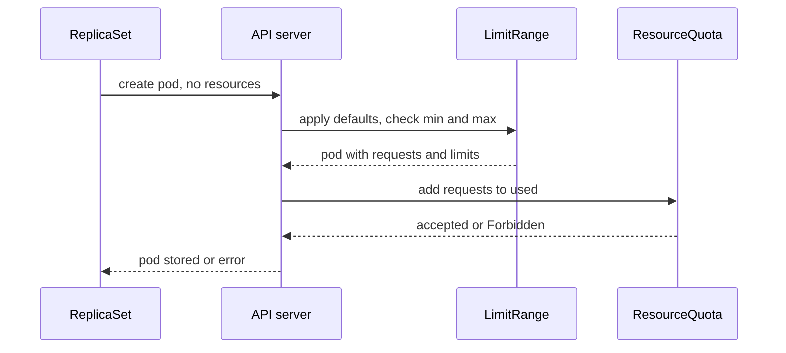

# LimitRange Sets Defaults And Maximums

The previous step ended with a rejected `probe` pod: the quota counts requests, and the pod declares none. Asking every team to write requests in every manifest works only until someone forgets. A LimitRange moves that job to the namespace, so a pod without values gets them at admission time.

## What a LimitRange does

A LimitRange lists `limits`, and each entry has a `type`. The common type is `Container`, which applies to every container in a pod. Four fields do the work:

- `defaultRequest` is the request a container gets when it declares none.
- `default` is the limit a container gets when it declares none.
- `min` and `max` are the smallest and largest value a container may declare. The API server rejects a pod outside that range.
- `maxLimitRequestRatio` is the largest allowed ratio of limit to request, for example `4` for memory.

The LimitRange admission step changes the pod before it is stored, and it rejects pods that break `min`, `max` or the ratio. It only works on pods created after the LimitRange exists.

## Admission order

Two admission steps act on a new pod, and their order matters. The LimitRange step runs first and fills in the defaults. The ResourceQuota step runs second and adds the now-complete pod to `used`.



The diagram shows why a default fixes the `must specify` error: by the time the quota step looks at the pod, the LimitRange step has already written the values.

## Create a LimitRange

<!-- astrona:playground:renew -->

The LimitRange below gives `outpost` default requests and a default memory limit. It also sets a minimum, a maximum and a ratio. Save this as `limitrange-outpost.yaml`:

```yaml
apiVersion: v1
kind: LimitRange
metadata:
  name: outpost-defaults
  namespace: outpost
spec:
  limits:
    - type: Container
      defaultRequest:
        cpu: 25m
        memory: 32Mi
      default:
        memory: 64Mi
      min:
        cpu: 10m
        memory: 16Mi
      max:
        cpu: 100m
        memory: 128Mi
      maxLimitRequestRatio:
        memory: "4"
```

Apply it:

```sh
kubectl apply -f limitrange-outpost.yaml
```

Then read it:

```sh
kubectl -n outpost describe limitrange outpost-defaults
```

You should see:

```text
Name:       outpost-defaults
Namespace:  outpost
Type        Resource  Min   Max    Default Request  Default Limit  Max Limit/Request Ratio
----        --------  ---   ---    ---------------  -------------  -----------------------
Container   cpu       10m   100m   25m              100m           -
Container   memory    16Mi  128Mi  32Mi             64Mi           4
```

Look at the CPU row. The file sets no `default` for CPU, but the table shows a default limit of `100m`. When a LimitRange has a `max` and no `default` for a resource, Kubernetes uses the `max` as the default limit. Set `default` yourself whenever you set `max`.

## Defaults in action

Restart `probe`. Its template still declares nothing, and the quota still counts requests:

```sh
kubectl -n outpost rollout restart deploy/probe
kubectl -n outpost rollout status deploy/probe --timeout=90s
kubectl -n outpost get pods -l app=probe -o custom-columns='NAME:.metadata.name,CPU_REQ:.spec.containers[0].resources.requests.cpu,MEM_REQ:.spec.containers[0].resources.requests.memory,MEM_LIM:.spec.containers[0].resources.limits.memory,QOS:.status.qosClass'
```

You should see something like (the rollout step prints more lines, which this output leaves out). If an old pod still shows as terminating, run the last command again:

```text
deployment.apps/probe restarted
deployment "probe" successfully rolled out
NAME                    CPU_REQ   MEM_REQ   MEM_LIM   QOS
probe-f6c79f4d6-zhc6z   25m       32Mi      64Mi      Burstable
```

The rollout now finishes. The pod has the defaults, and its QoS class changed from `BestEffort` to `Burstable`. The pod records what the LimitRange did in an annotation:

```sh
kubectl -n outpost get pods -l app=probe -o jsonpath='{.items[0].metadata.annotations.kubernetes\.io/limit-ranger}{"\n"}'
```

```text
LimitRanger plugin set: cpu, memory request for container probe; cpu, memory limit for container probe
```

## Maximums reject large containers

Save this as `pod-too-big.yaml`. The container asks for a `256Mi` memory limit, and the maximum is `128Mi`:

```yaml
apiVersion: v1
kind: Pod
metadata:
  name: too-big
  namespace: outpost
spec:
  containers:
    - name: probe
      image: mccutchen/go-httpbin:2.25.0
      resources:
        requests:
          cpu: 50m
          memory: 32Mi
        limits:
          memory: 256Mi
```

Apply it:

```sh
kubectl apply -f pod-too-big.yaml
```

You should see:

```text
Error from server (Forbidden): error when creating "pod-too-big.yaml": pods "too-big" is forbidden: [maximum memory usage per Container is 128Mi, but limit is 256Mi, memory max limit to request ratio per Container is 4, but provided ratio is 8.000000]
```

The message lists every rule the pod breaks. Here it breaks two: the maximum, and the ratio of `256Mi` to `32Mi`, which is `8`. Check the quota once more to see the defaulted pod counted:

```sh
kubectl -n outpost describe resourcequota outpost-quota
```

```text
Name:                   outpost-quota
Namespace:              outpost
Resource                Used   Hard
--------                ----   ----
count/configmaps        3      3
limits.memory           160Mi  512Mi
persistentvolumeclaims  0      2
pods                    3      10
requests.cpu            55m    100m
requests.memory         80Mi   256Mi
requests.storage        0      2Gi
```

`requests.cpu` is `55m`: `20m` for `scout`, `10m` for `shuttle` and `25m` for `probe`, which comes from the LimitRange default.

You now know the pair. The quota caps the namespace, the LimitRange sets each container's defaults and bounds, and the LimitRange step runs first. The open question is what happens when the namespace is full and a more important pod needs room.

## Common pitfalls

> [!WARNING]
> - **Expecting a LimitRange to change running pods.** It only changes pods created after it. Restart the Deployment to get defaults on existing workloads.
> - **Setting `max` without `default`.** The default limit becomes the `max`. A CPU `max` of `100m` gives every container a CPU limit of `100m` and can throttle it.
> - **Defaults that do not fit the quota.** If the default request is larger than what is left in the quota, the pod gets `exceeded quota`. Size the defaults so that several pods fit.
> - **Reading only the first rule.** A rejection lists every broken rule. Fix all of them.
