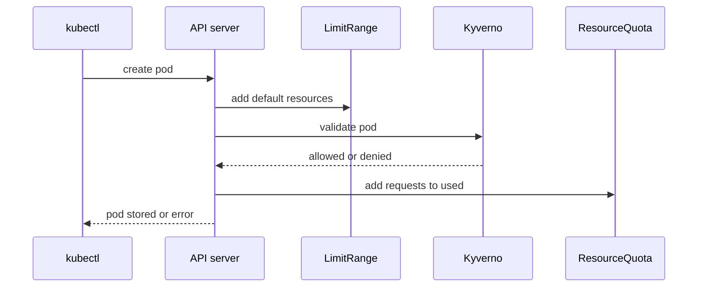

# Validate Rules: Enforce And Audit

A LimitRange can fill in missing resources, but some teams want the opposite: reject the pod and make the author fix the manifest. The cluster also needs a way to see how many existing pods break a rule before it blocks anything. Kyverno does both with one `validate` rule and one switch. This part writes the rule, shows a rejection, and then turns the same rule into a report.

## Where Kyverno sits

Kyverno runs in the cluster as an admission webhook. A webhook is an HTTPS endpoint that the API server calls for each matching request, and the answer decides whether the request continues. Kyverno answers from its policies. A `ClusterPolicy` is the Kyverno object that holds those rules. It is cluster-wide, and each rule says which resources it matches.

The sequence below shows where Kyverno sits for a new pod. The API server runs the LimitRange defaults first, because that step changes the pod. It then calls the Kyverno webhook, and the ResourceQuota check runs at the end.



The diagram shows that Kyverno sees the pod after the LimitRange defaults are applied. A pod denied by Kyverno never reaches the quota step, so it never raises `used`.

## Check the Kyverno install

<!-- astrona:playground:renew -->

Kyverno runs in the namespace `kyverno` as three controllers. The admission controller answers the webhook. The background controller runs `generate` rules. The reports controller writes policy reports. Check them and the policy kind:

```sh
kubectl -n kyverno get pods
kubectl api-resources --api-group=kyverno.io | grep -i "NAME\|clusterpolicies"
```

```text
NAME                                            READY   STATUS    RESTARTS   AGE
kyverno-admission-controller-74ccfb6869-hgtjg   1/1     Running   0          25s
kyverno-background-controller-54478495f-9p2vq   1/1     Running   0          25s
kyverno-reports-controller-86cbfc5499-kmv4w     1/1     Running   0          25s
NAME                     SHORTNAMES   APIVERSION      NAMESPACED   KIND
clusterpolicies          cpol         kyverno.io/v1   false        ClusterPolicy
```

The `ClusterPolicy` kind is served as `kyverno.io/v1`. In Kyverno `v1.19`, the API server prints a warning that this kind is deprecated, in favour of newer CEL-based kinds. The kind still works, and the exam material and most documentation still use it, so this module uses it. The commands below hide the warning line to keep the output short.

## Write a validate rule

The rule below matches every `Pod` in the namespace `outpost`. Its `pattern` says what a valid pod looks like. The value `"?*"` means any non-empty value, so the pattern requires each container to set a CPU request, a memory request and a memory limit. Save this as `clusterpolicy-require-resources.yaml`:

```yaml
apiVersion: kyverno.io/v1
kind: ClusterPolicy
metadata:
  name: require-requests-limits
spec:
  background: true
  rules:
    - name: require-requests-and-memory-limit
      match:
        any:
          - resources:
              kinds: ["Pod"]
              namespaces: ["outpost"]
      validate:
        failureAction: Enforce
        message: "Every container needs CPU and memory requests and a memory limit."
        pattern:
          spec:
            containers:
              - resources:
                  requests:
                    cpu: "?*"
                    memory: "?*"
                  limits:
                    memory: "?*"
```

The field `failureAction` says what happens when a request breaks the rule. `Enforce` denies the request. `Audit` allows it and records the failure. Apply the policy and wait for it to become ready:

```sh
kubectl apply -f clusterpolicy-require-resources.yaml
kubectl get clusterpolicy
```

```text
clusterpolicy.kyverno.io/require-requests-limits created
NAME                      ADMISSION   BACKGROUND   READY   AGE   MESSAGE
require-requests-limits   true        true         True    8s    Ready
```

The column `READY True` means the webhook now uses the policy. Create a pod with no resources:

```sh
kubectl -n outpost run bare --image=mccutchen/go-httpbin:2.25.0
```

```text
Error from server: admission webhook "validate.kyverno.svc-fail" denied the request: 

resource Pod/outpost/bare was blocked due to the following policies 

require-requests-limits:
  require-requests-and-memory-limit: 'validation error: Every container needs CPU and memory requests and a memory limit. rule require-requests-and-memory-limit failed at path /spec/containers/0/resources/limits/'
```

The message names the webhook, the policy, the rule, your `message` text and the path in the pod that failed. The path `/spec/containers/0/resources/limits/` tells you what to fix. Kyverno also protects Deployments. It adds a second rule, `autogen-require-requests-and-memory-limit`, that applies the same pattern to the pod template of a Deployment, a StatefulSet and other pod controllers. The Deployment is rejected when you create it:

```sh
kubectl create deployment web --image=mccutchen/go-httpbin:2.25.0 -n outpost
```

```text
error: failed to create deployment: admission webhook "validate.kyverno.svc-fail" denied the request: 

resource Deployment/outpost/web was blocked due to the following policies 

require-requests-limits:
  autogen-require-requests-and-memory-limit: 'validation error: Every container needs CPU and memory requests and a memory limit. rule autogen-require-requests-and-memory-limit failed at path /spec/template/spec/containers/0/resources/limits/'
```

The policy does not touch pods that already run. The `probe` pod in `outpost` has no resources and keeps running. A pod that follows the rule is accepted. Save this as `pod-with-resources.yaml`:

```yaml
apiVersion: v1
kind: Pod
metadata:
  name: with-resources
  namespace: outpost
spec:
  containers:
    - name: probe
      image: mccutchen/go-httpbin:2.25.0
      resources:
        requests:
          cpu: 10m
          memory: 16Mi
        limits:
          memory: 32Mi
```

Apply it:

```sh
kubectl apply -f pod-with-resources.yaml
```

```text
pod/with-resources created
```

## Switch to Audit and read the report

A new rule can break existing workloads, so teams often start in `Audit`. Save this as `clusterpolicy-require-resources-audit.yaml`. It is the same policy with one changed line:

```yaml
apiVersion: kyverno.io/v1
kind: ClusterPolicy
metadata:
  name: require-requests-limits
spec:
  background: true
  rules:
    - name: require-requests-and-memory-limit
      match:
        any:
          - resources:
              kinds: ["Pod"]
              namespaces: ["outpost"]
      validate:
        failureAction: Audit
        message: "Every container needs CPU and memory requests and a memory limit."
        pattern:
          spec:
            containers:
              - resources:
                  requests:
                    cpu: "?*"
                    memory: "?*"
                  limits:
                    memory: "?*"
```

Apply it, wait a few seconds for the webhook to update, and create the same bare pod again:

```sh
kubectl apply -f clusterpolicy-require-resources-audit.yaml
kubectl -n outpost run bare --image=mccutchen/go-httpbin:2.25.0
```

```text
clusterpolicy.kyverno.io/require-requests-limits configured
pod/bare created
```

The pod is accepted. Kyverno does not block it, and it records the failure in a policy report instead. A `PolicyReport` is a namespaced object that lists the pass and fail results of the policies for one resource. The reports controller writes it, and it needs about half a minute. The `background: true` setting also makes Kyverno scan pods that existed before the policy.

```sh
kubectl -n outpost get policyreport
kubectl -n outpost get policyreport -o jsonpath='{range .items[*]}{.scope.kind}{"/"}{.scope.name}{" fail="}{.summary.fail}{"\n"}{end}' | grep -v "fail=0"
```

```text
NAME                                   KIND         NAME                       PASS   FAIL   WARN   ERROR   SKIP   AGE
1dbdc19b-da79-4e96-9259-80e1eef997f4   ReplicaSet   probe-6888d5d7d4           0      1      0      0       0      37s
249a7c29-7639-458c-a692-53e111320fd6   Pod          scout-6db96cb88c-sg5gm     1      0      0      0       0      37s
4de73b95-fdbc-4b5a-9536-2273e8537982   Deployment   shuttle                    1      0      0      0       0      37s
51bb69a2-fe35-4c0f-802b-e98a5111784e   Deployment   scout                      1      0      0      0       0      37s
612f7e72-b149-4c4f-86d6-d6b040e15486   Pod          bare                       0      1      0      0       0      10s
677356f6-334c-4e8b-8893-2a01ea78e259   Deployment   probe                      0      1      0      0       0      37s
9b1a65ba-f7df-4334-977f-ffbf5861223c   Pod          with-resources             1      0      0      0       0      28s
9f575f12-fa8d-4216-95f4-3a2055f008be   Pod          shuttle-5c44b786bb-wgqnv   1      0      0      0       0      37s
d2f59df9-f918-4d71-917a-26963b6ecdd3   Pod          probe-6888d5d7d4-shvm6     0      1      0      0       0      37s
dfe29027-0a36-42bf-95ea-2a4492d62a64   ReplicaSet   scout-6db96cb88c           1      0      0      0       0      37s
e0fbfc73-c6b2-4e2c-a6c9-221d314e8d59   ReplicaSet   shuttle-5c44b786bb         1      0      0      0       0      37s
ReplicaSet/probe-6888d5d7d4 fail=1
Pod/bare fail=1
Deployment/probe fail=1
Pod/probe-6888d5d7d4-shvm6 fail=1
```

There is one report for each resource, named by its UID. The report lists the `bare` pod and the existing `probe` pod, its ReplicaSet and its Deployment as failures. This is the list a team would fix before it switches the policy back to `Enforce`.

## What you know now

Kyverno is a webhook that applies `ClusterPolicy` objects to requests. A `validate` rule matches resources, and a `pattern` describes a valid one. With `failureAction: Enforce` the API server returns the message and the failing path. With `Audit` the request passes and the reports controller records the failure in a `PolicyReport`. Kyverno sees a pod after the LimitRange defaults, and before the quota check. The open question is how a new tenant namespace gets its quota and LimitRange without a person creating them. A `generate` rule answers that.

## Common pitfalls

> [!WARNING]
> - **Testing right after `kubectl apply`.** The webhook needs a few seconds to use a new or changed policy. Wait for `READY True` and a short pause.
> - **Expecting `Enforce` to stop running pods.** A policy checks create and update requests. Pods that already run stay, and only the report shows them.
> - **Reading the report too early.** The `PolicyReport` for a new resource appears after about half a minute.
> - **Matching only `Pod`.** Kyverno adds `autogen-` rules for controllers by itself. A rule on `Pod` also rejects the Deployment that would create the pod.

## Your mission: Require Resources With A Kyverno Policy

You can now write a `validate` rule, read its rejection and switch it to audit. The mission gives you a namespace where pods without resources run, and asks for a policy that stops new ones while it leaves the existing pods alone.

Pause the playground first:

```sh
astrona stop ats-017-playground-050-03
```

Start the mission and send it for grading:

```sh
astrona run --git ssh://git@github.com/astrona-io/ATS017.git -c sections/section-050/module-03/labs/lab-01
astrona submit -c sections/section-050/module-03/labs/lab-01
```

When you finish, remove the mission cluster and resume the playground:

```sh
astrona destroy ats-017-lab-050-03-01
astrona start ats-017-playground-050-03
```
